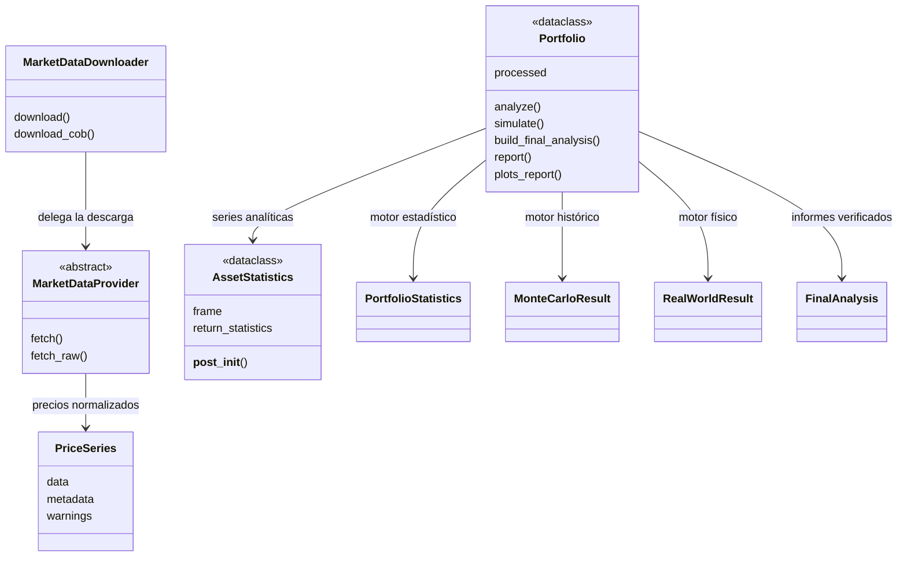
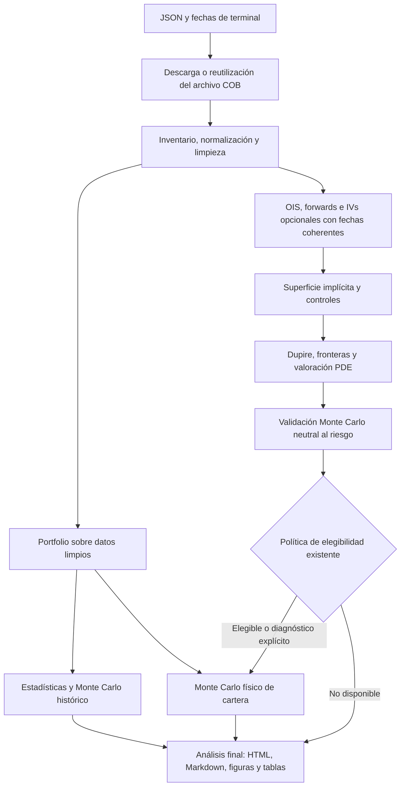

# Herramientas de datos de mercado y análisis de carteras

[English](README.md)

Biblioteca Python para un proyecto académico: descarga datos de mercado, conserva
las respuestas originales, limpia y alinea observaciones, analiza una cartera,
la simula y compara la evidencia disponible. Los instrumentos, la composición y
las políticas de modelización se definen mediante JSON. La cartera de ejemplo y
sus referencias actuales no limitan los instrumentos admitidos por la biblioteca.

**Presentación del proyecto:** [Ver las diapositivas (PDF)](presentacion/BME_Taller1_propuesta_15_diapositivas.pdf) o [descargar la presentación editable en PowerPoint](presentacion/BME_Taller1_propuesta_15_diapositivas.pptx). Los [informes de ejemplo](reports/examples/) contienen los gráficos y resultados que se comentan en las diapositivas.

## Guía de la documentación técnica

Las secciones siguientes explican las entradas, los algoritmos, las restricciones
y los archivos de salida. Los números de ejemplo describen políticas editables;
los JSON y los metadatos guardados de cada ejecución son la autoridad para fechas,
instrumentos, ponderaciones y tolerancias. No hay una cartera adicional definida
por esta documentación.

- [Informes oficiales de ejemplo](#informes-oficiales-de-ejemplo)
- [Flujos de ejecución](#flujos-de-ejecución)
- [Estadística histórica](#estadística-histórica)
- [Monte Carlo histórico](#monte-carlo-histórico)
- [Limpieza y combinación de proveedores](#limpieza-y-combinación-de-proveedores)
- [Descarga, configuración y archivos COB](#descarga-configuración-y-archivos-cob)
- [Curvas OIS manuales](#curvas-ois-manuales)
- [Opciones históricas y en vivo](#opciones-históricas-y-en-vivo)
- [Inspección y reutilización de archivos](#inspección-y-reutilización-de-archivos)
- [Bootstrap OIS, forwards e IV individuales](#bootstrap-ois-forwards-e-iv-individuales)
- [Superficie implícita y elegibilidad](#superficie-implícita-y-elegibilidad)
- [Conversión a volatilidad local](#conversión-a-volatilidad-local)
- [Fronteras y valoración mediante PDE](#fronteras-y-valoración-mediante-pde)
- [Validación Monte Carlo neutral al riesgo](#validación-monte-carlo-neutral-al-riesgo)
- [Simulación física de la cartera](#simulación-física-de-la-cartera)
- [Análisis académico final](#análisis-académico-final)
- [Verificación y alcance de la entrega](#verificación-y-alcance-de-la-entrega)

## Informes oficiales de ejemplo

El [directorio de informes oficiales](reports/examples/) contiene dos ejemplos completos del análisis final. Puedes leer el Markdown en GitHub o clonar el repositorio y abrir `report.html` en el navegador para ver el diseño completo y las figuras integradas. Para consultar los ejemplos no se necesitan Python, credenciales de proveedores ni suscripción de IBKR.

| Fecha de cierre (COB) | Qué muestra el informe |
|---|---|
| **19 de octubre de 2026 · Con datos de opciones** ([Markdown](reports/examples/2026-10-19/report.md) · [HTML](reports/examples/2026-10-19/report.html)) | La cartera de 70% SPY y 30% IEF incluye comparaciones gaussianas, Student-t, de supuestos del usuario y de la crisis financiera global (GFC). La sección de volatilidad muestra las sonrisas ajustadas de SPX y las superficies de volatilidad implícita y local. La previsión bajo la medida física usa SPX como referencia de SPY y volatilidad histórica para IEF. Su estado guardado es **diagnóstico**; el informe documenta los resultados de validación y los supuestos aplicables. |
| **30 de octubre de 2026 · Solo modelos históricos** ([Markdown](reports/examples/2026-10-30/report.md) · [HTML](reports/examples/2026-10-30/report.html)) | Sin una superficie SPX admisible, no se obtiene la previsión física con volatilidad local. Los modelos históricos, de estrés y de supuestos del usuario sí generan trayectorias, distribuciones, probabilidades de pérdida e informe final. |

Consulta primero la **disponibilidad** para identificar qué modelos se ejecutaron. Después compara crecimiento, distribuciones terminales y riesgo de pérdida durante el horizonte indicado. En ambos casos se utilizó USD como divisa alternativa por falta de histórico EUR/USD utilizable. La probabilidad de pérdida se refiere, por tanto, al patrimonio en USD. La simulación neutral al riesgo del subyacente valida los precios de las opciones; la simulación física genera la previsión de cartera.

Cada carpeta incluye tablas comparativas, figuras y un `summary.json` con el ID de ejecución y las huellas digitales de los resultados de origen. Son copias portátiles de resultados guardados. Las ubicaciones de las etapas anteriores se conservan como referencia; los datos brutos necesarios para repetirlas son locales. Las nuevas ejecuciones escriben en carpetas fechadas independientes de estos ejemplos de entrega.

## Instalación y ejecución

Utiliza Python 3.11 o posterior, en una versión compatible con las dependencias
declaradas. Desde una terminal:

```powershell
git clone --branch master https://github.com/francescocpl91/BME_Workshop1.git
cd BME_Workshop1
python -m venv .venv
.\.venv\Scripts\python.exe -m pip install -e .
.\.venv\Scripts\python.exe run.py
```

En VS Code, selecciona `.venv/Scripts/python.exe` como intérprete. Importa el paquete
como `src`; no añadas directamente el directorio `src` a `PYTHONPATH`, porque su
archivo `http.py` ocultaría el módulo homónimo de Python. Las dependencias están
declaradas en `pyproject.toml`. No guardes credenciales en código o JSON versionados.

`run.py` solicita un modo:

1. **Process saved archive:** introduce un COB archivado. No consulta proveedores.
2. **Download + process:** introduce COB y fecha inicial del histórico, en formato
   `DD/MM/YYYY`. Descarga o reutiliza el archivo y ejecuta el mismo proceso local.

El COB debe ser ayer o anterior según Europe/London; el inicio del histórico no
puede superar el COB. Una copia nueva del repositorio incluye los dos informes oficiales. Los archivos
privados de mercado son locales. Utiliza descarga con los accesos
disponibles o proporciona un archivo local válido. Los tests ofrecen ejemplos
sintéticos reproducibles sin APIs; no son observaciones de la cartera de ejemplo.

## Configuración y acceso a proveedores

### Primero la cartera, después los datos que hay que descargar

Los tickers, pesos, fechas y parámetros del ejemplo **están fijados en los JSON** («hardcoded») para que se pueda reproducir o modificar el experimento. Los campos `instructions` describen los parámetros. Para cambiar el comportamiento hay que editar sus valores. Conviene distinguir tres decisiones:

| Pregunta | Dónde se configura | Ejemplo actual |
|---|---|---|
| ¿Qué activos tenemos en cartera? | `config/portfolio.json`: `holdings`, `target_allocation`, `reporting_currency` | 70% SPY (ETF de renta variable) y 30% IEF (ETF de deuda pública estadounidense), con resultados en EUR. |
| ¿Qué series hacen falta? | Peticiones habilitadas en los JSON de proveedores indicados abajo. Las series de apoyo se identifican con `reference_data` en la cartera. | SPX es el índice de referencia para el modelo de opciones de SPY. SPX, sus opciones, las divisas y los tipos de interés no tienen peso en la cartera. |
| ¿Cómo se analizan las series? | JSON de limpieza, estadística, simulación y calibración descritos abajo. | Diez años para calibrar el Monte Carlo base, un periodo independiente para la crisis financiera global (GFC) y modelos opcionales basados en opciones. |

**Una posición.** Para invertir el 100% en SPY, sustituye solo estos dos campos de `config/portfolio.json`. Conserva los demás campos obligatorios, incluido `reference_data`. Así se ejecutan las mismas estadísticas, simulación e informe para un solo activo. Puedes conservar IEF en los proveedores si te interesa su histórico. Si quieres dejar de descargarlo, deshabilita sus peticiones en cada JSON de proveedor que lo solicite.

```json
{
  "target_allocation": {"equity": 1.0},
  "holdings": [
    {"request_id": "SPY", "bucket": "equity", "weight": 1.0}
  ]
}
```

**Varias posiciones o clases.** Para pasar a un 60% de renta variable y un 40% de renta fija, sustituye los mismos dos campos:

```json
{
  "target_allocation": {"equity": 0.60, "sovereign_fixed_income": 0.40},
  "holdings": [
    {"request_id": "SPY", "bucket": "equity", "weight": 0.60},
    {"request_id": "IEF", "bucket": "sovereign_fixed_income", "weight": 0.40}
  ]
}
```

Una clase de activo puede contener varias posiciones. Dos ETF de renta variable podrían tener pesos de 0.60 y 0.40 dentro del mismo grupo `equity`, cuyo objetivo sería 1.0. Cada posición necesita un ID de petición distinto y un histórico de precios utilizable. Los pesos se expresan como fracciones entre 0 y 1. La suma de los pesos de cada grupo debe coincidir con su objetivo, y los objetivos deben sumar 1. Un peso nulo queda pendiente de definir e impide procesar la cartera. El esquema admite posiciones largas y no limita la cartera a dos activos.

**Ejemplo de acción individual.** Apple (`AAPL`, producto `stock`) está habilitada
en `config/yahoo.json`, `config/alpha_vantage.json`, `config/marketdata.json`,
`config/massive.json` y `config/ibkr.json` para demostrar el requisito de acciones
individuales con los proveedores de precios aplicables. Las peticiones comparten
el ID AAPL y las fechas de inicio/COB introducidas, con identificadores y ajustes
propios de cada proveedor. La descarga depende del acceso y los permisos; la
limpieza compara únicamente observaciones compatibles. FRED y ECB mantienen su
función de referencias económicas, sin peticiones de precios de AAPL. Es un ejemplo adicional de descarga y
limpieza, fuera de la cartera 70% SPY / 30% IEF. No entra en las estadísticas
de cartera ni en las comparaciones Monte Carlo. Los informes de ejemplo
guardados son anteriores a esta incorporación y no contienen resultados de
AAPL. Para obtenerlos, realiza una nueva descarga con un COB válido que no tenga
archivo previo; añadir una petición cambia la compatibilidad del archivo y no
la incorpora automáticamente a uno ya completado.

**Cómo añadir un instrumento.** Define primero el instrumento en al menos una petición habilitada. Usa el mismo `id` interno para la misma serie económica en distintos proveedores y rellena el `input` específico de cada uno. Por ejemplo, `SPX` corresponde a `^GSPC` en Yahoo, a `I:SPX` en Massive y a un contrato de índice en IBKR. Comprueba producto, operación, mercado, divisa, unidad, frecuencia, intervalo y parámetros del proveedor. Para una opción se necesita además el contrato elegido, con vencimiento, precio de ejercicio y tipo (call/put). Después incorpora el ID a la cartera y revisa calendario, base de precios, posible vínculo con opciones y conversión de divisa. Si deshabilitas un proveedor, cada posición o referencia que conserves debe seguir teniendo una petición definida. Añadir un nombre de clase no incorpora un nuevo modelo de valoración. El ejemplo de renta fija utiliza precios de un ETF; no valora los cupones de un bono individual.

### ¿Qué modo y qué fechas conviene utilizar?

- **Cambiar pesos de instrumentos ya presentes en un archivo completo:** elige **1 - Process saved archive**. El programa valida la cartera actual frente a los ID del archivo y usa los nuevos pesos en los resultados derivados. No requiere credenciales. Añadir un ticker al JSON de un proveedor no incorpora precios ausentes en un archivo antiguo.
- **Descargar otro instrumento o ejecutar un nuevo cierre (COB):** elige **2 - Download + process** con las peticiones correspondientes habilitadas. Un archivo completo compatible puede reutilizarse. Si cambia el conjunto de instrumentos que se quiere descargar, utiliza un nuevo archivo compatible, por ejemplo el de otro COB. Los datos brutos guardados conservan sus entradas originales.
- En modo descarga, introduce el COB y el inicio del histórico en **DD/MM/AAAA**. Los valores `HISTORY_START` y `COB` de los proveedores se resuelven con esas fechas. El COB más reciente permitido es ayer según la hora de Londres. El histórico efectivo depende de la fecha de cotización inicial, la cobertura y los permisos. Si el proveedor rechaza el intervalo, el adaptador puede intentar recuperar el máximo histórico accesible. Los fallos de autenticación requieren un acceso válido.
- El horizonte de previsión se configura por separado. `forecast_start: "cob_plus_one"` toma la fecha de la ejecución y los pasos de negociación siguen el calendario configurado. `forecast_end: "2027-12-17"` es una fecha explícita del ejemplo. Revísala al cambiar de COB o de vencimientos cubiertos por el modelo opcional de volatilidad local.

### Qué controla cada JSON de análisis

Todas las rutas de esta tabla son relativas a `config/`.

| Archivo | Qué revisar al cambiar el experimento |
|---|---|
| `cleaning.json` | Prioridad de proveedores, bases de precios compatibles, calendarios, huecos en las series y metadatos. `instruments.SPY.option_reference = "SPX"` vincula la posición con el subyacente de las opciones. Añade otro vínculo solo si tiene sentido financiero. |
| `modeling.json` | Estadística descriptiva, anualización, ventanas móviles y periodos históricos de estrés. |
| `monte_carlo.json` | Fechas, 10 000 trayectorias, semilla, calendario, calibración base (10 años, mínimo de 252 observaciones alineadas), calibración de estrés, divisas y supuestos opcionales del usuario. La GFC (enero de 2008 a junio de 2009) requiere datos descargados de ese periodo, con independencia de la ventana base. |
| `ois.json` | Cotizaciones par de swaps SOFR y €STR introducidas manualmente, en porcentaje anual. Las curvas fijas del ejemplo se observaron el 20 de octubre de 2026. Se archivan con su fecha real en cada COB; guardarlas en una carpeta posterior no actualiza sus tipos. |
| `calibration/option_calibration.json` | Convenciones OIS asumidas, forwards, dividendos y criterios de admisión de cotizaciones en vivo o históricas para calcular la volatilidad implícita de opciones europeas. Las fechas de observación de la curva y de las opciones deben coincidir. |
| `calibration/surface.json` | Ajuste de las sonrisas de volatilidad implícita, strikes y vencimientos admitidos, y criterios de aceptación. |
| `calibration/local_volatility.json` | Evaluación de Dupire, tratamiento de los límites y validación por revaloración de opciones. |
| `calibration/local_vol_monte_carlo.json` | Simulación neutral al riesgo del subyacente de las opciones y su validación. |
| `local_vol_real_world.json` | Simulación de la cartera bajo la medida física con la superficie validada asignada y factores históricos para las demás posiciones admisibles. |
| `simulation_comparison.json` | Comparaciones finales, tolerancias, figuras y visualización opcional. `open_report_after_run` abre el informe; `plot_windows_after_run` selecciona actualmente las gráficas de trayectorias y densidad. |

Al cambiar las posiciones, hay dos ajustes particularmente importantes. En `monte_carlo.json`, el ejemplo `user_scenario.holdings.SPY` supone un crecimiento compuesto anual del 6% y una volatilidad anual del 30%. Modifica SPY en un escenario adicional de cartera; IEF conserva sus supuestos históricos. Aquí solo se admiten ID de posiciones con peso positivo. Para omitir el escenario, elimina la sección o asígnale `null`. Para presentar resultados en EUR, `fx_series` identifica `EURUSD` como dólares por euro. Revisa el par, el sentido de cotización y el histórico si cambias la divisa. La alternativa en USD solo se aplica cuando el modelo puede expresar la cartera en USD.

### Acceso a proveedores en una descarga nueva

Habilitar un JSON solicita una operación. Las credenciales, suscripciones y coberturas dependen del proveedor. Guarda las credenciales fuera de los JSON. Si falta una serie, consulta el estado de su petición en el archivo del COB.

| JSON del proveedor | Qué necesita este adaptador | Qué se obtiene |
|---|---|---|
| `yahoo.json` | Sin clave de proveedor | Histórico público de precios cuando está disponible, incluidos precios ajustados admisibles. |
| `ecb.json` | Sin clave de proveedor | Series públicas del BCE identificadas por flujo de datos y clave de serie. Son observaciones de referencia. [Servicios de datos del BCE](https://data.ecb.europa.eu/help/getting-data-web-services-sdmx-0) |
| `fred.json` | `FRED_API_KEY` | Se requiere una clave de la API de FRED incluso para series públicas como DGS10. [Claves de la API de FRED](https://fred.stlouisfed.org/docs/api/api_key.html) |
| `alpha_vantage.json` | `ALPHA_VANTAGE_API_KEY` | Las operaciones y la profundidad del histórico dependen del plan. |
| `marketdata.json` | `MARKETDATA_API_TOKEN` | Token y permiso para el producto e histórico solicitados. |
| `massive.json` | `MASSIVE_API_KEY` | El plan debe cubrir el activo, el servicio y el intervalo de fechas. |
| `ibkr.json` | Sesión iniciada en TWS o IB Gateway, API de socket habilitada, dirección y puerto correctos y permisos de datos | Contratos explícitos para precios históricos y opciones. Conectar correctamente solo confirma la sesión. |

Sin credenciales de proveedores ni sesión de IBKR, **Yahoo y el BCE son los dos proveedores configurados que pueden devolver datos nuevos**. La disponibilidad depende de la serie, del servicio y de las fechas. La falta de acceso a un proveedor permite continuar con peticiones independientes a los demás.

**Las opciones de IBKR requieren una comprobación específica.** Para el COB de ayer se solicitan instantáneas en vivo y se registra la fecha real de captura. Las cotizaciones en vivo requieren los permisos del mercado correspondiente; las sensibilidades (griegas) de IBKR normalmente requieren datos tanto de la opción como del subyacente. Para COB anteriores se solicitan barras históricas. Esta vía no devuelve la volatilidad implícita del modelo de IBKR ni sus griegas. Los permisos, la conservación del histórico y el vencimiento del contrato pueden impedir obtener barras incluso con una sesión operativa. Sin las suscripciones necesarias no se debe contar con reconstruir una superficie a partir del histórico de IBKR. Si el archivo contiene precios alineados suficientes, el análisis histórico de cartera puede continuar; las etapas de opciones exigen sus propios datos fechados y validaciones. [Limitaciones de datos de IBKR](https://www.interactivebrokers.com/docs/tws-api/doc/md/market-data-limitations) · [Griegas de opciones en IBKR](https://www.interactivebrokers.com/docs/tws-api/doc/md/option-greeks)

## Arquitectura e interfaz de cartera



`PriceSeries` conserva las observaciones del proveedor. `AssetStatistics` es la
DataClass analítica de precios: al crearla calcula automáticamente la media, la
desviación típica muestral y las estadísticas configuradas a partir de observaciones
limpias. `Portfolio.assets` expone estos objetos después de `.analyze()`. No se
calculan implícitamente rentabilidades sobre precios originales sin validar.

`PortfolioConfig` sigue validando la composición JSON. `Portfolio` es la interfaz
analítica sobre un `ProcessedArchive`; su definición procede del resultado de
limpieza, no de otra composición editable. Sus métodos delegan en los motores
existentes. Crear el objeto no descarga, calcula ni escribe archivos. Los algoritmos
financieros permanecen en sus módulos originales.



`run.py` conserva el orden y la gestión de errores. El estudio de volatilidad se
ejecuta antes de las llamadas al análisis histórico; después se intenta la
simulación física de cartera. El diagrama representa dependencias, no ejecución
paralela. Un fallo esperado de una etapa opcional no invalida el histórico
independiente. Se intenta generar el informe final incluso si un fallo anterior
impidió construir la cartera.

## Uso directo de la biblioteca

Uso directo: solo descarga. Este ejemplo consulta proveedores salvo que pueda
reutilizar el archivo seleccionado. Elige el inicio histórico de tu estudio.

```python
from datetime import date, timedelta
from src import MarketDataDownloader
from src.cob import london_today

cob = london_today() - timedelta(days=1)
downloader = MarketDataDownloader.from_json(
    "config", cob_date=cob, history_start=date(2000, 1, 3),
)
result = downloader.download_cob(
    cob, "tests/data_dumps", portfolio_file="config/portfolio.json",
    ois_file="config/ois.json",
)
```

Ejemplo con un archivo existente; sustituye la carpeta por tu COB guardado:

```python
from pathlib import Path
from src import Portfolio, process_archive

processed = process_archive(
    Path("tests/data_dumps/YYYY-MM-DD"), "config/cleaning.json",
    portfolio_file="config/portfolio.json",
)
folder = processed.save(Path("processed") / processed.cob / processed.run_id)
portfolio = Portfolio.from_processed(processed, source_folder=folder)

statistics = portfolio.analyze("config/modeling.json")
stats_folder = statistics.save(folder / "statistics" / statistics.run_id)
historical = portfolio.simulate("config/monte_carlo.json")
mc_folder = historical.save(folder / "monte_carlo" / historical.run_id)

analysis = portfolio.build_final_analysis(
    {"processing": folder, "statistics": stats_folder, "monte_carlo": mc_folder},
    "config/simulation_comparison.json",
)
if analysis is not None:  # Reporting can be disabled in JSON.
    target = analysis.save("reports")
    print(portfolio.report(sections=["overview", "forecast"], include_figures=False))
    plot_paths = portfolio.plots_report("reports")
```

Para la simulación física, proporciona **objetos compatibles ya calculados**. El
método no ajusta superficies ausentes ni ejecuta validaciones que falten:

```python
physical = portfolio.simulate(
    "config/local_vol_real_world.json", method="physical_local_vol",
    historical_config="config/monte_carlo.json",
    local_vol=local_vol_result, surface=surface_result,
    validation=risk_neutral_validation,
)
physical.save()
```

La ausencia de objetos obligatorios se rechaza. El motor físico sigue comprobando
identidades, COB, correspondencias, fechas y controles neutrales al riesgo. Los
resultados no disponibles o de diagnóstico conservan su estado. La simulación
neutral al riesgo valida el subyacente; no es otra previsión de cartera.

Antes del análisis final, `portfolio.report()` devuelve el Markdown estadístico y
`.plots_report(directory)` delega en sus gráficos. Con análisis final, `.report()`
devuelve el Markdown consolidado y `.plots_report(reports_root)` verifica/publica
el conjunto y devuelve las rutas PNG. Generar informes no ejecuta simulaciones.
Las secciones disponibles son `overview`, `modeling`, `forecast`, `vol`, `history`,
`sources`. Las funciones de nivel inferior siguen disponibles para usos existentes.

## Flujos de ejecución

`run.py` ofrece dos entradas a la misma cadena de procesamiento:

1. **Process saved archive:** solicita el COB guardado y procesa los datos locales.
   No solicita fecha inicial de descarga, no comprueba credenciales de proveedores
   y no abre conexiones de mercado.
2. **Download + process:** solicita COB y comienzo del histórico; descarga o reutiliza
   el archivo compatible y ejecuta después la misma cadena local.

Los alias `process`, `inventory` y `download` siguen admitidos. La función pública
`inspect_archive()` solo inventaría; `download_cob()` solo obtiene y guarda datos.
Es el punto de entrada el que conecta inventario, limpieza, calibración opcional,
estadística, simulaciones e informe final. No hay una segunda selección de COB.
Un archivo incompleto, inexistente o con un bloqueo `.running` activo no se trata
como una ejecución terminada.

Tras la limpieza se crea `Portfolio` sobre el `ProcessedArchive` de esa ejecución.
Sus métodos delegan en los motores existentes. La secuencia numérica sigue siendo:
calibración de opciones, superficie, volatilidad local/PDE, validación neutral al
riesgo, estadística histórica, MC histórico y escenario físico opcional. El informe
final se intenta también cuando una etapa anterior falla. Un error inesperado
continúa propagándose; generar un informe de disponibilidad no lo convierte en éxito.

La simulación física no puede fabricar una superficie ni omitir la validación neutral
al riesgo por llamar directamente a `Portfolio.simulate()`. El motor comprueba las
identidades y aplica su política existente, incluida únicamente la excepción de
precisión que autorice explícitamente una salida diagnóstica.

## Estadística histórica

`config/modeling.json` controla la estadística; `config/portfolio.json` controla
posiciones y pesos. Este módulo analiza las posiciones configuradas, no incorpora
opciones ni instrumentos de referencia a la asignación y no valora opciones.
La estadística es descriptiva y permanece separada de los motores de simulación.

`src/statistics.py` expone `AssetStatistics` y `PortfolioStatistics`.
`AssetStatistics.__post_init__()` calcula automáticamente sus estadísticas al
instanciarse con observaciones limpias. `PortfolioStatistics` reúne activos,
estadística de cartera, tablas, `.report()`, `.plots_report()` y `.save()`.
Estos objetos analíticos no sustituyen al `PriceSeries` de recuperación de datos:
no se calculan rentabilidades implícitamente sobre precios brutos no validados.
`Portfolio.assets` permite acceder a los objetos analíticos después de `.analyze()`.

`statistics.return_types` acepta `["simple", "log"]` o una sola convención.
Ambas utilizan los mismos intervalos válidos:

```text
simple_t = P_t / P_anterior - 1
log_t    = log1p(simple_t)
```

Para cada convención se calculan media y desviación diaria, media y volatilidad
anualizadas, asimetría, exceso de curtosis, cuantiles y extremos empíricos,
volatilidad móvil, ajustes normal/Student-t, covarianza, correlación y estrés.
Las filas de tablas dependientes de rentabilidades incluyen `return_type`.

La media anual es la media diaria multiplicada por `periods_per_year`: media
aritmética para simples y crecimiento logarítmico aditivo para logs. No es CAGR.
La desviación utiliza `ddof=1` y la volatilidad anual multiplica por la raíz del
número configurado de periodos, normalmente 252. La referencia normal tiene exceso
de curtosis cero. Las métricas indefinidas permanecen vacías/null, no se convierten
en cero. Los gráficos diferencian porcentajes de rentabilidad simple y unidades
logarítmicas multiplicadas por 100.

Patrimonio normalizado, rentabilidad acumulada, CAGR, drawdown y cobertura se
calculan una sola vez sobre la trayectoria de precios/patrimonio. CAGR usa años
de calendario transcurridos. El informe muestra las fechas efectivas: la historia
individual de una posición puede empezar antes que la historia común de la cartera.
Las rentabilidades logarítmicas de cartera se calculan desde su patrimonio agregado;
no son una suma ponderada de los logs de las posiciones.

Para acceso directo, `asset.return_statistics["simple"]` y `["log"]` contienen
métricas, estrés, series móviles y ajustes. `asset.path_metrics` y
`asset.stress_paths` contienen resultados compartidos de patrimonio. Los atributos
de compatibilidad `metrics`, `stress`, `rolling` y `distribution` prefieren simples
si están habilitadas; en otro caso exponen la convención log etiquetada. Para evitar
ambigüedades conviene consultar `return_statistics[kind]`.

La cartera histórica representa un backtest hipotético de comprar y mantener:
los pesos actuales se aplican una vez en la primera fecha común observada. Las
ponderaciones efectivas evolucionan después. No existe rebalanceo diario.
Las series ajustadas ya incorporan distribuciones; no se suma de nuevo el efectivo
de dividendos. Una cartera basada en precios sin ese ajuste se etiqueta
`price_return`.

Todas las posiciones con peso positivo deben estar disponibles, tener una divisa
común y un significado de rentabilidad compatible. No se eliminan ni renormalizan
posiciones ausentes. Si las divisas o bases son incompatibles, el patrimonio de
cartera queda no disponible, pero se conserva la estadística individual válida.
Una cartera histórica de series USD se etiqueta USD aunque se solicite EUR.
Este módulo no hace conversión FX ni presupone un cambio constante.

No se rellenan sesiones. Una rentabilidad diaria no puede atravesar un hueco.
Covarianza y correlación utilizan observaciones completas con el mismo comienzo
y final de intervalo. Las ventanas móviles conservan las fechas ausentes, de modo
que un hueco interrumpe el cálculo. Se omiten rentabilidad acumulada, CAGR y máximo
drawdown si la trayectoria contiene precios ausentes o intervalos excluidos.
Las fechas anteriores al inicio de una serie no cuentan como huecos interiores.

GFC, COVID y 2022 son ejemplos de ventanas de estrés configurables, no fechas
impuestas en Python. Se guardan cobertura real, número de observaciones,
volatilidad, drawdown y correlación. Se excluye una rentabilidad cuyo comienzo
preceda la ventana. La estadística individual usa su cobertura propia; la
dependencia conjunta usa una muestra común y publica su tamaño por separado.

Los ajustes normal y Student-t son descriptivos, no parámetros copiados al MC.
La escala de Student-t no es su desviación típica; se señala cuando la varianza
no existe. Una historia corta o constante no se fuerza a producir un ajuste.
Un fallo del optimizador queda registrado sin detener el resto de estadísticas.

### Archivos estadísticos

Destino: `processed/<COB>/<processing-id>/statistics/<statistics-id>/`.

| Archivo | Contenido |
|---|---|
| `statistics.csv` | Momentos de cada serie y convención simple/log |
| `path_statistics.csv` | Crecimiento, CAGR, drawdown y cobertura por trayectoria |
| `daily_statistics.csv` | Precios, ambos retornos, inicio del intervalo, patrimonio y drawdown |
| `rolling_volatility.csv` | Volatilidad móvil por convención |
| `dependence.csv`, `rolling_correlations.csv` | Covarianzas/correlaciones y comparación móvil |
| `aligned_returns.csv` | Intervalos comunes y columnas `return::<id>` |
| `stress_statistics.csv`, `stress_dependence.csv` | Comparaciones por ventana y tipo de retorno |
| `stress_path_statistics.csv` | Trayectorias de estrés y cobertura efectiva |
| `distributions.csv` | Parámetros descriptivos normal/t y estado del ajuste |
| `report.md`, `manifest.json` | Supuestos, advertencias, identidad y hashes |
| `plots/simple/`, `plots/log/` | Volatilidad, histogramas, Q-Q y dependencia |
| `plots/wealth.png`, `plots/drawdown.png` | Figuras compartidas de patrimonio y drawdown |

Los resultados estadísticos separan las métricas de trayectoria de las estadísticas
de retornos. `path_statistics.csv` y su equivalente de estrés contienen CAGR y
drawdown; las tablas de retornos distinguen retornos simples y logarítmicos
mediante `return_type`. `aligned_observations` cuenta cada
intervalo una vez, no dos; también se informa el desglose por tipo. Los hashes de
gráficos usan rutas relativas para distinguir archivos homónimos de simple/log.
La identidad incluye datos limpios, pesos, políticas, código y dependencias.
Completo significa exportado, no que todos los activos sean utilizables.

Ejemplo de análisis directo de una ejecución limpia, sin volver a inventariar:

```python
from pathlib import Path
from src import analyze_saved_processing

folder = Path("processed/YYYY-MM-DD/<processing-id>")
analysis = analyze_saved_processing(folder, "config/modeling.json")
print(analysis.report())
analysis.save(folder / "statistics" / analysis.run_id)
```

Debe seleccionarse el ID concreto. El lector comprueba el hash de precios, no
busca automáticamente la carpeta más reciente. `analyze_processed()` acepta el
objeto en memoria; `Portfolio.analyze()` delega en esa misma función.

## Monte Carlo histórico

`src/monte_carlo.py` se ejecuta después de la estadística. Con `enabled=false`
guarda un estado deshabilitado. Historia insuficiente o factores de conversión
ausentes producen un resultado no disponible; configuración inválida y corrupción
se comunican como errores explícitos. Las etapas anteriores no dependen de su éxito.

El ejemplo suministrado usa 10.000 caminos por escenario, patrimonio inicial 100,
calendario XNYS y final 17/12/2027. Son elecciones del JSON. El origen es siempre
**COB más un día natural**, mediante `forecast_start: "cob_plus_one"`.
Se rechazan fechas iniciales fijas. Si el origen cae en fin de semana/festivo,
se conserva ese nivel inicial y el primer incremento termina en la siguiente
sesión. Un final no hábil utiliza la última sesión anterior y genera advertencia.
Un horizonte sin sesiones válidas no produce una simulación ficticia.

La calibración toma los últimos diez años de calendario hasta COB, salvo que
`calibration.start` establezca un comienzo explícito. Media log diaria y matriz
de covarianza muestral usan exactamente los mismos intervalos válidos para todos
los factores. El mínimo suministrado es 252 observaciones comunes. Se excluye
información posterior a COB, no se rellenan huecos y se publican fechas y tamaño
reales. El motor exige posiciones compatibles con el calendario configurado;
no supone que calendarios distintos puedan mezclarse automáticamente.

```text
g = media_log_histórica + shock_correlacionado
patrimonio_siguiente = patrimonio_anterior * exp(g)
```

La media log ya es crecimiento logarítmico: no se vuelve a restar media varianza.
En el caso gaussiano, el crecimiento bruto esperado de un paso es
`exp(media_log + varianza_log/2)`. El error estándar estimado de la media histórica
es `std_log/sqrt(n)`, bajo independencia; no mide incertidumbre de régimen.
Drift y covarianza se mantienen constantes en cada escenario y los shocks son
independientes entre sesiones.

Se simulan conjuntamente las posiciones, no una sola serie de cartera previamente
agregada. Los pesos iniciales se aplican una vez y el patrimonio se suma después
de las conversiones. No se rebalancea diariamente ni se duplican dividendos de
series ajustadas. Las posiciones ausentes no se descartan.

Una suma de pesos aceptada dentro de la tolerancia existente `1e-8` se reconcilia
a asignación unitaria solo dentro del MC. Se conservan pesos configurados y
efectivos, con advertencia; errores mayores se rechazan. Las ganancias se agregan
alrededor del valor inicial para evitar pérdidas artificiales por redondeo.
La covarianza convertida se obtiene desde el factor de simulación transformado,
evitando varianzas negativas por cancelación numérica cuando activo y FX se
compensan. Una covarianza materialmente inválida sigue siendo un error.

### Modelos gaussiano y Student-t

- **Gaussiano:** shocks log normales correlacionados con la covarianza histórica.
- **Student-t multivariante truncado:** un único grado de libertad conjunto,
  estimado por máxima verosimilitud acotada con media y covarianza históricas
  fijadas. Un shock radial compartido relaciona la magnitud de movimientos
  simultáneos. No se combinan ajustes univariantes de la estadística descriptiva.

Student-t sin límite no tiene momento exponencial finito. Exponenciarlo como
retorno log daría un patrimonio con esperanza teórica no finita. Por ello se
condiciona el radio conjunto a una región finita y se reescala la covarianza
retenida a la misma covarianza histórica del modelo normal. Se truncan shocks
según su distribución; no se recortan precios después de simularlos.

Ejemplo de configuración, esquema 2:

```json
"student_t": {
  "fit_df": true,
  "df_bounds": [2.1, 50],
  "excluded_tail_probability": 0.0005,
  "sensitivity_tail_probabilities": [0.002, 0.00005]
}
```

`fit_df` debe ser verdadero. Se rechazan grados de libertad o radios fijos.
`df_bounds` son límites del optimizador, no estimaciones. Un ajuste en un límite
se informa; no se inventa un valor alternativo ni se amplían límites silenciosamente.
Cambiar la ventana o los factores recalibra media, covarianza y grados de libertad.
Cambiar solo los pesos no cambia dichos parámetros si factores y muestra son iguales.

Las probabilidades anteriores excluyen 0,05%, 0,2% y 0,005% de la distribución
conjunta diaria teórica no truncada. Son supuestos de escenarios, no probabilidades
de pérdida terminal ni estimaciones de crisis. El radio depende de los grados
de libertad estimados y de la dimensión estocástica efectiva, incluyendo FX:

```text
radio = sqrt(d * (df-2)/df * F_inverse_survival(probabilidad_excluida, d, df))
```

Factores constantes o perfectamente dependientes no añaden dimensiones.
La varianza se restaura mediante el segundo momento radial condicional exacto.
Se exportan masa excluida, df, dimensión, radio, reescalado y radio efectivo.
Con datos completamente deterministas los shocks son cero, df es null y la
exclusión real es cero. No se asigna un df artificial.
Los JSON MC de esquema 1 requieren migración explícita; no se reinterpretan.
Igual media/covarianza log no implica igual esperanza de patrimonio entre familias.

### Divisas y métricas de riesgo

La divisa objetivo procede de la cartera guardada. Las definiciones FX declaran
ID, divisa base y cotizada; EURUSD significa USD por EUR. Se calibran y simulan
los factores de cambio conjuntamente con las posiciones sobre intervalos comunes.
Para una posición USD reportada en EUR:

```text
crecimiento_log_EUR = crecimiento_log_USD - crecimiento_log_EURUSD
```

Se admite conversión directa o inversa, no triangulación. Si el FX objetivo falta,
es inválido o insuficiente, se intenta el fallback USD explícito. Una cartera
íntegramente USD puede entonces funcionar sin FX; una posición no USD sigue
necesitando su conversión. No se suman monedas distintas sin convertir.
La estadística descriptiva conserva su convención separada en moneda local.

Se guardan cuantiles terminales, probabilidad de pérdida, media/mediana,
VaR y Expected Shortfall a los niveles configurados, drawdown de caminos y error
estándar Monte Carlo de la media terminal. VaR/ES son del horizonte completo,
no diarios, y se expresan como fracción del patrimonio inicial. Pueden ser
negativos cuando el cuantil correspondiente es una ganancia. La incertidumbre
de muestreo MC no incluye incertidumbre del drift ni riesgo de modelo.

Una pérdida relativa de como máximo 64 épsilon de float64, aproximadamente
`1.42e-14`, se considera cero numérico para las probabilidades de pérdida.
Con valor inicial 100 son aproximadamente `1.42e-12` unidades. Esto evita marcar
como pérdidas residuos de posiciones activo/FX exactamente compensadas.
No altera caminos, retornos, VaR/ES o momentos ni establece una pérdida económica
mínima. Los nombres de columnas de probabilidades conservan su precisión decimal:
por ejemplo, 0.95 y 0.9500001 no comparten una columna.

### Diagnósticos y escenarios de estrés

```json
"diagnostics": {
  "enabled": true,
  "horizons_sessions": [1, 5, 20],
  "sigma_thresholds": [3, 4],
  "histogram_bins": 100
},
"stress_calibrations": [
  {"name": "gfc", "start": "2008-01-01", "end": "2009-06-30", "drift": "baseline"}
]
```

Es un ejemplo de política, no una instrucción de cambiar los JSON actuales.
`baseline` identifica la calibración principal. Ambos extremos de cada retorno
de estrés deben estar dentro de su ventana; se exige el mismo mínimo de muestra.
Una ventana que termine después de COB no está disponible. Se publica su cobertura
efectiva; estas fechas no pretenden definir oficialmente la crisis.

`drift: "baseline"` conserva la media log diaria y su error estándar de la
calibración principal, pero sustituye volatilidades y correlaciones por las del
estrés. El df de Student-t se ajusta sobre retornos de estrés centrados en su
propia media, no en el drift retenido. La media observada de estrés se publica
separada del drift simulado. `drift: "stress"` utiliza también esa media como drift.
Mantener media log no mantiene esperanza aritmética: esta incorpora media varianza
en el modelo gaussiano.

Los escenarios conservan posiciones, horizonte y divisa real de simulación.
La falta de FX/historia de estrés no cambia silenciosamente la moneda ni elimina
activos; el baseline válido permanece disponible. Nombres de modelo iguales
comparten flujos aleatorios entre calibraciones. Añadir estrés o diagnósticos no
modifica los caminos baseline. Cada escenario mantiene sus parámetros durante
todo el horizonte: no reproduce la cronología de la crisis ni clustering de vol.
Para deshabilitarlos, usar `stress_calibrations: []`.

`src/mc_diagnostics.py` analiza patrimonio ya simulado sin nuevos shocks.
Publica momentos log diarios, asimetría, exceso de curtosis, cuantiles y excedencias.
Los z-scores de posiciones usan momentos de calibración; los de cartera usan
momentos de los retornos simulados agrupados porque cambian los pesos efectivos.
La comparación histórica usa la muestra real en divisa de simulación, no una
cartera de pesos constantes presentada como buy-and-hold.
Los histogramas muestran z entre -10 y 10, pero guardan desbordamientos y utilizan
la muestra completa como denominador. No recortan datos; un z-score determinista
queda indefinido.

VaR/ES a corto plazo usan una observación por camino desde el inicio hasta la
sesión indicada, no ventanas móviles solapadas. Un plazo posterior al horizonte
es no disponible. Peor retorno diario y máximo drawdown se calculan por separado.
Los gráficos de colas diarias, pérdidas cortas y drawdowns complementan la
distribución terminal. Configuraciones antiguas del esquema 2 pueden omitir estos
bloques: diagnósticos tienen valores predeterminados y el estrés queda vacío.

### Archivos de simulación histórica

Destino: `processed/<COB>/<processing-id>/monte_carlo/<simulation-id>/`.

- `calibration_returns.csv`: muestra exacta de intervalos comunes.
- `calibration_parameters.csv`: medias log, volatilidades y errores estándar.
- `calibration_covariance.csv`: matriz de covarianza calibrada.
- `simulation_diagnostics.csv`: momentos simulados frente a objetivos.
- `risk_summary.csv`: riesgo individual/de cartera y comprobación de media gaussiana.
- `terminal_values.csv`: todos los resultados terminales, peores retornos y drawdowns.
- `daily_distribution_diagnostics.csv`, `daily_histograms.csv`: momentos y colas diarias.
- `horizon_risk.csv`, `path_risk.csv`: riesgo por plazo y por trayectoria.
- `bands.csv`: medias/cuantiles por fecha; son bandas marginales, no caminos.
- `sample_paths.csv`: muestra configurable de trayectorias reales.
- `report.md`, `manifest.json`, `plots/`: métodos, advertencias, hashes y figuras.

Las tablas identifican `calibration_set`; los modelos de estrés usan prefijo
`<name>__`. La semilla y los flujos por modelo hacen los resultados reproducibles
sin depender del orden de modelos. Identidad incluye políticas, datos, código y
dependencias. Este motor no consulta APIs ni utiliza OIS, opciones o drift neutral.

```python
from pathlib import Path
from src import simulate_saved_processing

folder = Path("processed/YYYY-MM-DD/<processing-id>")
result = simulate_saved_processing(folder, "config/monte_carlo.json")
print(result.report())
result.save(folder / "monte_carlo" / result.run_id)
```

Se verifican hashes y números de filas. `simulate_processed()` acepta el objeto
en memoria y `Portfolio.simulate()` delega en él para el método histórico.
`sample_paths` no puede superar `paths`; si se reduce este último debe revisarse.

## Limpieza y combinación de proveedores

`src/preprocessing.py` interpreta bytes guardados y verifica hashes.
`src/data_cleaning.py` genera tablas derivadas separadas. `config/cleaning.json`
define prioridades, calendarios, umbrales y overrides; añadir símbolos compatibles
no requiere condiciones nuevas en Python. Acciones/ETF, índices, snapshots,
barras históricas de opciones, corporate actions, referencias y OIS tienen reglas
distintas.

**Por qué se restringen los inputs.** Una serie numérica con fechas no basta
para tratar sus valores como precios de activos invertibles. Los inputs deben
tener un significado financiero y metadatos compatibles con el análisis:
instrumento, divisa, unidades, fechas, frecuencia y base de ajuste. Los precios
utilizados para calcular retornos logarítmicos deben ser finitos y estrictamente
positivos. Los tipos de interés y las observaciones macroeconómicas se conservan
como referencias, con reglas propias; no se tratan como precios de activos.
Estas restricciones evitan comparaciones sin sentido económico, retornos
artificiales al mezclar bases de ajuste y covarianzas engañosas entre intervalos
de retorno distintos. Los precios ausentes no se interpolan ni se rellenan con
el último valor; un hueco solo puede cubrirse con una cotización observada de
otro proveedor que supere los controles de compatibilidad descritos abajo.
Se conservan las respuestas originales y se documentan las exclusiones: admitir
un input para almacenarlo no lo hace automáticamente apto para estadísticas o
simulación.

El orden de trabajo es:

1. Leer el intento registrado de cada petición/proveedor. Datos ilegibles o con
   hash incorrecto no se convierten en observaciones seleccionables.
2. Validar números finitos, ventana, frecuencia diaria, precios positivos, OHLC,
   duplicados y calendario. Duplicados iguales colapsan; contradictorios se
   conservan en cuarentena. Conflictos entre moneda/unidad configurada y recibida
   también se conservan y excluyen; no se corrigen con conversiones implícitas.
3. Seleccionar base y proveedor principal. Acciones/ETF prefieren un ajuste
   documentado por splits y dividendos; índices conservan su convención declarada.
   Cada observación ajustada debe acreditar la convención. Se retienen closes
   ordinarios y corporate actions para inspección.
4. Comparar closes únicamente con moneda, unidades y base compatibles. No se
   promedian proveedores. El umbral suministrado es 0,1%, editable en JSON.
   Para rellenar huecos de precios ordinarios compatibles hacen falta al menos
   dos solapamientos que concuerden y ningún solapamiento comparado que falle.
   Las escalas de adjusted close **no se empalman automáticamente**.
5. Alinear sesiones y calcular retornos solo entre sesiones consecutivas.
   No interpolar ni forward-fill. Un precio ausente invalida también el retorno
   diario siguiente. La tabla común exige igual fecha inicial y final por activo;
   se excluyen y explican intervalos incompatibles entre mercados.
6. Examinar snapshots completos de opciones: bid/ask positivos ordenados,
   contrato, vencimiento, IV/model underlying y, según política, PV de dividendos
   no negativo. El ejemplo usa spread relativo máximo del 10% del midpoint.
   Greeks o volumen opcionales ausentes no excluyen automáticamente. Vega muy
   baja o negativa suministrada queda señalada. No se mezclan campos de proveedores
   o timestamps diferentes para fabricar una observación completa.
7. Conservar fechas originales, unidades de tipos, eventos y fechas de OIS.
   Publicar selecciones, comparaciones, exclusiones y diagnóstico.

XNYS es el calendario predeterminado con `exchange-calendars`: incluye festivos,
cierres excepcionales y sesiones reducidas. Otros mercados necesitan su calendario
declarado. No se aplica el calendario bursátil a fechas de tipos, FX o recepción
de snapshots. La falta de cobertura anterior a la primera observación permanece
visible, sin fabricar precios.

Los retornos ajustados ya incorporan la distribución del proveedor: no sumar
dividendos otra vez. Dividendos históricos no son previsiones futuras; el PV de
dividendos de IBKR tampoco es un calendario de flujos previstos.
IV/model price/model underlying/PV permanecen separados de bid/ask, midpoint e
IV bid/ask. IV es decimal anualizado. El reloj AM/PM es una aproximación declarada.
La recepción SDK no acredita frescura de mercado; un capture span superior al
límite configurado se señala. Ser candidato no prueba simultaneidad, liquidez,
forward coherente ni ausencia de arbitraje. Las opciones americanas se distinguen
de candidatos europeos; las barras históricas no reciben Greeks o IV inventadas.

### Tablas de limpieza y trazabilidad

Brutos: `tests/data_dumps/YYYY-MM-DD/`. Inventario:
`reports/YYYY-MM-DD/inventory.json` e `inventory.md`. Limpieza:
`processed/YYYY-MM-DD/<processing-id>/`.

| Archivo | Función |
|---|---|
| `provider_prices.csv` | Precios de proveedor, flags y duplicados |
| `selected_prices.csv` | Precio seleccionado, fuente/base, retornos e intervalos |
| `aligned_holding_returns.csv` | Intervalos comunes de todas las posiciones |
| `price_comparisons.csv` | Diferencias comparables y tolerancias |
| `corporate_actions.csv` | Dividendos/splits, sin sumarlos otra vez a retornos |
| `option_quotes.csv` | Todas las observaciones de opciones y exclusiones |
| `selected_option_quotes.csv` | Observaciones completas elegidas, incluidos candidatos fallidos |
| `option_iv_candidates.csv` | Candidatos preliminares de campos/spread/vega |
| `historical_option_bars.csv` | Barras históricas separadas de snapshots |
| `reference_observations.csv`, `selected_references.csv` | Referencias y selección de fuente |
| `ois_quotes.csv` | Par OIS en porcentaje y decimal, con fechas reales |
| `exchange_sessions.csv` | Apertura/cierre de sesiones |
| `request_status.csv`, `issues.csv` | Estados y diagnósticos de lectura/procesamiento |
| `manifest.json`, `report.md` | Cartera actual/archivada, políticas, cobertura y hashes |

El ID incorpora entradas, hashes, políticas, cartera y versión de calendario.
Modificar pesos o reglas produce otra ejecución derivada; nunca modifica respuestas
brutas. Completo significa que terminó el procesamiento, no que toda observación pasó.
El procesamiento utiliza el JSON de cartera **actual** y conserva la cartera del
archivo en el informe. Para nuevos pesos sobre datos antiguos, elegir modo 1.
La compatibilidad estricta del archivo de descarga sigue aplicándose en modo 2.

La limpieza no valora la cartera, convierte FX, rebalancea, pronostica dividendos,
calibra proxies ETF/índice, bootstrappea OIS ni ejecuta MC. Son responsabilidades
de etapas posteriores. Posiciones extranjeras requieren FX para análisis convertido.

```python
from src import process_archive

result = process_archive(
    "tests/data_dumps/YYYY-MM-DD", "config/cleaning.json",
    portfolio_file="config/portfolio.json", progress=print,
)
result.save(f"processed/{result.cob}/{result.run_id}")
```

`result.tables` contiene DataFrames y `result.summary` diagnósticos.
`run.main("08/10/2026", mode="process")` ilustra uso programático con una fecha
guardada; `mode="inventory"` es alias del flujo completo y devuelve el inventario
por compatibilidad. Download devuelve el resultado de descarga original.
Fuera del directorio del proyecto deben usarse rutas absolutas.

## Descarga, configuración y archivos COB

En modo 2 se solicita COB y comienzo en `DD/MM/YYYY`. Hoy se obtiene en
Europe/London; COB debe ser ayer o anterior y comienzo no posterior a COB.
La fecha mínima aceptada es 01/01/1900.

- Un archivo terminado y compatible se reutiliza sin peticiones, aunque se ejecute
  días después. Si no existe, se intentan las peticiones habilitadas y se guardan
  tanto respuestas como fallos.
- Los productos y referencias piden la ventana elegida. SPX, SPY e IEF son el
  ejemplo actual, no condiciones especiales de ejecución.
- Opciones seleccionan endpoint según fecha, conservando la fecha real recibida.
- Después, la misma ejecución procesa localmente el archivo y recorre las etapas
  analíticas disponibles. No descarga automáticamente lo que falte a una calibración.

| COB | API de opciones IBKR | Fecha de observación |
|---|---|---|
| Ayer | Snapshots actuales, IV/Greeks si existen | Captura real de hoy |
| Anterior a ayer | Barras históricas de un minuto por canal | COB solicitado |

La regla usa días naturales; no desplaza fines de semana ni festivos. Si falla
una consulta histórica de un COB antiguo, no la sustituye por precios vivos.
Un archivo con COB de ayer mezcla deliberadamente histórico de activos hasta
COB y opciones del día siguiente; no es una superficie histórica sincronizada.
La captura se registra por separado. El adaptador comprueba la fecha londinense
antes de cada lote y deja de iniciar snapshots si cambia el día.

### Instrumentos, identificadores y ventanas

`config/portfolio.json` define posiciones, pesos y divisa objetivo. En el ejemplo,
SPX y sus opciones son referencias para el proxy de SPY, no posiciones.
`option_reference` declara la relación; no existe un mapeo obligatorio en Python.

- Yahoo, Massive e IBKR tienen peticiones de histórico para el ejemplo.
- Alpha Vantage y MarketData.app conservan SPX habilitado, pero sus adaptadores
  actuales guardan `unsupported_operation` para ese índice; no envían una petición
  de acción con un identificador incorrecto. Los ETF usan su ruta correspondiente.
- FRED y ECB aportan referencias de tipos y FX.
- El catálogo estático de ejemplo IBKR contiene 4.181 calls SPX AM hasta 17/12/2027,
  incluidas entradas deshabilitadas. Solo se ejecutan las habilitadas. No se descubren
  nuevos contratos durante el run. El ejemplo no solicita puts ni weeklies SPXW.
- Los otros proveedores no solicitan opciones en el flujo normal suministrado.

Yahoo identifica SPX como `^GSPC`, Massive como `I:SPX`, e IBKR mediante contrato
estructurado. Cada JSON explica su formato. La cualificación IBKR valida el contrato
ya seleccionado; no descubre un universo nuevo.

Los placeholders `{"start":"HISTORY_START","end":"COB"}` se resuelven en memoria
con las fechas introducidas y se guardan en `resolved_inputs.json`. No se reescribe
cada JSON de proveedor. En uso directo, pasar `cob_date` e `history_start` a
`MarketDataDownloader.from_json()`. Fechas explícitas de configuraciones propias
se respetan si no hay override inicial en tiempo de ejecución.

El antiguo `lookback: "max"` sin comienzo se rechaza con mensaje de migración.
No se elige enero de 2000 silenciosamente. Se pide primero la ventana del usuario.
Si el activo empezó más tarde, se conserva la parte disponible. Un rechazo de
rango/plan puede activar la búsqueda de máximo histórico accesible. Fallos de
autenticación, transporte, pacing o endpoint no se arreglan ampliando fechas.

| Proveedor | Fallback de histórico |
|---|---|
| Yahoo | Obtener primer timestamp de negociación y consultar hasta COB |
| FRED/ECB | Omitir límite inferior y conservar superior COB |
| Alpha Vantage | Full daily; si no tiene acceso, compact; endpoint sin fechas explícitas |
| MarketData.app | Paginación retrospectiva con countback y reducción de página en límites |
| Massive | Ventanas retrospectivas, reduciéndolas ante rechazo; límite Unix no negativo/1970 |
| IBKR | Chunks diarios y primer timestamp disponible; ante fallo de rango, ampliar al primero conocido o buscar hacia atrás con límite de seguridad 1900 |

Máximo significa accesible con ese proveedor/cuenta, no garantía de ausencia de
huecos. Se registran límites y rangos realmente ejecutados. Los brutos pueden
contener fechas anteriores al comienzo o posteriores a COB si el endpoint no
admite límites; aquí no se rellenan ni limpian. La selección posterior limita
la muestra analítica. Un archivo compatible con historia más amplia puede
reutilizarse; solicitar antes del comienzo compatible no lo amplía silenciosamente.

Las opciones conservan `operation: "option_history"` y ventana COB/COB en su JSON.
`src/cob.py` decide la operación real. Los parámetros históricos incluyen barras,
canales, RTH y corte horario. Expiración y COB son conceptos diferentes. Solo se
piden contratos listados explícitamente; la biblioteca no reconstruye cuáles
cotizaban en una fecha antigua.

## Curvas OIS manuales

`config/ois.json` contiene par swaps OIS spot-starting SOFR/USD y ESTR/EUR,
con fecha y unidades originales. No son tipos cero. Se archivan sin modificar;
la calibración posterior utiliza QuantLib y convenciones asumidas documentadas.
No hay API, suscripción, clave ni sesión web para estas entradas.

`run.py` pasa `ois_file` a `download_cob()` y `src.ois.load_ois_config()` valida
antes de llamar a proveedores. La carga por directorio de configuraciones de
proveedor excluye este archivo de política separado.

Cada región contiene exactamente una curva fija. `date_policy=fixed_for_all_cobs`
incluye las mismas cotizaciones en todo COB, sin cambiar su fecha real.
El archivo guarda la relación temporal respecto de COB y
`suitable_for_strict_cob`, verdadero solo cuando coinciden. Esta marca es
procedencia, no autorización de calibración: el calibrador exige coincidencia
con la fecha efectiva de opciones antes de usar los tipos.

Se guardan `ois/input.json`, `ois/us/curve.json`, `ois/us/status.json`,
`ois/euro/curve.json` y `ois/euro/status.json`; ambos resultados figuran en el
resumen aunque fallen proveedores. OIS participa en la identidad del archivo:
cambiar cotizaciones o añadirlas a un archivo incompatible impide reutilización
sin sobrescribirlo. Una reutilización válida verifica sin escribir ni descargar.

No se necesita `OIS.docx` para ejecutar ni para tests. Nombre/hash de origen son
solo procedencia. Las cotizaciones se contrastaron al importarlas; las pruebas
actuales verifican JSON, política fija y reutilización. Los gráficos forward del
documento no se convirtieron en cotizaciones numéricas adicionales.

## Opciones históricas y en vivo

Histórico usa `reqHistoricalData`, final UTC explícito, duración de un día y
`keepUpToDate=False`. Los canales configurados incluyen TRADES, BID, ASK y MIDPOINT.
No proporciona IV/Greeks históricos por contrato y no hay histórico de opciones
expiradas en esta ruta. Una entrada JSON no garantiza disponibilidad. Las barras
intradiarias no son precios oficiales de liquidación; canales ausentes se declaran.

Vivo utiliza `ib_insync`: una conexión de opciones de solo lectura, cualificación
y snapshots `reqTickersAsync`, con concurrencia acotada por configuración.
El valor suministrado es 50; los snapshots regulatorios de pago están desactivados.
Se preservan cotizaciones, modelo, Greeks, PV de dividendos y underlying cuando
existen. Falta de campos produce `partial_model_data`. Una suscripción no garantiza
todos los campos en todos los strikes. Recuperación no calcula IV; la calibración
offline posterior realiza su propia inversión europea.

Histórico comparte otra conexión de solo lectura, con límite suministrado de
cinco contratos y pacing. Una opción puede necesitar cuatro consultas.
Tres fallos consecutivos de timeout/rate/network de un canal lo pausan durante
el resto de esa ejecución, con registros de fallo. Un universo grande puede tardar.

TWS/IB Gateway debe estar autenticado y abierto. En TWS habilitar ActiveX and
Socket Clients y Read-Only API; hacer coincidir puerto y usar client ID único.
El ejemplo de `run.py` usa puerto 7496 y client ID 81; adaptarlos al entorno.
La autenticación ocurre en TWS, no mediante una clave IBKR en JSON. Las claves
HTTP se leen de variables de entorno declaradas en `run.py`. Fallar un proveedor
no detiene los independientes. No se implementan órdenes de negociación.

## Inspección y reutilización de archivos

Un directorio COB contiene:

- `manifest.json`: COB, fecha de ejecución, ruta de opciones, identidad y estados.
- `summary.json`: resultado por petición/proveedor y campos ausentes.
- `resolved_inputs.json`, `portfolio.json`: snapshot de entradas.
- Directorios de petición con `request.json`, `status.json` y
  `attempt_NNN/response_*`, metadatos e historial de intentos.

Los cuerpos HTTP y callbacks serializados IBKR se guardan antes de limpiar.
Se redactan credenciales configuradas si reaparecen en respuestas. Metadata
actual, padding y ajustes del proveedor pueden permanecer. Alpha Vantage carece
de final histórico explícito; la fase analítica debe limitar sus observaciones.
Macroeconomía representa vintages disponibles, no un archivo completo de revisiones.

`complete` significa que se intentaron todas las peticiones, no éxito de todas.
Revisar `all_requests_succeeded`, estados por canal y campos faltantes.
La reutilización predeterminada conserva también fallos guardados; una interrupción
reanuda checkpoints pendientes. Una configuración incompatible del mismo COB
se rechaza antes de APIs. El bloqueo `.running` evita escritores simultáneos;
antes de retirar uno tras una terminación forzada, verificar el proceso anterior.

El esquema 3 incluye settings efectivos de datos en la identidad y excluye
credenciales/transporte: rotar claves no invalida datos. Los archivos compatibles
de esquema 2 se reutilizan como se capturaron, con aviso de que sus settings
efectivos no pueden verificarse retrospectivamente.

Cada intento guarda operación y rango solicitado en `attempt_NNN/request.json`.
El resumen muestra el último rango; `resolved_inputs.json` conserva la identidad
original. Reutilización comprueba también el rango realmente solicitado en el
intento guardado: un reintento estrecho exitoso no satisface una petición posterior
más amplia. Por defecto se rechaza sin APIs/escrituras; `retry_failed=True` puede
recuperar el rango insuficiente en un nuevo intento, reteniendo los anteriores.

Los instrumentos, parámetros y fechas deben ser compatibles. Añadir tickers no
es incremental actualmente. Cambiar instrumentos o ajustes registrados falla la
compatibilidad. Los fallos se reintentan solo con la opción explícita:

```python
import run
result = run.main("07/10/2026", "03/01/2000", mode="download", retry_failed=True)
```

Las fechas son ilustrativas y deben corresponder al estudio. El reintento usa la
regla temporal del momento: una captura viva perdida no puede recrearse otro día
como viva del día anterior; se solicitará histórico con procedencia explícita.
La biblioteca no llama a `input()`; solo `run.py` pregunta. `download_raw()` y
`download()` normalizado siguen disponibles para sus rutas; el flujo COB actual
utiliza `download_cob()`.

## Bootstrap OIS, forwards e IV individuales

`src/option_calibration.py` recibe los datos limpios y su directorio desde el flujo.
`config/calibration/option_calibration.json` contiene políticas, no una fecha
valorativa ni un directorio hardcodeado. Vivo e histórico comparten motor pero
tienen requisitos diferentes de precios, tiempos y carry.

1. La observación determina fecha efectiva, underlying y convenciones. COB no
   sustituye la fecha de opción. La curva debe coincidir exactamente con esa fecha;
   una curva de otro día bloquea el grupo afectado, sin trasladar cotizaciones.
2. `src/ois_bootstrap.py` construye descuentos desde par OIS mediante QuantLib.
   Calendario, lags, frecuencia fija, day count, roll y end-of-month vienen del
   JSON. Se etiquetan como supuestos del prototipo no verificados contra la fuente.
   ACT/360 gobierna cupones; ACT/365F el eje de curva/opciones. El primer segmento
   log-lineal también es un supuesto de tramo corto. No se extrapola más allá
   de la curva disponible.
3. Del descuento se obtiene tipo cero continuo `-log(D)/T` y forwards de tipos
   mediante cocientes de descuentos. No hace falta otra curva forward OIS para
   obtener el forward de renta variable:
   `F=(S-PVdiv)/D`, con unidades, fechas y descuento observación-vencimiento coherentes.
4. Vivo utiliza bid/ask elegible y underlying del modelo asociado. PV de dividendos
   del broker solo se admite con permiso explícito y advertencia: combinarlo con
   nuestra OIS no demuestra iguales supuestos de descuento del broker.
   La IV del broker se conserva como evidencia, no como IV recalculada.
   La política actual acepta market-data type 1; delayed/frozen necesitan una
   política temporal verificada que no se inventa.
5. Histórico usa barras completadas cerca del cierre real del mercado subyacente,
   incluidos cierres reducidos. Timestamps de barras son comienzos: se necesita
   duración y el intervalo debe terminar antes o en el cierre. La aproximación
   diaria exige autorización. Carry histórico requiere forward o PV de dividendos
   manual, fechado para esa observación/vencimiento. No se deduce de dividendos
   realizados ni se toma un modelo actual para una fecha antigua.
6. Se invierte Black europeo con carry consistente:

   ```text
   d1 = [log(F/K) + 0.5*sigma^2*T] / (sigma*sqrt(T))
   d2 = d1 - sigma*sqrt(T)
   Call = D * [F*N(d1) - K*N(d2)]
   Put  = D * [K*N(-d2) - F*N(-d1)]
   ```

   Sigma es decimal anualizado. Se invierten por separado bid/ask cuando existen.
   El máximo configurado es límite de búsqueda, no clipping de soluciones.
   Se validan identidad del contrato, cotas de precio, time value y vega para
   excluir inversiones inconsistentes o mal condicionadas. Un contrato americano
   no se vuelve europeo por disponer de IV.

Edad del modelo y capture span son políticas explícitas. Hora de recepción no
garantiza frescura de bolsa. Los relojes AM/PM son estimaciones de convención.
Coincidir en fecha no implica simultaneidad intradiaria; la superficie aplica
después su política temporal y de calidad.

`option_calibration/<id>/` guarda nodos y repricing de curvas, entradas resueltas,
forwards/IV, exclusiones, reportes y manifiesto. Este último enumera archivos
exactos. No sobrescribe entradas ni resultados previos. Una IV individual válida
no implica que la superficie pueda calibrarse.

## Superficie implícita y elegibilidad

Configuración: `config/calibration/surface.json`. Los módulos son:

| Módulo | Responsabilidad |
|---|---|
| `volatility_surface.py` | Configuración, selección, coordinación y publicación |
| `surface_model.py` | Black normalizado, SSVI/raw SVI y auditorías de forma |
| `surface_checks.py` | Calidad, refits, derivadas y elegibilidad limitada al dominio |
| `surface_reporting.py` | Decisión Markdown/HTML y gráficos vinculados |

Coordenadas: `k=log(K/F(0,T))`, `w=sigma_IV^2*T`. El forward es `k=0`, una
referencia relativa comparable entre vencimientos. Raw SVI utiliza
`w(k)=a+b*(rho*(k-m)+sqrt((k-m)^2+s^2))`. El optimizador estima los cinco parámetros
bajo restricciones implementadas; no se eligen valores por strike manualmente.
SSVI es una alternativa/benchmark más estructurada. El JSON selecciona modelo
y objetivo; convergencia del optimizador no equivale a aceptación financiera.

La interpolación entre expiries raw SVI trabaja con calls normalizadas
`c=C/(D*F)` a `k` fijo y luego invierte Black normalizado. Es continua en precio,
pero la pendiente temporal puede cambiar en nodos. Por eso se revisan saltos y
estabilidad de derivadas antes de Dupire. Un buen error de precios no basta para
garantizar un cociente estable de derivadas.

Se separan RMSE por expiry, cobertura práctica y cobertura estricta bid/ask.
La estricta se conserva como diagnóstico; la práctica usa presupuestos configurados
de precio/spread/IV. Cobertura alrededor del forward, gaps, arbitraje numérico,
condicionamiento de densidad y sensibilidad de refits son requisitos separados.
Las tolerancias son políticas del prototipo, no leyes universales de liquidez.
El informe muestra valores activos y motivos de fallo. No se quitan observaciones
solo porque eliminarlas mejoraría artificialmente la cobertura.

Cada cohorte underlying/fecha/ruta/convención recibe `blocked`,
`eligible_with_warnings` o `eligible`. Los cuatro bloques esenciales son:
entradas/cobertura/ajuste; arbitraje/precisión de derivadas; estabilidad de refits
y derivadas; dominio/condicionamiento. La falta de evidencia bloquea.
Permisos JSON pueden aceptar aproximación intradiaria, closes históricos o saltos
revisados, pero no derogan los fallos esenciales. Densidad insuficiente, derivadas
de frontera negativas o falta de evidencia de borde siguen bloqueando.

`eligibility.json` exporta permiso, razones, advertencias e intervalos exactos.
El dominio seguro intersecta soportes del baseline y refits numéricos. Se usan
cotas del intervalo completo; muestras interiores no autorizan strikes fuera
de soporte cerca de fronteras temporales. Nodos exactos de expiración, tramo antes
del primero/después del último y wings sin soporte se excluyen de la interfaz estricta.
`allows_surface_point()` y `allows_surface_stencil()` exigen que un stencil
permanezca en un único intervalo.

`dupire_input_eligible` autoriza el siguiente módulo. El flag de alcance
`local_volatility_implemented=false` de esta etapa no significa que la biblioteca
carezca de Dupire: este se implementa posteriormente. No equivale a permiso MC.
El antiguo flag ambiguo `dupire_ready` ya no se utiliza.

Reportes muestran decisión, requisitos, dominio, advertencias y fit por expiry.
CSV detallados conservan selecciones, grids, refits, saltos y exclusiones.
Exportación se prepara en directorio temporal hermano y se publica por rename.
Un incompleto antiguo se conserva bajo `.i-UNIQUE`; la corrupción de un resultado
completo nunca se sustituye silenciosamente. Cada identidad distinta crea otra carpeta.

`diagnostics.extended=false` evita estudios opcionales como benchmark SSVI,
sensibilidad de forwards/condicionamiento, correlaciones de residuos y factibilidad
discreta de intervalos bid/ask. Las salvaguardas esenciales permanecen. Configs
antiguos sin ese flag conservan diagnósticos extendidos; sin elegibilidad explícita
no autorizan la siguiente etapa. Histórico no recibe spreads inventados.

## Conversión a volatilidad local

`src/local_volatility.py` recibe la superficie exacta. Su JSON controla muestras
interiores y tolerancias, no fuente, ticker, fecha ni ampliación del permiso.
Ambas rutas conservan fechas, convenciones y advertencias originales.

El evaluador estricto calcula varianza local anual `w_T/g` a `k` fijo usando
derivadas de la superficie. No refit, suavizado, extrapolación, nueva interpolación
forward ni cap de volatilidad. Solo un `w_T` negativo dentro del redondeo permitido
puede hacerse cero y cada ajuste se cuenta. Tolerancias de densidad/derivadas
se heredan, no se redefinen en otro JSON.

Diferencias finitas independientes de la call normalizada calculan
`2*c_T/(c_kk-c_k)` con paso base y mitad. Ambas estimaciones deben concordar con
la analítica y entre sí dentro del score numérico configurado. Es evidencia
muestreada interior, no certificación global.
`LocalVolResult.evaluators` contiene solo cohortes que pasan todos los puntos
solicitados. `evaluate(years,k)` consulta el modelo original y devuelve estado;
el grid exportado no se usa como otro interpolador.

El destino inmutable `local_volatility/<id>/` incluye HTML, dominios, grid,
validación numérica, datos de reconstrucción y manifiesto. Resultados completos
se verifican antes de reutilizar; no se escriben de nuevo. Valores están en
decimal anualizado, figuras en porcentaje. Este módulo no consulta proveedores.

La interfaz estricta sigue limitada al soporte. Si `pricing.enabled` está
activado, un wrapper de fronteras y la validación PDE completan el modelo bajo
supuestos explícitos. No modifican la superficie original ni su permiso.
El MC neutral al riesgo posterior es una etapa diferente.

## Fronteras y valoración mediante PDE

`src/local_vol_pricing.py` resuelve la PDE forward normalizada:

```text
c = C/(D*F), k = log(K/F)
c_T = 0.5 * varianza_local * (c_kk - c_k)
c(0,k) = max(1-exp(k), 0)
```

Una resolución evoluciona todos los strikes a cada expiry. Los puts se obtienen
por paridad. No hay sorteos aleatorios. Forwards/descuentos de referencia son
log-lineales entre nodos guardados, con `F(0)=spot`, `D(0)=1`; no se extrapola.

`src/local_vol_boundary.py` define la completion calibrada:

- Tramo corto no suavizado: `w(T,k)=(T/T1)*w(T1,k)`, anclando el primer smile
  completado. Dupire deriva la varianza; no se congela el primer coeficiente local.
- Wings OTM: mezclas positivas de potencias que empalman prima y pendiente.
  Joins anidados contienen los strips aprobados sin salir del soporte de ajustes
  nodales. Exponentes lentos salen de pendientes; pesos/exponentes rápidos aseguran
  orden temporal de colas exteriores.
- Core y transiciones se auditan por densidad, digitales y calendario. El orden
  exterior tiene construcción analítica. Auditorías fallidas o joins inviables
  bloquean; no se cambian parámetros del fit para forzar aceptación.
- La completion actual exige raw SVI con interpolación lineal de calls normalizadas.
  Otros modelos pueden usar la interfaz estricta pero necesitan su completion compatible.
- En knots se selecciona el intervalo derecho, con límite izquierdo terminal,
  y se divide la malla temporal. No se extrapola más allá del último expiry.
- Mallas refinadas y dominio más amplio son comprobaciones separadas obligatorias.
- Sensibilidades de fracción de cola y potencia temporal reproducen también el
  primer smile. Son otras completions calibradas, no alternativas sin calibrar.
- Joins C1 pueden tener saltos de densidad. Volatilidad local muy grande en wings
  no observados no demuestra realismo de cola física, aunque repricing sea correcto.

Las políticas legacy de varianza plana siguen seleccionables conjuntamente para
comparaciones reproducibles. `wing_transition_width` e `interior_time_fraction`
son de legacy, no controles efectivos de la nueva completion calibrada.

El solver calibrado usa stencil exponencial en log-strike y promedio armónico
de varianza por celda, separando cuadratura en saltos de densidad. Legacy usa
diferencias centrales. Ambos usan Crank-Nicolson y medios pasos implícitos al
comienzo de intervalos. Reproducción, convergencia, sensibilidad a fronteras y
ajuste de mercado son requisitos distintos:

```text
presupuesto_precio = absolute_price_forward_fraction * D * F
                   + relative_price_tolerance * abs(precio_objetivo)
```

La comparación de mallas usa una fracción configurada del presupuesto. Cada
cotización soportada y todos los expiries deben representarse y pasar los checks
numéricos. Error IV tiene un límite independiente. No se recorta una cotización
para introducirla artificialmente en sus límites.

Precios objetivo a fecha de referencia se distinguen de comparaciones con mercado.
Para estas últimas, la IV de PDE se transporta al `F,D,tau` original bajo la
aproximación de IV estable. Histórico recibe RMSE, no spreads inventados.
Vivo conserva reglas de cobertura práctica. Exclusiones fuera de strips adyacentes
se registran. `review_required` indica falta de validación del modelo completo,
no invalidez automática de la fórmula de Dupire interior.

Se guardan `pricing_summary.csv`, `pricing_expiries.csv`,
`pricing_reference_nodes.csv`, `boundary_calibration.csv`, `boundary_audit.csv`
y `option_repricing.csv`. `full_simulation_ready=false` es correcto en esta etapa:
pasar la PDE todavía no constituye validación Monte Carlo.

### Estabilización temporal, wings y dominio computacional

`first_wing_tail_weight` positivo introduce el exponente asintótico común desde
el primer expiry. Pesos posteriores son el mínimo que satisface el orden global,
evaluado en extremos y en el posible mínimo estacionario de diferencias de colas.
Esto evita trasladar innecesariamente masa rápida anterior a una cola más lenta.
Se siguen empalmando precio y pendiente.

El suavizado temporal promedia **precios completados**, no volatilidades, con
pesos positivos y tiempos mapeados monótonos. Preserva convexidad en strike y
orden temporal. La anchura es una fracción del menor gap de expiries y tiende a
cero en origen/final; no extrapola. Cuadratura divide en knots y las mallas PDE/MC
resuelven transiciones. Los precios nodales intermedios pueden variar ligeramente
y deben seguir pasando los presupuestos de precio/IV/mercado. No hay cap.

Con permiso de fronteras, la interfaz fecha/spot y MC usan la misma completion
que PDE, incluido suavizado dentro de strips. La interfaz estricta original
permanece disponible. Parámetros cero preservan legacy para reproducibilidad.
Todos los controles son independientes de ticker, COB y cartera.

La caja computacional no es soporte observado. Al ampliar su anchura debe
incrementarse la resolución espacial para mantener precisión y retener las
comparaciones refinada/ampliada. Salir de la caja aborta: no se absorben,
reflejan, recortan ni eliminan caminos.

### Visualización e interfaz de estados

`src/surface_view.py` crea HTML 3D interactivo autocontenido cuando `plots=true`:
rotación, zoom, wireframe, observaciones y hover. Mallas separadas mantienen gaps
temporales; las extensiones no aparecen como soporte observado. Escala de
volatilidad sin cap, en porcentaje; la implícita superpone IV observadas.
No necesita CDN ni conexión.

Tras PDE válida, `state_evaluators[group_id]` expone
`evaluate(timestamp,underlying)`. Exige timestamp con zona, nivel positivo y
moneda de la superficie. Usa ACT/365F desde la observación y `k=log(S/F(t))`.
Por defecto el soporte es estricto. `allow_boundary_assumptions=True` habilita
completion y devuelve flags por estado. Se rechazan niveles fuera de límites
PDE e instantes posteriores al último expiry, sin clipping.
`validate_window(start,end)` valida instantes exactos y knots intermedios;
no simula. `state_mapping.csv` y `state_mapping_checks.csv` documentan el mapeo.
Esta interfaz aún no convierte ETF ni FX.

## Validación Monte Carlo neutral al riesgo

Después de PDE, `src/local_vol_monte_carlo.py` recibe los mismos objetos de
superficie/local vol. `config/calibration/local_vol_monte_carlo.json` controla
la etapa. Cohortes ausentes o bloqueadas quedan registradas; un fallo numérico
no se convierte en aprobado. Se simula el underlying, no una cartera ni el proxy
ETF, y no se utiliza drift histórico o conversión FX.

Estado normalizado `X=S/F`, inicialmente uno. Con carry determinista:

```text
dX/X = sigma_local(t,S) dW
log_X_siguiente = log_X - 0.5*varianza*dt + sqrt(varianza)*dW
S = F * X
```

Se inicia en el timestamp real guardado, que debe corresponder a COB+1 en la zona
valorativa. Una discrepancia no se arregla desplazando la superficie. El reloj
es ACT/365F, la malla divide cada expiry y termina en el último instante exacto.
La configuración no selecciona otro archivo ni inventa una fecha inicial.

Cada cotización soportada por PDE se valida al mismo strike/tiempo de referencia.
Caminos finos/gruesos comparten incrementos brownianos; antitéticos se tratan
como pares para errores estándar. Se conservan precios brutos y test forward
sin ajuste. La aproximación intradiaria heredada no se convierte en snapshot
sincrónico de bid/ask.

Se comprueba acuerdo con precio de superficie, PDE, convergencia fina/gruesa,
precisión de muestreo y `E[S/F]=1`. Límites vienen de JSON. Multiplicadores de
confianza usan aproximación normal Bonferroni sobre tests de precio/forward.
Dos resoluciones e intervalos aproximados son evidencia, no prueba matemática
de convergencia. Deben pasar todas las comprobaciones evaluadas; no hay un
quorum del 70%/80% para estos tests numéricos.

`control_variate` admite `delta` o `coupled_black`. El segundo utiliza un
lognormal auxiliar `Y` impulsado por el mismo Browniano:

```text
H(X) - H(Y) + BlackPrice - delta*(X-Y)
```

Las esperanzas auxiliares se conocen analíticamente. No se estima un coeficiente
sobre la muestra de valoración ni se copia el precio PDE como expectativa del
control. La estadística usa medias de pares antitéticos; el control se cancela en
la diferencia fina/gruesa y preserva paridad. Se publican precios raw/legacy,
errores estándar y reducción de varianza. Más caminos reducen ruido, no relajan
tolerancias ni arreglan automáticamente un modelo.

Coeficientes provienen de la superficie/completion, sin caps ni interpolación
adicional de varianza. Estados inválidos o salidas de dominio abortan la cohorte;
no se descartan, resortean ni recortan caminos. Expiries completados antes del
aborto pueden guardarse como evidencia parcial, nunca como validación completa.

Destino: `processed/<COB>/<processing-id>/local_vol_mc/<validation-id>/`.

| Archivo | Contenido |
|---|---|
| `report.html` | Métodos, umbrales, resultado y fronteras |
| `quotes.csv` | Precios, SE por pares, errores y convergencia por opción |
| `forwards.csv` | Medias normalizadas brutas y errores en expiries |
| `boundaries.csv` | Uso de short-end/wings, rango de estados y volatilidad |
| `failures.csv` | Paso/estado/shock y motivo de rechazo |
| `expiries.csv`, `cohorts.csv` | Gates y razones de no disponibilidad |
| `manifest.json` | Identidad, políticas, versiones y hashes |

`validated_with_boundary_assumptions` no autoriza cualquier cartera: el motor
físico vuelve a comprobar dependencias, mapeos, fechas, horizonte y FX.

### Caminos, gráficos y lectura de estados

La configuración rutinaria usa 10.000 caminos, equivalentes a 5.000 pares
antitéticos independientes. Puede terminar `review_required` por precisión y
aun así guardar resultados diagnósticos. No hay retry automático aumentando caminos.
`reporting` controla:

- `plots`: trayectoria, distribución terminal/colas y scores por expiry.
- `sample_paths`: líneas de ejemplo elegidas con RNG independiente del simulador.
- `time_points`: observaciones guardadas sobre nodos finos existentes, incluyendo
  origen y expiries; no implica almacenar cada paso Euler.
- `save_all_paths`: `paths_<group-id>.npz` con filas de tiempo y columnas de caminos.
  Arrays: `years`, `timestamps`, `forward`, `path_ids`, `log_normalized_paths`.
  Niveles: `exp(log_normalized_paths)*forward[:,None]`.

`path_summary.csv` calcula bandas con todos los caminos; `sample_paths.csv`
contiene solo los mostrados; `terminal_paths.csv`, todos los valores finales.
El almacenamiento se limita a 20 millones de valores camino-tiempo por cohorte.
NPZ es un archivo comprimido de arrays, no código ejecutable.

Cada lanzamiento vuelve a calcular MC. La semilla fija permite reproducibilidad;
reutilizar una carpeta después del cálculo verifica la identidad y no sobrescribe.
Cambios en datos/código/políticas generan otra carpeta. No se muestran caminos
completos ficticios para cohortes omitidas o abortadas.

Tras las cuatro etapas de volatilidad, el punto de entrada imprime
`processed/<COB>/<processing-id>/volatility_review/<id>/report.html`.
Distingue grupos de entrada rechazados de superficies calculadas que fallan,
identifica gates MC y conserva advertencias temporales. `summary.json` recoge
estados/settings y `progress.log` el detalle. Es una vista de presentación:
no elimina quotes ni relaja tolerancias. Los informes originales siguen enlazados.
`docs/` está excluido de Git y no se necesita; enlaces a metodología local se
omiten si no existe. Ciertos límites de optimización, inicializaciones y defensas
numéricas siguen siendo decisiones de implementación en Python, no todos JSON.

## Simulación física de la cartera

`src/local_vol_real_world.py` ejecuta el escenario físico/híbrido tras MC
histórico. Reutiliza de `src/mc_common.py` alineación, FX y agregación.
`monte_carlo.py` conserva Gaussian/Student-t/estrés;
`local_vol_monte_carlo.py` conserva validación neutral del underlying.
No se reutilizan caminos históricos como si fueran conjuntamente simulados con
otros nuevos: se reutilizan calibración y funciones para generar factores conjuntos.

`config/local_vol_real_world.json` define políticas propias. Posiciones, pesos y
`option_reference` provienen de la limpieza guardada. Paths, semilla, ventana,
final y cuantiles vienen de `config/monte_carlo.json`. No hay ticker ni directorio
fijo. La política de proxy se elige explícitamente por convención de retorno;
supone exposición uno-a-uno sin apalancamiento ni tracking noise. No infiere
automáticamente ETF apalancados, cubiertos en divisa o relaciones no declaradas.

Los momentos log históricos diarios se anualizan para el reloj ACT/365F.
El drift de la SDE de precio es media log anual más media varianza histórica anual.
En cada incremento log se resta media varianza **actual**, que depende de local vol.
La correlación permanece histórica; la covarianza cambia con las volatilidades
de cada paso y estado. Activos no mapeados y FX usan volatilidades históricas.

Para patrimonio total-return de renta variable `G` normalizado inicialmente a uno:

```text
B(t) = D(0,t) * F(0,t) / I0
Iproxy(t) = I0 * G(t) * B(t)
```

`I0` es spot inicial del underlying de opciones; `B` es factor de dividendos
implícito en los forwards/discounts, no otro retorno simulado. El proxy determina
dónde consultar local vol en cada paso; `G` es la riqueza del activo ajustado.
No se duplican dividendos. Tras conversión de moneda, los pesos se aplican una
vez para la cartera buy-and-hold.

El timestamp real de superficie debe estar en COB+1. Final se hereda del JSON
histórico; `end_time`/`end_timezone` precisan el instante. Debe caber en todas las
superficies mapeadas; no se acorta horizonte ni extrapola silenciosamente.
Todos los factores evolucionan también durante fines de semana bajo este reloj.
El control gaussiano de la misma malla ayuda a separar efectos del reloj y local vol.

Destino: `processed/<COB>/<processing-id>/local_vol_real_world/<id>/`.
`report.html`, tablas, `summary.json`, hashes y `paths.npz` documentan resultados.
`native_log_growth` tiene ejes `[time,path,factor]`; patrimonio por posición en
moneda de reporte es `initial_value*exp(native_log_growth @ conversion_matrix.T)`.
Los `weights` se aplican una vez para agregar. Índices proxy y
`proxy_level_per_unit_growth` reconstruyen los underlyings latentes. Drawdowns
usan todos los pasos finos, no solo endpoints guardados.

La excepción explícita de precisión permite resultados **diagnósticos** solo si
los gates exigidos de fit, PDE, convergencia y forward han pasado. Otros fallos
bloquean. La convergencia física fina/gruesa se comprueba por separado.
Ni esa prueba ni repricing demuestran realismo de colas físicas. Exposición a
short-end/wings se publica, sin cap ni eliminación de caminos. Un activo mapeado
sin superficie válida no se transforma silenciosamente en histórico.

Identidad de resultados incluye todos los Python en `src/` y dependencias;
incluso comentarios pueden generar nuevos IDs. Identificadores se leen como
texto, preservando ceros iniciales y `NA`; valores numéricos usan precisión
round-trip. Zonas IANA inválidas producen errores de configuración comunicados.

`clock_comparison` guarda ACT/365F real, número de sesiones siguientes del exchange
y sesiones divididas por periodos anuales. XNYS excluye festivos; 252 es convención
de anualización, no número real de sesiones de todo año. Comparación final puede
admitir finales aproximadamente equivalentes, con etiqueta y tolerancia. No alinea
retornos diarios o drawdowns de mallas distintas. Sustituir 365 por 252 solo en
el evaluador local cambiaría el modelo que valoró opciones.

## Análisis académico final

### Supuestos históricos del usuario

En `config/monte_carlo.json` se incluye un escenario para SPY con crecimiento
compuesto anual del 6% y volatilidad anual del 30%. Para desactivarlo, usar
`user_scenario: null` u omitir el bloque. Cada clave de `user_scenario.holdings`
debe coincidir con el `request_id` de una posición invertida de la cartera usada
en la limpieza. Se puede indicar solo SPY, SPY e IEF, o cualquier número de
posiciones reales. Añadir un símbolo en el JSON de un proveedor o como referencia
no lo convierte en posición. Para incorporar otra posición hacen falta pesos
válidos e historia alineada suficiente, incluidos los tipos de cambio necesarios.
Un identificador ajeno a la cartera deja sin resultado solo ese escenario.
Las posiciones omitidas conservan sus parámetros históricos. Crecimiento y
volatilidad se expresan en decimales y moneda local: la media logarítmica diaria
es `log1p(crecimiento)/periodos_por_año` y la volatilidad diaria se obtiene
dividiendo la anual por la raíz de ese número de períodos. Se mantienen las
correlaciones históricas y el ajuste de colas Student-t.

Elegir la opción **1** con un COB archivado para recalcular el escenario de forma
local con los rendimientos históricos. El informe incorpora el escenario en el resumen, metodología, calibración,
comparaciones principales, distribuciones, colas y ventanas de estrés, aunque no
haya opciones ni volatilidad local. Las diferencias se calculan frente al mismo
modelo base. En los gráficos de crisis se comparan alternativas sobre el mismo
horizonte; el escenario de usuario conserva su ventana base. Si se omite el bloque
o se indica `null`, no aparecen secciones ni gráficos del escenario. Una petición
inviable muestra su motivo. Ambas modalidades de ejecución pasan por el mismo informe.

Al final de la ejecución en la terminal interactiva de VS Code, `open_report_after_run`
abre el HTML y `plot_windows_after_run` abre ventanas de escritorio para las familias
de gráficos seleccionadas (por defecto, `mc_paths` y `mc_density`). Cada ventana
permite elegir otros PNG del informe. Una lista vacía desactiva estas ventanas.
La visualización nativa requiere Tk y un escritorio gráfico. Desde Python se puede
llamar a `analysis.show(saved_folder)` o a `analysis.show_plot_windows(saved_folder)`.

La dataclass analítica `AssetStatistics` calcula la media y la desviación típica
muestral al construirla a partir de los intervalos de rentabilidad depurados.
Tras `portfolio.analyze(modeling_file)`, consultar las claves `mean_daily` y
`std_daily` de `portfolio.assets[holding_id].metrics`. Los huecos del calendario
no se convierten en rendimientos diarios.

Los escenarios históricos de estrés configurados en `config/monte_carlo.json`
también tienen comparaciones específicas frente al escenario base: trayectorias,
crecimiento medio y mediano, densidad terminal, colas y probabilidades de pérdida.
Se incluyen los resultados físicos de volatilidad local cuando son compatibles
y están disponibles. Las sensibilidades del truncamiento permanecen separadas.
La ventana base y las ventanas de estrés son independientes: reducir el lookback
base no impide usar una crisis si el archivo conserva suficientes observaciones
de ese período. Si faltan datos comunes suficientes, se explica la indisponibilidad
del estrés y continúa el informe base. Se muestran fechas solicitadas, fechas
reales e intervalos utilizados, sin inventar años ausentes ni ocultar cobertura
parcial. Son escenarios condicionales, no predicciones de otra crisis. Los
gráficos reutilizan resultados guardados sin descargas ni nuevas simulaciones.


`src/simulation_comparison.py` recibe carpetas explícitas de esta ejecución.
No busca la más reciente ni descarga, ajusta o simula de nuevo.
`config/simulation_comparison.json` controla presentación, niveles de cola,
intervalos de muestreo, materialidad y tolerancia de horizonte. No altera modelos.

Abrir `reports/<COB>/final_analysis/<analysis-id>/report.html`.
Método y fechas explica la difusión gaussiana, la extensión discreta Student-t
truncada y la SDE física de local vol, con SVG matemáticos autocontenidos y texto
alternativo. No necesita JavaScript externo ni conexión. Se leen los settings
guardados, no los JSON editados hoy. Se distinguen fechas solicitadas/reales,
ventana de calibración, intervalos comunes, calendario, semilla, paths y estrés.
Metadata ausente no se deduce inventando valores desde la intención de configuración.
La estadística descriptiva puede cubrir más historia que la calibración MC.

El HTML integra cobertura, momentos, correlaciones, volatilidad móvil/drawdown,
MC histórico y físico comparable, pérdidas, VaR/ES, smiles y superficies disponibles,
y evidencia concisa de validación neutral. Informes de etapa quedan enlazados.
Las figuras de forecast muestran caminos guardados, bandas poblacionales, crecimiento
medio/mediano, densidades y colas terminales. La pequeña muestra visual no determina
bandas ni riesgo. Cada motor conserva sus fechas; igual número de path no implica
shocks pareados.

`simulation_plots` controla cantidad visual, bins, cuantiles, rango de cola y
umbrales de pérdida. Los cuantiles históricos de bandas deben existir en archivos;
no se estiman desde la muestra de caminos. Smiles por expiry superponen IV observadas
y ajustadas; superficies y sus restricciones se muestran cuando están disponibles.

También se exportan `report.md`, `summary.json`, `comparison.csv`,
`availability.csv`, `forecast_bands.csv`, `loss_thresholds.csv`, PNGs y manifiesto.
Markdown enlaza PNGs relativos y mantiene ecuaciones SVG; algunos visores restringen
esas imágenes. Mantener todo el bundle junto. HTML autocontenido es la opción
más fiable para figuras/ecuaciones; enlaces a informes de etapa necesitan sus fuentes.

`Portfolio.report(sections=...,include_figures=False)` devuelve las mismas tablas
y advertencias antes o después de dibujar. Ocultar imágenes no oculta probabilidades
de pérdida ni avisos de trayectorias ausentes. La preparación numérica del informe
es independiente del renderer y no duplica filas/notas al repetir llamadas.
`Portfolio.plots_report()` verifica/publica ese bundle y devuelve rutas PNG.
Antes de construir Final Analysis, estos métodos usan el informe estadístico
disponible; no presentan simulaciones como si ya estuvieran incluidas.

Faltar opciones no impide histórico. Faltar simulaciones no impide evidencia
descriptiva. Una ejecución vacía presenta disponibilidad, no riesgo cero ficticio.
Una entrada con hash/COB incorrecto se rechaza. Rechazar una dependencia suministrada
excluye transitivamente resultados dependientes; omitir etapas opcionales en un
reporte standalone es distinto. Fallos esperados de estadística/historia permiten
continuar etapas independientes; errores inesperados siguen propagándose tras
intentar el reporte final.

Escenarios físicos diagnósticos comparables aparecen en el análisis principal
manteniendo esa calificación. Underlying neutral al riesgo nunca se presenta
como forecast físico de cartera. Para comparar terminales deben concordar divisa,
asignación, convención de inversión, observaciones de calibración y fechas previstas.
La tolerancia relativa suministrada del 0,5% de reloj permite comparación terminal
aproximada etiquetada, no una malla diaria común. No se rankean drawdowns o peores
días entre relojes distintos. Estrés y sensibilidades Student-t se separan.
Intervalos de media/probabilidad reflejan solo error de muestreo, no incertidumbre
paramétrica ni riesgo de modelo. No se recomienda una asignación automáticamente.

Para reproducir únicamente el reporte se puede usar
`build_analysis(cob,stage_folders,config_file)` y `.save(reports_root)`, o la
interfaz `Portfolio.build_final_analysis()`. El mapping usa claves de
`simulation_comparison.STAGES` y directorios concretos completados de una ejecución.
Con `Portfolio` se exige el mismo directorio e identidad de procesamiento; no se
adjunta otra cartera solo porque sus pesos coincidan.

## Verificación y alcance de la entrega

```powershell
.\.venv\Scripts\python.exe -m unittest discover -s tests -q
```

Pruebas offline utilizan respuestas simuladas, fixtures y carpetas temporales.
Cubren contratos de entrada, calendarios, corrupción, reanudación, rangos,
dependencias, identidades financieras, motores numéricos, reportes y datos opcionales
ausentes. Incluyen snapshots/histórico, reutilización, fallo de modelos, carteras
sin historia, sin opciones, resultados de otro COB y orden de llamadas de reporte.
No validan acceso real, suscripciones ni disponibilidad futura de proveedores.

Python 3.11+ y dependencias están en `pyproject.toml`; instalación editable con
`python -m pip install -e .`. `ib_insync` es dependencia declarada; no se requiere
el SDK `ibapi` separado para este flujo. Importar desde `src`, sin añadir esa
carpeta directamente a PYTHONPATH, para no ocultar `http` de la biblioteca estándar.

El repositorio incluye fuente en `/src`, configuración, tests, README en ambos
idiomas y diagramas formales. Excluye credenciales, entornos, archivos de mercado,
resultados regenerables salvo los dos informes oficiales, y `docs/` local. Un clon no contiene los datos privados de
la demostración: debe obtener datos con sus accesos o aportar archivos compatibles.
Los fixtures permiten verificar la biblioteca sin conexión, pero no son datos de
mercado reales. No se añaden acciones a la cartera de ejemplo para demostrar una
capacidad ya soportada por los adaptadores.

El núcleo solicitado por BME es extracción multifuente, normalización, DataClasses
analíticas, agregación ponderada, MC configurable, limpieza y reportes. `Portfolio`
expone simulación/reportes como métodos sin duplicar los motores. Student-t, OIS,
calibración de opciones y local vol son extensiones. La presentación debe explicar
primero arquitectura, flujo y decisiones, y después los supuestos de las extensiones.
La guía de instalación al principio utiliza `master`, la rama de entrega final.
