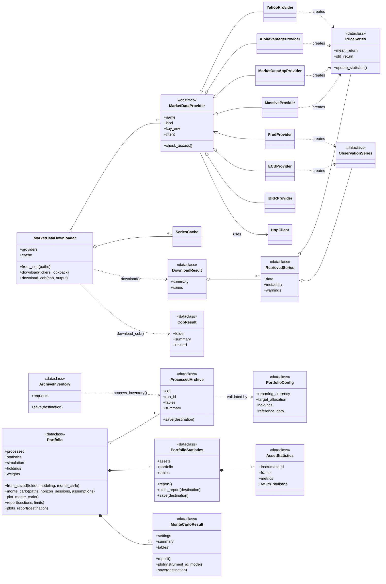
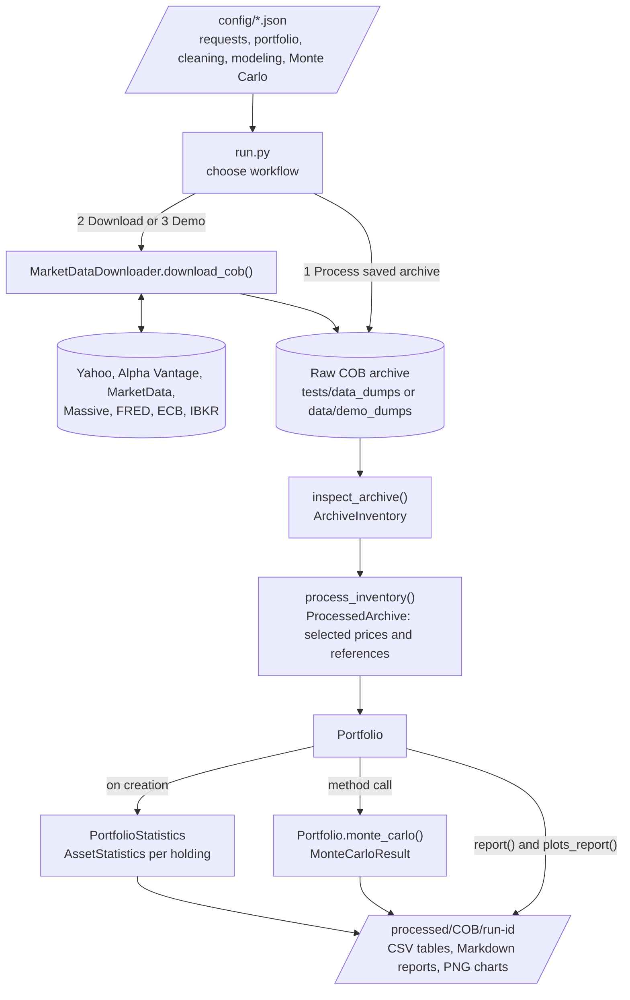

# Architecture

Two UML-style diagrams describe the toolkit: the class hierarchy and the flow of data
through the system. GitHub renders them directly from this file.

The main design rule is that **data ingestion is decoupled from analysis**. Providers only
retrieve and describe data. Analysis reads the cleaned tables and never knows which API
supplied them, so a new source or analysis does not change the core of the system.

## Class diagram

`IBKRProvider` has no `creates` arrow because it saves native responses to the archive
instead of building a series object. All sources meet again in the cleaned tables.

## System flow

## Extending the toolkit

| To add | Change | Core left untouched |
|---|---|---|
| A data source | A `MarketDataProvider` subclass, its entry in `PROVIDERS` and a JSON file | Cleaning, statistics, Monte Carlo |
| An instrument | The provider JSON files and `config/portfolio.json` | All code |
| A simulation setting | `config/monte_carlo.json` or a `Portfolio.monte_carlo()` argument | Retrieval and cleaning |
| A portfolio analysis | A `Portfolio` method reading its existing tables | Retrieval and cleaning |
