ACADEMIC PROJECT / FINAL ANALYSIS

# Portfolio evidence and simulation comparison

Archive COB 2026-10-30 | Analysis 97c25bdd7495f3ae

## What can this run tell us?

This report uses the saved outputs of this execution. Generating this summary made no provider calls and did not rerun models. Missing optional data does not invalidate independent historical evidence.

- Requested reporting currency is EUR; available simulation currencies are USD. These results do not measure EUR portfolio risk without the corresponding FX conversion.
- User assumptions for the full portfolio using the baseline calibration window: SPY: annual compound growth 6.00%, annual volatility 30.00%.
- student_t_truncated: loss probability differs from gaussian by +0.85 percentage points. Below the configured descriptive materiality threshold; this is not a model-ranking or significance test.
- At 99% confidence, student_t_truncated terminal ES is 21.08% of initial wealth, versus 20.71% for gaussian. Loss frequency and tail severity answer different questions.
- higher_equity_volatility__gaussian: loss probability differs from gaussian by +22.26 percentage points. Above the configured descriptive materiality threshold; this is not a model-ranking or significance test.
- At 99% confidence, higher_equity_volatility__gaussian terminal ES is 38.04% of initial wealth, versus 20.71% for gaussian. Loss frequency and tail severity answer different questions.
- higher_equity_volatility__student_t_truncated: loss probability differs from student_t_truncated by +22.34 percentage points. Above the configured descriptive materiality threshold; this is not a model-ranking or significance test.
- At 99% confidence, higher_equity_volatility__student_t_truncated terminal ES is 38.42% of initial wealth, versus 21.08% for student_t_truncated. Loss frequency and tail severity answer different questions.
- Stress scenarios: loss probabilities range from 75.99% to 77.54%. These are conditional scenario outcomes, not estimated probabilities of a crisis or proof of a preferred tail specification.
- Tail sensitivity scenarios: loss probabilities range from 18.78% to 18.86%. These are conditional scenario outcomes, not estimated probabilities of a crisis or proof of a preferred tail specification.
- No physical local-volatility comparison is available. The historical portfolio analysis remains usable on its own terms.
- No automatic allocation recommendation: compare conditional downside, data coverage and model assumptions rather than choosing the model with the highest mean.

### Portfolio requested

| Request id | Bucket | Weight |
| --- | --- | --- |
| SPY | equity | 70.00% |
| IEF | sovereign_fixed_income | 30.00% |

Requested reporting currency: **EUR**. Actual analysis/simulation currencies are shown below. Weights were not renormalized by this report.

**Stage availability and exclusions**

| Stage | Label | Status | Reason |
| --- | --- | --- | --- |
| processing | Cleaned data | saved | Verified saved artifacts |
| statistics | Historical statistics | available | Verified saved artifacts |
| monte_carlo | Historical portfolio Monte Carlo | complete | Verified saved artifacts |
| option_calibration | OIS, forwards and individual IVs | skipped | Verified saved artifacts |
| volatility_surface | Fitted implied volatility | skipped | Verified saved artifacts |
| local_volatility | Local volatility and boundary validation | saved | Verified saved artifacts |
| local_vol_mc | Risk-neutral underlying validation | saved | Verified saved artifacts |
| local_vol_real_world | Physical local-volatility portfolio | unavailable | missing_or_ambiguous_surface:SPY |

## Simulation method, forecast period and calibration data

These settings come from the JSON snapshots saved with each result, not from possibly edited current configuration files. Requested windows and actual usable data are shown separately. Descriptive historical statistics may use a longer history than the Monte Carlo calibration window.

### Historical portfolio Monte Carlo

| Setting | Saved value |
| --- | --- |
| Source status | complete |
| Requested forecast | 2026-10-31 to 2027-12-17 |
| Actual simulated period | 2026-10-31 to 2027-12-17 |
| Paths requested per scenario | 10000 |
| Time convention | Exchange-session daily log increments |
| Simulated steps | 284 |
| Exchange calendar | XNYS |
| Portfolio convention | buy_and_hold |
| Initial wealth / currency | 100 / USD |
| Random seed | 1729 |
| Historical window policy | Trailing 10 calendar years |
| Requested calibration interval | 2016-10-30 to 2026-10-30 |
| Actual common historical interval | 2016-10-31 to 2026-10-30 |
| Matched daily return intervals | 2513 |
| Minimum required intervals | 252 |

**Gaussian MC and its SDE interpretation.** Normalized holding/factor wealth follows a diffusion with correlated Brownian shocks:

<img alt="Gaussian SDE: relative wealth change equals drift times dt plus volatility times a correlated Brownian increment." src="data:image/svg+xml;base64,PD94bWwgdmVyc2lvbj0iMS4wIiBlbmNvZGluZz0idXRmLTgiIHN0YW5kYWxvbmU9Im5vIj8+CjwhRE9DVFlQRSBzdmcgUFVCTElDICItLy9XM0MvL0RURCBTVkcgMS4xLy9FTiIKICAiaHR0cDovL3d3dy53My5vcmcvR3JhcGhpY3MvU1ZHLzEuMS9EVEQvc3ZnMTEuZHRkIj4KPHN2ZyB4bWxuczp4bGluaz0iaHR0cDovL3d3dy53My5vcmcvMTk5OS94bGluayIgd2lkdGg9IjM2OHB0IiBoZWlnaHQ9IjI3cHQiIHZpZXdCb3g9IjAgMCAzNjggMjciIHhtbG5zPSJodHRwOi8vd3d3LnczLm9yZy8yMDAwL3N2ZyIgdmVyc2lvbj0iMS4xIj4KIDxtZXRhZGF0YT4KICA8cmRmOlJERiB4bWxuczpkYz0iaHR0cDovL3B1cmwub3JnL2RjL2VsZW1lbnRzLzEuMS8iIHhtbG5zOmNjPSJodHRwOi8vY3JlYXRpdmVjb21tb25zLm9yZy9ucyMiIHhtbG5zOnJkZj0iaHR0cDovL3d3dy53My5vcmcvMTk5OS8wMi8yMi1yZGYtc3ludGF4LW5zIyI+CiAgIDxjYzpXb3JrPgogICAgPGRjOnR5cGUgcmRmOnJlc291cmNlPSJodHRwOi8vcHVybC5vcmcvZGMvZGNtaXR5cGUvU3RpbGxJbWFnZSIvPgogICAgCiAgICA8ZGM6Zm9ybWF0PmltYWdlL3N2Zyt4bWw8L2RjOmZvcm1hdD4KICAgIDxkYzpjcmVhdG9yPgogICAgIDxjYzpBZ2VudD4KICAgICAgPGRjOnRpdGxlPk1hdHBsb3RsaWIgdjMuMTEuMiwgaHR0cHM6Ly9tYXRwbG90bGliLm9yZy88L2RjOnRpdGxlPgogICAgIDwvY2M6QWdlbnQ+CiAgICA8L2RjOmNyZWF0b3I+CiAgIDwvY2M6V29yaz4KICA8L3JkZjpSREY+CiA8L21ldGFkYXRhPgogPGRlZnM+CiAgPHN0eWxlIHR5cGU9InRleHQvY3NzIj4qe3N0cm9rZS1saW5lam9pbjogcm91bmQ7IHN0cm9rZS1saW5lY2FwOiBidXR0fTwvc3R5bGU+CiA8L2RlZnM+CiA8ZyBpZD0iZmlndXJlXzEiPgogIDxnIGlkPSJwYXRjaF8xIj4KICAgPHBhdGggZD0iTSAwIDI3IApMIDM2OCAyNyAKTCAzNjggMCAKTCAwIDAgCnoKIiBzdHlsZT0iZmlsbDogI2ZmZmZmZiIvPgogIDwvZz4KICA8ZyBpZD0idGV4dF8xIj4KICAgPCEtLSAkXGZyYWN7XG1hdGhybXtkfUdfaSh0KX17R19pKHQpfT1cbXVfaVwsXG1hdGhybXtkfXQrXHNpZ21hX2lcLFxtYXRocm17ZH1XX2kodCksXHFxdWFkIFxtYXRocm17ZH1XX2lcLFxtYXRocm17ZH1XX2o9XHJob197aWp9XCxcbWF0aHJte2R9dCQgLS0+CiAgIDxnIHRyYW5zZm9ybT0idHJhbnNsYXRlKDAgMTgpIHNjYWxlKDAuMTggLTAuMTgpIj4KICAgIDxkZWZzPgogICAgIDxwYXRoIGlkPSJEZWphVnVTYW5zLTQ3IiBkPSJNIDI5MDYgMjk2OSAKTCAyOTA2IDQ4NjMgCkwgMzQ4MSA0ODYzIApMIDM0ODEgMCAKTCAyOTA2IDAgCkwgMjkwNiA1MjUgClEgMjcyNSAyMTMgMjQ0OCA2MSAKUSAyMTcyIC05MSAxNzg0IC05MSAKUSAxMTUwIC05MSA3NTEgNDE1IApRIDM1MyA5MjIgMzUzIDE3NDcgClEgMzUzIDI1NzIgNzUxIDMwNzggClEgMTE1MCAzNTg0IDE3ODQgMzU4NCAKUSAyMTcyIDM1ODQgMjQ0OCAzNDMyIApRIDI3MjUgMzI4MSAyOTA2IDI5NjkgCnoKTSA5NDcgMTc0NyAKUSA5NDcgMTExMyAxMjA4IDc1MiAKUSAxNDY5IDM5MSAxOTI1IDM5MSAKUSAyMzgxIDM5MSAyNjQzIDc1MiAKUSAyOTA2IDExMTMgMjkwNiAxNzQ3IApRIDI5MDYgMjM4MSAyNjQzIDI3NDIgClEgMjM4MSAzMTAzIDE5MjUgMzEwMyAKUSAxNDY5IDMxMDMgMTIwOCAyNzQyIApRIDk0NyAyMzgxIDk0NyAxNzQ3IAp6CiIgdHJhbnNmb3JtPSJzY2FsZSgwLjAxNTYyNSkiLz4KICAgICA8cGF0aCBpZD0iRGVqYVZ1U2Fucy1PYmxpcXVlLTJhIiBkPSJNIDM0OTQgNjk3IApMIDM3MzggMTkxOSAKTCAyNzAwIDE5MTkgCkwgMjc5NyAyNDM4IApMIDQ0NTMgMjQzOCAKTCA0MDUwIDM4NCAKUSAzNjM0IDE1NiAzMTQzIDMyIApRIDI2NTMgLTkxIDIxNTYgLTkxIApRIDEyNzggLTkxIDc4MyAzOTYgClEgMjg4IDg4NCAyODggMTc1MyAKUSAyODggMjQ3NSA1ODkgMzEyNiAKUSA4OTEgMzc3OCAxNDIyIDQyMTMgClEgMTc1NiA0NDg0IDIxNTMgNDYxNyAKUSAyNTUwIDQ3NTAgMzAzNCA0NzUwIApRIDM0NzIgNDc1MCAzODczIDQ2MzkgClEgNDI3NSA0NTI4IDQ2NDEgNDMwNiAKTCA0NTEzIDM2MzQgClEgNDIzMSAzOTI4IDM4NTMgNDA4MyAKUSAzNDc1IDQyMzggMzA0NyA0MjM4IApRIDI1NTAgNDIzOCAyMTcyIDQwNDggClEgMTc5NCAzODU5IDE0OTcgMzQ2MyAKUSAxMjQ0IDMxMjUgMTA5OCAyNjY3IApRIDk1MyAyMjA5IDk1MyAxNzM0IApRIDk1MyAxMDgxIDEyODcgNzUxIApRIDE2MjIgNDIyIDIyODQgNDIyIApRIDI2MTYgNDIyIDI5MjUgNDkyIApRIDMyMzQgNTYzIDM0OTQgNjk3IAp6CiIgdHJhbnNmb3JtPSJzY2FsZSgwLjAxNTYyNSkiLz4KICAgICA8cGF0aCBpZD0iRGVqYVZ1U2Fucy1PYmxpcXVlLTRjIiBkPSJNIDExNzIgNDg2MyAKTCAxNzQ3IDQ4NjMgCkwgMTYwNiA0MTM0IApMIDEwMzEgNDEzNCAKTCAxMTcyIDQ4NjMgCnoKTSA5MDkgMzUwMCAKTCAxNDg0IDM1MDAgCkwgODAwIDAgCkwgMjI1IDAgCkwgOTA5IDM1MDAgCnoKIiB0cmFuc2Zvcm09InNjYWxlKDAuMDE1NjI1KSIvPgogICAgIDxwYXRoIGlkPSJEZWphVnVTYW5zLWIiIGQ9Ik0gMTk4NCA0ODU2IApRIDE1NjYgNDEzOCAxMzYyIDM0MzQgClEgMTE1OSAyNzMxIDExNTkgMjAwOSAKUSAxMTU5IDEyODggMTM2NCA1ODAgClEgMTU2OSAtMTI4IDE5ODQgLTg0NCAKTCAxNDg0IC04NDQgClEgMTAxNiAtMTA5IDc4MyA2MDAgClEgNTUwIDEzMDkgNTUwIDIwMDkgClEgNTUwIDI3MDYgNzgxIDM0MTIgClEgMTAxMyA0MTE5IDE0ODQgNDg1NiAKTCAxOTg0IDQ4NTYgCnoKIiB0cmFuc2Zvcm09InNjYWxlKDAuMDE1NjI1KSIvPgogICAgIDxwYXRoIGlkPSJEZWphVnVTYW5zLU9ibGlxdWUtNTciIGQ9Ik0gMjcwNiAzNTAwIApMIDI2MTkgMzA1MyAKTCAxNDcyIDMwNTMgCkwgMTEwMCAxMTUzIApRIDEwODEgMTA0NyAxMDcyIDk3NSAKUSAxMDYzIDkwMyAxMDYzIDg2MyAKUSAxMDYzIDY2MyAxMTgzIDU3MiAKUSAxMzAzIDQ4MSAxNTY5IDQ4MSAKTCAyMTUwIDQ4MSAKTCAyMDUzIDAgCkwgMTUwMyAwIApRIDk5MSAwIDczOSAyMDAgClEgNDg4IDQwMCA0ODggODA2IApRIDQ4OCA4NzggNDk3IDk2NCAKUSA1MDYgMTA1MCA1MjUgMTE1MyAKTCA4OTcgMzA1MyAKTCA0MDkgMzA1MyAKTCA1MDAgMzUwMCAKTCA5NzggMzUwMCAKTCAxMTcyIDQ0OTQgCkwgMTc0NyA0NDk0IApMIDE1NTYgMzUwMCAKTCAyNzA2IDM1MDAgCnoKIiB0cmFuc2Zvcm09InNjYWxlKDAuMDE1NjI1KSIvPgogICAgIDxwYXRoIGlkPSJEZWphVnVTYW5zLWMiIGQ9Ik0gNTEzIDQ4NTYgCkwgMTAxMyA0ODU2IApRIDE0ODEgNDExOSAxNzE0IDM0MTIgClEgMTk0NyAyNzA2IDE5NDcgMjAwOSAKUSAxOTQ3IDEzMDkgMTcxNCA2MDAgClEgMTQ4MSAtMTA5IDEwMTMgLTg0NCAKTCA1MTMgLTg0NCAKUSA5MjggLTEyOCAxMTMzIDU4MCAKUSAxMzM4IDEyODggMTMzOCAyMDA5IApRIDEzMzggMjczMSAxMTMzIDM0MzQgClEgOTI4IDQxMzggNTEzIDQ4NTYgCnoKIiB0cmFuc2Zvcm09InNjYWxlKDAuMDE1NjI1KSIvPgogICAgIDxwYXRoIGlkPSJEZWphVnVTYW5zLTIwIiBkPSJNIDY3OCAyOTA2IApMIDQ2ODQgMjkwNiAKTCA0Njg0IDIzODEgCkwgNjc4IDIzODEgCkwgNjc4IDI5MDYgCnoKTSA2NzggMTYzMSAKTCA0Njg0IDE2MzEgCkwgNDY4NCAxMTAwIApMIDY3OCAxMTAwIApMIDY3OCAxNjMxIAp6CiIgdHJhbnNmb3JtPSJzY2FsZSgwLjAxNTYyNSkiLz4KICAgICA8cGF0aCBpZD0iRGVqYVZ1U2Fucy1PYmxpcXVlLTM1MCIgZD0iTSAtODQgLTEzMzEgCkwgODU2IDM1MDAgCkwgMTQzNCAzNTAwIApMIDEwMDkgMTMyMiAKUSA5OTcgMTI1NiA5ODcgMTE3NSAKUSA5NzggMTA5NCA5NzggMTAxMyAKUSA5NzggNzIyIDExNjEgNTY1IApRIDEzNDQgNDA5IDE2ODQgNDA5IApRIDIxNDcgNDA5IDI0MzEgNjcxIApRIDI3MTYgOTM0IDI4MTYgMTQ1OSAKTCAzMjEzIDM1MDAgCkwgMzc4OCAzNTAwIApMIDMyNjYgODA5IApRIDMyNTMgNzUwIDMyNDggNzA2IApRIDMyNDQgNjYzIDMyNDQgNjI4IApRIDMyNDQgNTMxIDMyODMgNDg2IApRIDMzMjIgNDQxIDM0MDYgNDQxIApRIDM0MzggNDQxIDM0OTIgNDU2IApRIDM1NDcgNDcyIDM2NDcgNTEzIApMIDM1NTkgNTAgClEgMzQyMiAtMTkgMzI5NyAtNTUgClEgMzE3MiAtOTEgMzA1MyAtOTEgClEgMjg0NyAtOTEgMjczMCA0MCAKUSAyNjEzIDE3MiAyNjEzIDQwMyAKUSAyNDM4IDE1MyAyMTk1IDMxIApRIDE5NTMgLTkxIDE2MjUgLTkxIApRIDEzMzQgLTkxIDExMTcgNDMgClEgOTAwIDE3OCA4MzEgMzk3IApMIDQ5NCAtMTMzMSAKTCAtODQgLTEzMzEgCnoKIiB0cmFuc2Zvcm09InNjYWxlKDAuMDE1NjI1KSIvPgogICAgIDxwYXRoIGlkPSJEZWphVnVTYW5zLWUiIGQ9Ik0gMjk0NCA0MDEzIApMIDI5NDQgMjI3MiAKTCA0Njg0IDIyNzIgCkwgNDY4NCAxNzQxIApMIDI5NDQgMTc0MSAKTCAyOTQ0IDAgCkwgMjQxOSAwIApMIDI0MTkgMTc0MSAKTCA2NzggMTc0MSAKTCA2NzggMjI3MiAKTCAyNDE5IDIyNzIgCkwgMjQxOSA0MDEzIApMIDI5NDQgNDAxMyAKegoiIHRyYW5zZm9ybT0ic2NhbGUoMC4wMTU2MjUpIi8+CiAgICAgPHBhdGggaWQ9IkRlamFWdVNhbnMtT2JsaXF1ZS0zNTciIGQ9Ik0gMjIxOSAzMDQ0IApRIDE3NDQgMzA0NCAxNDIyIDI3MDAgClEgMTA4MSAyMzQxIDk2OSAxNzQ3IApRIDg0NCAxMTE5IDEwNDQgNzU2IApRIDEyNDEgMzk3IDE3MDYgMzk3IApRIDIxNjYgMzk3IDI1MDMgNzU5IApRIDI4NDQgMTEyMiAyOTY2IDE3NDcgClEgMzA3NSAyMzE5IDI4ODEgMjcwMCAKUSAyNzAwIDMwNDQgMjIxOSAzMDQ0IAp6Ck0gMjMwOSAzNTAzIApMIDQyMTkgMzUwMCAKTCA0MTA2IDI5MjUgCkwgMzQ2MyAyOTI1IApRIDM3MDYgMjQzOCAzNTc1IDE3NDcgClEgMzQwNiA4ODggMjg4NCA0MDAgClEgMjM1OSAtOTEgMTYwOSAtOTEgClEgODU2IC05MSA1MjUgNDAwIApRIDE5NCA4ODggMzYzIDE3NDcgClEgNTI4IDI2MDkgMTA1MCAzMDk3IApRIDE0ODQgMzUwMyAyMzA5IDM1MDMgCnoKIiB0cmFuc2Zvcm09InNjYWxlKDAuMDE1NjI1KSIvPgogICAgIDxwYXRoIGlkPSJEZWphVnVTYW5zLU9ibGlxdWUtM2EiIGQ9Ik0gNjE2IDQ2NjYgCkwgMTIyOCA0NjY2IApMIDE0NTMgNjk3IApMIDMyMTMgNDY2NiAKTCAzOTE2IDQ2NjYgCkwgNDE0NyA2OTcgCkwgNTg4OCA0NjY2IApMIDY1MjggNDY2NiAKTCA0NDUzIDAgCkwgMzY1OSAwIApMIDM0NDQgMzg5MSAKTCAxNjk3IDAgCkwgOTAzIDAgCkwgNjE2IDQ2NjYgCnoKIiB0cmFuc2Zvcm09InNjYWxlKDAuMDE1NjI1KSIvPgogICAgIDxwYXRoIGlkPSJEZWphVnVTYW5zLWYiIGQ9Ik0gNzUwIDc5NCAKTCAxNDA5IDc5NCAKTCAxNDA5IDI1NiAKTCA4OTcgLTc0NCAKTCA0OTQgLTc0NCAKTCA3NTAgMjU2IApMIDc1MCA3OTQgCnoKIiB0cmFuc2Zvcm09InNjYWxlKDAuMDE1NjI1KSIvPgogICAgIDxwYXRoIGlkPSJEZWphVnVTYW5zLU9ibGlxdWUtNGQiIGQ9Ik0gOTI4IDM1MDAgCkwgMTUwMyAzNTAwIApMIDgxMyAtNjMgCkwgODA5IC03OCAKUSA2OTQgLTY3NSA1NDQgLTg5NyAKUSA0MDMgLTExMDYgMTMyIC0xMjE4IApRIC0xMzggLTEzMzEgLTUwNiAtMTMzMSAKTCAtNzIyIC0xMzMxIApMIC02MjggLTg0NCAKTCAtNDgxIC04NDQgClEgLTE0NCAtODQ0IC0xIC03MDMgClEgMTQxIC01NjMgMjM4IC02MyAKTCA5MjggMzUwMCAKegpNIDExOTcgNDg2MyAKTCAxNzcyIDQ4NjMgCkwgMTYzMSA0MTM0IApMIDEwNTYgNDEzNCAKTCAxMTk3IDQ4NjMgCnoKIiB0cmFuc2Zvcm09InNjYWxlKDAuMDE1NjI1KSIvPgogICAgIDxwYXRoIGlkPSJEZWphVnVTYW5zLU9ibGlxdWUtMzU1IiBkPSJNIDEyMDMgMjg3NSAKUSAxNDUzIDMxOTQgMTk4MSAzNDc1IApRIDIxODggMzU4NCAyNzU2IDM1ODQgClEgMzM5NCAzNTg0IDM2OTQgMzA3OCAKUSAzOTk0IDI1NzIgMzgzNCAxNzQ3IApRIDM2NzIgOTIyIDMxNzUgNDE1IApRIDI2NzggLTkxIDIwNDEgLTkxIApRIDE2NTYgLTkxIDE0MDkgNjMgClEgMTE2MyAyMTMgMTA0NCA1MjUgCkwgNjgxIC0xMzMxIApMIDEwMyAtMTMzMSAKTCA2OTcgMTcxNiAKUSA4MzggMjQzOCAxMjAzIDI4NzUgCnoKTSAzMjM4IDE3NDcgClEgMzM1OSAyMzgxIDMxNjkgMjc0NCAKUSAyOTc4IDMxMDMgMjUyMiAzMTAzIApRIDIwNjYgMzEwMyAxNzM0IDI3NDQgClEgMTQwMyAyMzgxIDEyODEgMTc0NyAKUSAxMTU2IDExMTMgMTM0NyA3NTAgClEgMTUzOCAzOTEgMTk5NCAzOTEgClEgMjQ1MCAzOTEgMjc4MSA3NTAgClEgMzExMyAxMTEzIDMyMzggMTc0NyAKegoiIHRyYW5zZm9ybT0ic2NhbGUoMC4wMTU2MjUpIi8+CiAgICA8L2RlZnM+CiAgICA8dXNlIHhsaW5rOmhyZWY9IiNEZWphVnVTYW5zLTQ3IiB0cmFuc2Zvcm09InRyYW5zbGF0ZSg2LjI1IDQ1LjgxMDkzOCkgc2NhbGUoMC43KSIvPgogICAgPHVzZSB4bGluazpocmVmPSIjRGVqYVZ1U2Fucy1PYmxpcXVlLTJhIiB0cmFuc2Zvcm09InRyYW5zbGF0ZSg1MC42ODM1OTQgNDUuODEwOTM4KSBzY2FsZSgwLjcpIi8+CiAgICA8dXNlIHhsaW5rOmhyZWY9IiNEZWphVnVTYW5zLU9ibGlxdWUtNGMiIHRyYW5zZm9ybT0idHJhbnNsYXRlKDEwNC45MjY3NTggMzUuMzEwOTcyKSBzY2FsZSgwLjQ5KSIvPgogICAgPHVzZSB4bGluazpocmVmPSIjRGVqYVZ1U2Fucy1iIiB0cmFuc2Zvcm09InRyYW5zbGF0ZSgxMjAuNDU0NTkgNDUuODEwOTM4KSBzY2FsZSgwLjcpIi8+CiAgICA8dXNlIHhsaW5rOmhyZWY9IiNEZWphVnVTYW5zLU9ibGlxdWUtNTciIHRyYW5zZm9ybT0idHJhbnNsYXRlKDE0Ny43NjQxNiA0NS44MTA5MzgpIHNjYWxlKDAuNykiLz4KICAgIDx1c2UgeGxpbms6aHJlZj0iI0RlamFWdVNhbnMtYyIgdHJhbnNmb3JtPSJ0cmFuc2xhdGUoMTc1LjIxMDQ0OSA0NS44MTA5MzgpIHNjYWxlKDAuNykiLz4KICAgIDx1c2UgeGxpbms6aHJlZj0iI0RlamFWdVNhbnMtT2JsaXF1ZS0yYSIgdHJhbnNmb3JtPSJ0cmFuc2xhdGUoMjguMjUgLTM2LjU1MTUyOCkgc2NhbGUoMC43KSIvPgogICAgPHVzZSB4bGluazpocmVmPSIjRGVqYVZ1U2Fucy1PYmxpcXVlLTRjIiB0cmFuc2Zvcm09InRyYW5zbGF0ZSg4Mi40OTMxNjQgLTQ3LjA1MTQ5NCkgc2NhbGUoMC40OSkiLz4KICAgIDx1c2UgeGxpbms6aHJlZj0iI0RlamFWdVNhbnMtYiIgdHJhbnNmb3JtPSJ0cmFuc2xhdGUoOTguMDIwOTk2IC0zNi41NTE1MjgpIHNjYWxlKDAuNykiLz4KICAgIDx1c2UgeGxpbms6aHJlZj0iI0RlamFWdVNhbnMtT2JsaXF1ZS01NyIgdHJhbnNmb3JtPSJ0cmFuc2xhdGUoMTI1LjMzMDU2NiAtMzYuNTUxNTI4KSBzY2FsZSgwLjcpIi8+CiAgICA8dXNlIHhsaW5rOmhyZWY9IiNEZWphVnVTYW5zLWMiIHRyYW5zZm9ybT0idHJhbnNsYXRlKDE1Mi43NzY4NTUgLTM2LjU1MTUyOCkgc2NhbGUoMC43KSIvPgogICAgPHVzZSB4bGluazpocmVmPSIjRGVqYVZ1U2Fucy0yMCIgdHJhbnNmb3JtPSJ0cmFuc2xhdGUoMjI4LjI1MjQ0MSAwLjkzNTk3MikiLz4KICAgIDx1c2UgeGxpbms6aHJlZj0iI0RlamFWdVNhbnMtT2JsaXF1ZS0zNTAiIHRyYW5zZm9ybT0idHJhbnNsYXRlKDMzMS41MjM5MjYgMC45MzU5NzIpIi8+CiAgICA8dXNlIHhsaW5rOmhyZWY9IiNEZWphVnVTYW5zLU9ibGlxdWUtNGMiIHRyYW5zZm9ybT0idHJhbnNsYXRlKDM5NS4xNDY5NzMgLTE0LjA2Mzk3OSkgc2NhbGUoMC43KSIvPgogICAgPHVzZSB4bGluazpocmVmPSIjRGVqYVZ1U2Fucy00NyIgdHJhbnNmb3JtPSJ0cmFuc2xhdGUoNDMzLjU2NTI2NiAwLjkzNTk3MikiLz4KICAgIDx1c2UgeGxpbms6aHJlZj0iI0RlamFWdVNhbnMtT2JsaXF1ZS01NyIgdHJhbnNmb3JtPSJ0cmFuc2xhdGUoNDk3LjA0MTgyOSAwLjkzNTk3MikiLz4KICAgIDx1c2UgeGxpbms6aHJlZj0iI0RlamFWdVNhbnMtZSIgdHJhbnNmb3JtPSJ0cmFuc2xhdGUoNTU1LjczMzIzNSAwLjkzNTk3MikiLz4KICAgIDx1c2UgeGxpbms6aHJlZj0iI0RlamFWdVNhbnMtT2JsaXF1ZS0zNTciIHRyYW5zZm9ybT0idHJhbnNsYXRlKDY1OS4wMDQ3MTkgMC45MzU5NzIpIi8+CiAgICA8dXNlIHhsaW5rOmhyZWY9IiNEZWphVnVTYW5zLU9ibGlxdWUtNGMiIHRyYW5zZm9ybT0idHJhbnNsYXRlKDcyMi4zODM2MjUgLTE0LjA2Mzk3OSkgc2NhbGUoMC43KSIvPgogICAgPHVzZSB4bGluazpocmVmPSIjRGVqYVZ1U2Fucy00NyIgdHJhbnNmb3JtPSJ0cmFuc2xhdGUoNzYwLjgwMTkxOSAwLjkzNTk3MikiLz4KICAgIDx1c2UgeGxpbms6aHJlZj0iI0RlamFWdVNhbnMtT2JsaXF1ZS0zYSIgdHJhbnNmb3JtPSJ0cmFuc2xhdGUoODI0LjI3ODQ4MSAwLjkzNTk3MikiLz4KICAgIDx1c2UgeGxpbms6aHJlZj0iI0RlamFWdVNhbnMtT2JsaXF1ZS00YyIgdHJhbnNmb3JtPSJ0cmFuc2xhdGUoOTIzLjE1NTQzNSAtMTQuMDYzOTc5KSBzY2FsZSgwLjcpIi8+CiAgICA8dXNlIHhsaW5rOmhyZWY9IiNEZWphVnVTYW5zLWIiIHRyYW5zZm9ybT0idHJhbnNsYXRlKDk0NS4zMzgwNTIgMC45MzU5NzIpIi8+CiAgICA8dXNlIHhsaW5rOmhyZWY9IiNEZWphVnVTYW5zLU9ibGlxdWUtNTciIHRyYW5zZm9ybT0idHJhbnNsYXRlKDk4NC4zNTE3MjQgMC45MzU5NzIpIi8+CiAgICA8dXNlIHhsaW5rOmhyZWY9IiNEZWphVnVTYW5zLWMiIHRyYW5zZm9ybT0idHJhbnNsYXRlKDEwMjMuNTYwNzA4IDAuOTM1OTcyKSIvPgogICAgPHVzZSB4bGluazpocmVmPSIjRGVqYVZ1U2Fucy1mIiB0cmFuc2Zvcm09InRyYW5zbGF0ZSgxMDYyLjU3NDM4IDAuOTM1OTcyKSIvPgogICAgPHVzZSB4bGluazpocmVmPSIjRGVqYVZ1U2Fucy00NyIgdHJhbnNmb3JtPSJ0cmFuc2xhdGUoMTMwOC42NjgxMyAwLjkzNTk3MikiLz4KICAgIDx1c2UgeGxpbms6aHJlZj0iI0RlamFWdVNhbnMtT2JsaXF1ZS0zYSIgdHJhbnNmb3JtPSJ0cmFuc2xhdGUoMTM3Mi4xNDQ2OTIgMC45MzU5NzIpIi8+CiAgICA8dXNlIHhsaW5rOmhyZWY9IiNEZWphVnVTYW5zLU9ibGlxdWUtNGMiIHRyYW5zZm9ybT0idHJhbnNsYXRlKDE0NzEuMDIxNjQ2IC0xNC4wNjM5NzkpIHNjYWxlKDAuNykiLz4KICAgIDx1c2UgeGxpbms6aHJlZj0iI0RlamFWdVNhbnMtNDciIHRyYW5zZm9ybT0idHJhbnNsYXRlKDE1MDkuNDM5OTM5IDAuOTM1OTcyKSIvPgogICAgPHVzZSB4bGluazpocmVmPSIjRGVqYVZ1U2Fucy1PYmxpcXVlLTNhIiB0cmFuc2Zvcm09InRyYW5zbGF0ZSgxNTcyLjkxNjUwMSAwLjkzNTk3MikiLz4KICAgIDx1c2UgeGxpbms6aHJlZj0iI0RlamFWdVNhbnMtT2JsaXF1ZS00ZCIgdHJhbnNmb3JtPSJ0cmFuc2xhdGUoMTY3MS43OTM0NTUgLTE0LjA2Mzk3OSkgc2NhbGUoMC43KSIvPgogICAgPHVzZSB4bGluazpocmVmPSIjRGVqYVZ1U2Fucy0yMCIgdHJhbnNmb3JtPSJ0cmFuc2xhdGUoMTcxMy40NTg0OTQgMC45MzU5NzIpIi8+CiAgICA8dXNlIHhsaW5rOmhyZWY9IiNEZWphVnVTYW5zLU9ibGlxdWUtMzU1IiB0cmFuc2Zvcm09InRyYW5zbGF0ZSgxODE2LjcyOTk3OCAwLjkzNTk3MikiLz4KICAgIDx1c2UgeGxpbms6aHJlZj0iI0RlamFWdVNhbnMtT2JsaXF1ZS00YyIgdHJhbnNmb3JtPSJ0cmFuc2xhdGUoMTg4MC4yMDY1NDEgLTE0LjA2Mzk3OSkgc2NhbGUoMC43KSIvPgogICAgPHVzZSB4bGluazpocmVmPSIjRGVqYVZ1U2Fucy1PYmxpcXVlLTRkIiB0cmFuc2Zvcm09InRyYW5zbGF0ZSgxODk5LjY1NDc4MyAtMTQuMDYzOTc5KSBzY2FsZSgwLjcpIi8+CiAgICA8dXNlIHhsaW5rOmhyZWY9IiNEZWphVnVTYW5zLTQ3IiB0cmFuc2Zvcm09InRyYW5zbGF0ZSgxOTM4LjA3MzA3NiAwLjkzNTk3MikiLz4KICAgIDx1c2UgeGxpbms6aHJlZj0iI0RlamFWdVNhbnMtT2JsaXF1ZS01NyIgdHJhbnNmb3JtPSJ0cmFuc2xhdGUoMjAwMS41NDk2MzkgMC45MzU5NzIpIi8+CiAgICA8cGF0aCBkPSJNIDYuMjUgMjIuODEwOTcyIApMIDYuMjUgMjkuMDYwOTcyIApMIDIwMi41MjAwMiAyOS4wNjA5NzIgCkwgMjAyLjUyMDAyIDIyLjgxMDk3MiAKTCA2LjI1IDIyLjgxMDk3MiAKegoiLz4KICAgPC9nPgogIDwvZz4KIDwvZz4KPC9zdmc+Cg=="/>

The code simulates the joint log increments directly, one exchange session at a time:

<img alt="Daily joint log increments equal the historical log mean vector plus covariance-scaled standard normal shocks." src="data:image/svg+xml;base64,PD94bWwgdmVyc2lvbj0iMS4wIiBlbmNvZGluZz0idXRmLTgiIHN0YW5kYWxvbmU9Im5vIj8+CjwhRE9DVFlQRSBzdmcgUFVCTElDICItLy9XM0MvL0RURCBTVkcgMS4xLy9FTiIKICAiaHR0cDovL3d3dy53My5vcmcvR3JhcGhpY3MvU1ZHLzEuMS9EVEQvc3ZnMTEuZHRkIj4KPHN2ZyB4bWxuczp4bGluaz0iaHR0cDovL3d3dy53My5vcmcvMTk5OS94bGluayIgd2lkdGg9IjM5MnB0IiBoZWlnaHQ9IjIxcHQiIHZpZXdCb3g9IjAgMCAzOTIgMjEiIHhtbG5zPSJodHRwOi8vd3d3LnczLm9yZy8yMDAwL3N2ZyIgdmVyc2lvbj0iMS4xIj4KIDxtZXRhZGF0YT4KICA8cmRmOlJERiB4bWxuczpkYz0iaHR0cDovL3B1cmwub3JnL2RjL2VsZW1lbnRzLzEuMS8iIHhtbG5zOmNjPSJodHRwOi8vY3JlYXRpdmVjb21tb25zLm9yZy9ucyMiIHhtbG5zOnJkZj0iaHR0cDovL3d3dy53My5vcmcvMTk5OS8wMi8yMi1yZGYtc3ludGF4LW5zIyI+CiAgIDxjYzpXb3JrPgogICAgPGRjOnR5cGUgcmRmOnJlc291cmNlPSJodHRwOi8vcHVybC5vcmcvZGMvZGNtaXR5cGUvU3RpbGxJbWFnZSIvPgogICAgCiAgICA8ZGM6Zm9ybWF0PmltYWdlL3N2Zyt4bWw8L2RjOmZvcm1hdD4KICAgIDxkYzpjcmVhdG9yPgogICAgIDxjYzpBZ2VudD4KICAgICAgPGRjOnRpdGxlPk1hdHBsb3RsaWIgdjMuMTEuMiwgaHR0cHM6Ly9tYXRwbG90bGliLm9yZy88L2RjOnRpdGxlPgogICAgIDwvY2M6QWdlbnQ+CiAgICA8L2RjOmNyZWF0b3I+CiAgIDwvY2M6V29yaz4KICA8L3JkZjpSREY+CiA8L21ldGFkYXRhPgogPGRlZnM+CiAgPHN0eWxlIHR5cGU9InRleHQvY3NzIj4qe3N0cm9rZS1saW5lam9pbjogcm91bmQ7IHN0cm9rZS1saW5lY2FwOiBidXR0fTwvc3R5bGU+CiA8L2RlZnM+CiA8ZyBpZD0iZmlndXJlXzEiPgogIDxnIGlkPSJwYXRjaF8xIj4KICAgPHBhdGggZD0iTSAwIDIxIApMIDM5MiAyMSAKTCAzOTIgMCAKTCAwIDAgCnoKIiBzdHlsZT0iZmlsbDogI2ZmZmZmZiIvPgogIDwvZz4KICA8ZyBpZD0idGV4dF8xIj4KICAgPCEtLSAkXERlbHRhXGxvZ1xtYXRoYmZ7R309XG1hdGhiZnttfStCXG1hdGhiZnt6fSxccXF1YWRcbWF0aGJme3p9XHNpbVxtYXRoY2Fse059KFxtYXRoYmZ7MH0sSSksXHFxdWFkIEJCXntcbWF0aHNme1R9fT1DJCAtLT4KICAgPGcgdHJhbnNmb3JtPSJ0cmFuc2xhdGUoMCAxNykgc2NhbGUoMC4xOCAtMC4xOCkiPgogICAgPGRlZnM+CiAgICAgPHBhdGggaWQ9IkRlamFWdVNhbnMtMzI5IiBkPSJNIDIxODggNDA0NCAKTCA5MDYgNTI1IApMIDM0NzIgNTI1IApMIDIxODggNDA0NCAKegpNIDUwIDAgCkwgMTgzMSA0NjY2IApMIDI1NDcgNDY2NiAKTCA0MzI1IDAgCkwgNTAgMCAKegoiIHRyYW5zZm9ybT0ic2NhbGUoMC4wMTU2MjUpIi8+CiAgICAgPHBhdGggaWQ9IkRlamFWdVNhbnMtNGYiIGQ9Ik0gNjAzIDQ4NjMgCkwgMTE3OCA0ODYzIApMIDExNzggMCAKTCA2MDMgMCAKTCA2MDMgNDg2MyAKegoiIHRyYW5zZm9ybT0ic2NhbGUoMC4wMTU2MjUpIi8+CiAgICAgPHBhdGggaWQ9IkRlamFWdVNhbnMtNTIiIGQ9Ik0gMTk1OSAzMDk3IApRIDE0OTcgMzA5NyAxMjI4IDI3MzYgClEgOTU5IDIzNzUgOTU5IDE3NDcgClEgOTU5IDExMTkgMTIyNiA3NTggClEgMTQ5NCAzOTcgMTk1OSAzOTcgClEgMjQxOSAzOTcgMjY4NyA3NTkgClEgMjk1NiAxMTIyIDI5NTYgMTc0NyAKUSAyOTU2IDIzNjkgMjY4NyAyNzMzIApRIDI0MTkgMzA5NyAxOTU5IDMwOTcgCnoKTSAxOTU5IDM1ODQgClEgMjcwOSAzNTg0IDMxMzcgMzA5NiAKUSAzNTY2IDI2MDkgMzU2NiAxNzQ3IApRIDM1NjYgODg4IDMxMzcgMzk4IApRIDI3MDkgLTkxIDE5NTkgLTkxIApRIDEyMDYgLTkxIDc3OSAzOTggClEgMzUzIDg4OCAzNTMgMTc0NyAKUSAzNTMgMjYwOSA3NzkgMzA5NiAKUSAxMjA2IDM1ODQgMTk1OSAzNTg0IAp6CiIgdHJhbnNmb3JtPSJzY2FsZSgwLjAxNTYyNSkiLz4KICAgICA8cGF0aCBpZD0iRGVqYVZ1U2Fucy00YSIgZD0iTSAyOTA2IDE3OTEgClEgMjkwNiAyNDE2IDI2NDggMjc1OSAKUSAyMzkxIDMxMDMgMTkyNSAzMTAzIApRIDE0NjMgMzEwMyAxMjA1IDI3NTkgClEgOTQ3IDI0MTYgOTQ3IDE3OTEgClEgOTQ3IDExNjkgMTIwNSA4MjUgClEgMTQ2MyA0ODEgMTkyNSA0ODEgClEgMjM5MSA0ODEgMjY0OCA4MjUgClEgMjkwNiAxMTY5IDI5MDYgMTc5MSAKegpNIDM0ODEgNDM0IApRIDM0ODEgLTQ1OSAzMDg0IC04OTUgClEgMjY4OCAtMTMzMSAxODY5IC0xMzMxIApRIDE1NjYgLTEzMzEgMTI5NyAtMTI4NiAKUSAxMDI4IC0xMjQxIDc3NSAtMTE0NyAKTCA3NzUgLTU4OCAKUSAxMDI4IC03MjUgMTI3NSAtNzkwIApRIDE1MjIgLTg1NiAxNzc4IC04NTYgClEgMjM0NCAtODU2IDI2MjUgLTU2MSAKUSAyOTA2IC0yNjYgMjkwNiAzMzEgCkwgMjkwNiA2MTYgClEgMjcyOCAzMDYgMjQ1MCAxNTMgClEgMjE3MiAwIDE3ODQgMCAKUSAxMTQxIDAgNzQ3IDQ5MCAKUSAzNTMgOTgxIDM1MyAxNzkxIApRIDM1MyAyNjAzIDc0NyAzMDkzIApRIDExNDEgMzU4NCAxNzg0IDM1ODQgClEgMjE3MiAzNTg0IDI0NTAgMzQzMSAKUSAyNzI4IDMyNzggMjkwNiAyOTY5IApMIDI5MDYgMzUwMCAKTCAzNDgxIDM1MDAgCkwgMzQ4MSA0MzQgCnoKIiB0cmFuc2Zvcm09InNjYWxlKDAuMDE1NjI1KSIvPgogICAgIDxwYXRoIGlkPSJEZWphVnVTYW5zLUJvbGQtMmEiIGQ9Ik0gNDc4MSAzNDcgClEgNDMzMSAxMjggMzg0NyAxOCAKUSAzMzYzIC05MSAyODQ3IC05MSAKUSAxNjgxIC05MSAxMDAwIDU2MSAKUSAzMTkgMTIxMyAzMTkgMjMyOCAKUSAzMTkgMzQ1NiAxMDEyIDQxMDMgClEgMTcwNiA0NzUwIDI5MTMgNDc1MCAKUSAzMzc4IDQ3NTAgMzgwNCA0NjYyIApRIDQyMzEgNDU3NSA0NjA5IDQ0MDMgCkwgNDYwOSAzNDM4IApRIDQyMTkgMzY1OSAzODMzIDM3NjggClEgMzQ0NyAzODc4IDMwNTkgMzg3OCAKUSAyMzQxIDM4NzggMTk1MiAzNDc2IApRIDE1NjMgMzA3NSAxNTYzIDIzMjggClEgMTU2MyAxNTg4IDE5MzggMTE4NCAKUSAyMzEzIDc4MSAzMDAzIDc4MSAKUSAzMTkxIDc4MSAzMzUyIDgwNCAKUSAzNTEzIDgyOCAzNjQxIDg3OCAKTCAzNjQxIDE3ODQgCkwgMjkwNiAxNzg0IApMIDI5MDYgMjU5MSAKTCA0NzgxIDI1OTEgCkwgNDc4MSAzNDcgCnoKIiB0cmFuc2Zvcm09InNjYWxlKDAuMDE1NjI1KSIvPgogICAgIDxwYXRoIGlkPSJEZWphVnVTYW5zLTIwIiBkPSJNIDY3OCAyOTA2IApMIDQ2ODQgMjkwNiAKTCA0Njg0IDIzODEgCkwgNjc4IDIzODEgCkwgNjc4IDI5MDYgCnoKTSA2NzggMTYzMSAKTCA0Njg0IDE2MzEgCkwgNDY4NCAxMTAwIApMIDY3OCAxMTAwIApMIDY3OCAxNjMxIAp6CiIgdHJhbnNmb3JtPSJzY2FsZSgwLjAxNTYyNSkiLz4KICAgICA8cGF0aCBpZD0iRGVqYVZ1U2Fucy1Cb2xkLTUwIiBkPSJNIDM3ODEgMjkxOSAKUSAzOTk0IDMyNDQgNDI4NiAzNDE0IApRIDQ1NzggMzU4NCA0OTI4IDM1ODQgClEgNTUzMSAzNTg0IDU4NDcgMzIxMiAKUSA2MTYzIDI4NDEgNjE2MyAyMTMxIApMIDYxNjMgMCAKTCA1MDM4IDAgCkwgNTAzOCAxODI1IApRIDUwNDEgMTg2NiA1MDQyIDE5MDkgClEgNTA0NCAxOTUzIDUwNDQgMjAzNCAKUSA1MDQ0IDI0MDYgNDkzNCAyNTczIApRIDQ4MjUgMjc0MSA0NTgxIDI3NDEgClEgNDI2MyAyNzQxIDQwODkgMjQ3OCAKUSAzOTE2IDIyMTYgMzkwOSAxNzE5IApMIDM5MDkgMCAKTCAyNzg0IDAgCkwgMjc4NCAxODI1IApRIDI3ODQgMjQwNiAyNjg0IDI1NzMgClEgMjU4NCAyNzQxIDIzMjggMjc0MSAKUSAyMDA2IDI3NDEgMTgzMSAyNDc3IApRIDE2NTYgMjIxMyAxNjU2IDE3MjIgCkwgMTY1NiAwIApMIDUzMSAwIApMIDUzMSAzNTAwIApMIDE2NTYgMzUwMCAKTCAxNjU2IDI5ODggClEgMTg2MyAzMjg0IDIxMzAgMzQzNCAKUSAyMzk3IDM1ODQgMjcxOSAzNTg0IApRIDMwODEgMzU4NCAzMzU5IDM0MDkgClEgMzYzOCAzMjM0IDM3ODEgMjkxOSAKegoiIHRyYW5zZm9ybT0ic2NhbGUoMC4wMTU2MjUpIi8+CiAgICAgPHBhdGggaWQ9IkRlamFWdVNhbnMtZSIgZD0iTSAyOTQ0IDQwMTMgCkwgMjk0NCAyMjcyIApMIDQ2ODQgMjI3MiAKTCA0Njg0IDE3NDEgCkwgMjk0NCAxNzQxIApMIDI5NDQgMCAKTCAyNDE5IDAgCkwgMjQxOSAxNzQxIApMIDY3OCAxNzQxIApMIDY3OCAyMjcyIApMIDI0MTkgMjI3MiAKTCAyNDE5IDQwMTMgCkwgMjk0NCA0MDEzIAp6CiIgdHJhbnNmb3JtPSJzY2FsZSgwLjAxNTYyNSkiLz4KICAgICA8cGF0aCBpZD0iRGVqYVZ1U2Fucy1PYmxpcXVlLTI1IiBkPSJNIDEwODEgNDY2NiAKTCAyNjk0IDQ2NjYgClEgMzM1MCA0NjY2IDM2NzUgNDQyMiAKUSA0MDAwIDQxNzggNDAwMCAzNjg4IApRIDQwMDAgMzIzOCAzNzIwIDI5MTEgClEgMzQ0MSAyNTg0IDI5ODggMjUxNiAKUSAzMzc1IDI0MjggMzU2OSAyMTgxIApRIDM3NjMgMTkzNCAzNzYzIDE1MjIgClEgMzc2MyA4MTkgMzI0MiA0MDkgClEgMjcyMiAwIDE4MTkgMCAKTCAxNzIgMCAKTCAxMDgxIDQ2NjYgCnoKTSAxMjM0IDIyMjggCkwgOTAzIDUxOSAKTCAxOTE5IDUxOSAKUSAyNDkxIDUxOSAyODAwIDc4MSAKUSAzMTA5IDEwNDQgMzEwOSAxNTIyIApRIDMxMDkgMTg5MSAyOTA0IDIwNTkgClEgMjcwMCAyMjI4IDIyNDcgMjIyOCAKTCAxMjM0IDIyMjggCnoKTSAxNjA2IDQxNDcgCkwgMTMzMSAyNzQxIApMIDIyNzIgMjc0MSAKUSAyNzc1IDI3NDEgMzA1OCAyOTU5IApRIDMzNDEgMzE3OCAzMzQxIDM1NjYgClEgMzM0MSAzODY5IDMxNTAgNDAwOCAKUSAyOTU5IDQxNDcgMjU0MSA0MTQ3IApMIDE2MDYgNDE0NyAKegoiIHRyYW5zZm9ybT0ic2NhbGUoMC4wMTU2MjUpIi8+CiAgICAgPHBhdGggaWQ9IkRlamFWdVNhbnMtQm9sZC01ZCIgZD0iTSAzNjYgMzUwMCAKTCAzNDE5IDM1MDAgCkwgMzQxOSAyNzE5IApMIDE1NzUgODAwIApMIDM0MTkgODAwIApMIDM0MTkgMCAKTCAyODggMCAKTCAyODggNzgxIApMIDIxMzEgMjcwMCAKTCAzNjYgMjcwMCAKTCAzNjYgMzUwMCAKegoiIHRyYW5zZm9ybT0ic2NhbGUoMC4wMTU2MjUpIi8+CiAgICAgPHBhdGggaWQ9IkRlamFWdVNhbnMtZiIgZD0iTSA3NTAgNzk0IApMIDE0MDkgNzk0IApMIDE0MDkgMjU2IApMIDg5NyAtNzQ0IApMIDQ5NCAtNzQ0IApMIDc1MCAyNTYgCkwgNzUwIDc5NCAKegoiIHRyYW5zZm9ybT0ic2NhbGUoMC4wMTU2MjUpIi8+CiAgICAgPHBhdGggaWQ9IkRlamFWdVNhbnMtY2M2IiBkPSJNIDQ2ODQgMjU1NiAKTCA0Njg0IDE5OTcgClEgNDM1NiAxNzUzIDQwNzYgMTY0NSAKUSAzNzk3IDE1MzggMzQ5NCAxNTM4IApRIDMxNTAgMTUzOCAyNjk0IDE3MjIgClEgMjY2MyAxNzM0IDI2NDEgMTc0NCAKUSAyNjIyIDE3NTAgMjU3NSAxNzY5IApRIDIwOTEgMTk1OSAxNzk3IDE5NTkgClEgMTUyMiAxOTU5IDEyNTMgMTg0MCAKUSA5ODQgMTcyMiA2NzggMTQ1OSAKTCA2NzggMjAxOSAKUSAxMDA2IDIyNjMgMTI4NiAyMzcwIApRIDE1NjYgMjQ3OCAxODY5IDI0NzggClEgMjIxMyAyNDc4IDI2NzIgMjI5NCAKUSAyNzA2IDIyNzggMjcyMiAyMjcyIApRIDI3NDEgMjI2NiAyNzg4IDIyNDcgClEgMzI3MiAyMDU2IDM1NjYgMjA1NiAKUSAzODM0IDIwNTYgNDA5OCAyMTczIApRIDQzNjMgMjI5MSA0Njg0IDI1NTYgCnoKIiB0cmFuc2Zvcm09InNjYWxlKDAuMDE1NjI1KSIvPgogICAgIDxwYXRoIGlkPSJTVElYTm9uVW5pY29kZS1JdGFsaWMtODAiIGQ9Ik0gNDI5NCA4MDAgCkwgNDMwMSA4MDAgClEgNTI5MyA0MDcwIDU0MDggNDM3OCAKUSA1NDcyIDQ1MzggNTUyMyA0NjE0IApRIDU4MzAgNTA4OCA2MjUzIDUwODggClEgNjQ5MCA1MDg4IDY2NTAgNDkzMSAKUSA2ODEwIDQ3NzQgNjgxMCA0NTUwIApRIDY4MTAgNDM3OCA2NzIwIDQyNzIgClEgNjYzMCA0MTY2IDY0NzAgNDE2NiAKUSA2MzY4IDQxNjYgNjI5NyA0MjI0IApRIDYyMjcgNDI4MiA2MTk4IDQzNDkgClEgNjE3MCA0NDE2IDYxMTggNDQ3MyAKUSA2MDY3IDQ1MzEgNjAwMyA0NTMxIApRIDU5MzkgNDUzMSA1ODgxIDQ1MDggClEgNTgyNCA0NDg2IDU3ODUgNDQ1NyAKUSA1NzQ3IDQ0MjkgNTcwNSA0MzcxIApRIDU2NjQgNDMxNCA1NjM4IDQyNzUgClEgNTYxMyA0MjM3IDU1ODQgNDE2MyAKUSA1NTU1IDQwOTAgNTU0NSA0MDU4IApRIDU1MzYgNDAyNiA1NTEwIDM5NTIgClEgNTQ4NSAzODc4IDU0ODUgMzg2NiAKTCA0MjYyIC0xNTQgCkwgNDEzNCAtMTU0IApRIDMwNzggMTI4MCAyNDgzIDI4OTMgCkwgMjQ3MCAyODkzIApRIDI0MDYgMjU3OSAyMzU4IDIzNjEgClEgMjMxMCAyMTQ0IDIyMTQgMTc5MiAKUSAyMTE4IDE0NDAgMjAyOCAxMTkwIApRIDE5MzkgOTQxIDE4MDQgNjUzIApRIDE2NzAgMzY1IDE1MjkgMTg1IApRIDEzODkgNiAxMjAzIC0xMTUgClEgMTAxOCAtMjM3IDgxMyAtMjM3IApRIDU3NiAtMjM3IDQxNiAtODAgClEgMjU2IDc3IDI1NiAzMDEgClEgMjU2IDQ3NCAzNDUgNTc5IApRIDQzNSA2ODUgNTk1IDY4NSAKUSA2OTggNjg1IDc2OCA2MjcgClEgODM4IDU3MCA4NjcgNTAyIApRIDg5NiA0MzUgOTQ3IDM3NyAKUSA5OTggMzIwIDEwNjIgMzIwIApRIDEyMjIgMzIwIDEzNjkgNDgwIApRIDE1MTcgNjQwIDE2MzggOTI4IApRIDE3NjAgMTIxNiAxODYyIDE1NDIgClEgMTk2NSAxODY5IDIwNTcgMjI4OCAKUSAyMTUwIDI3MDcgMjIxNCAzMDMzIApRIDIyNzggMzM2MCAyMzQ4IDM3NDEgClEgMjQxOSA0MTIyIDI0NTggNDI5NCAKTCAyNjMwIDQyOTQgClEgMjY4MiA0MTY2IDI4NzQgMzY4MCAKUSAzMDY2IDMxOTQgMzE0MiAzMDA4IApRIDMyMTkgMjgyMiAzMzkyIDI0MjIgClEgMzU2NSAyMDIyIDM2ODMgMTc5OCAKUSAzODAyIDE1NzQgMzk2OCAxMjkyIApRIDQxMzQgMTAxMSA0Mjk0IDgwMCAKegoiIHRyYW5zZm9ybT0ic2NhbGUoMC4wMTU2MjUpIi8+CiAgICAgPHBhdGggaWQ9IkRlamFWdVNhbnMtYiIgZD0iTSAxOTg0IDQ4NTYgClEgMTU2NiA0MTM4IDEzNjIgMzQzNCAKUSAxMTU5IDI3MzEgMTE1OSAyMDA5IApRIDExNTkgMTI4OCAxMzY0IDU4MCAKUSAxNTY5IC0xMjggMTk4NCAtODQ0IApMIDE0ODQgLTg0NCAKUSAxMDE2IC0xMDkgNzgzIDYwMCAKUSA1NTAgMTMwOSA1NTAgMjAwOSAKUSA1NTAgMjcwNiA3ODEgMzQxMiAKUSAxMDEzIDQxMTkgMTQ4NCA0ODU2IApMIDE5ODQgNDg1NiAKegoiIHRyYW5zZm9ybT0ic2NhbGUoMC4wMTU2MjUpIi8+CiAgICAgPHBhdGggaWQ9IkRlamFWdVNhbnMtQm9sZC0xMyIgZD0iTSAyOTQ0IDIzMzggClEgMjk0NCAzMjEzIDI3ODAgMzU3MCAKUSAyNjE2IDM5MjggMjIyOCAzOTI4IApRIDE4NDEgMzkyOCAxNjc1IDM1NzAgClEgMTUwOSAzMjEzIDE1MDkgMjMzOCAKUSAxNTA5IDE0NTMgMTY3NSAxMDkwIApRIDE4NDEgNzI4IDIyMjggNzI4IApRIDI2MTMgNzI4IDI3NzggMTA5MCAKUSAyOTQ0IDE0NTMgMjk0NCAyMzM4IAp6Ck0gNDE0NyAyMzI4IApRIDQxNDcgMTE2OSAzNjQ3IDUzOSAKUSAzMTQ3IC05MSAyMjI4IC05MSAKUSAxMzA2IC05MSA4MDYgNTM5IApRIDMwNiAxMTY5IDMwNiAyMzI4IApRIDMwNiAzNDkxIDgwNiA0MTIwIApRIDEzMDYgNDc1MCAyMjI4IDQ3NTAgClEgMzE0NyA0NzUwIDM2NDcgNDEyMCAKUSA0MTQ3IDM0OTEgNDE0NyAyMzI4IAp6CiIgdHJhbnNmb3JtPSJzY2FsZSgwLjAxNTYyNSkiLz4KICAgICA8cGF0aCBpZD0iRGVqYVZ1U2Fucy1PYmxpcXVlLTJjIiBkPSJNIDEwODEgNDY2NiAKTCAxNzE2IDQ2NjYgCkwgODA2IDAgCkwgMTcyIDAgCkwgMTA4MSA0NjY2IAp6CiIgdHJhbnNmb3JtPSJzY2FsZSgwLjAxNTYyNSkiLz4KICAgICA8cGF0aCBpZD0iRGVqYVZ1U2Fucy1jIiBkPSJNIDUxMyA0ODU2IApMIDEwMTMgNDg1NiAKUSAxNDgxIDQxMTkgMTcxNCAzNDEyIApRIDE5NDcgMjcwNiAxOTQ3IDIwMDkgClEgMTk0NyAxMzA5IDE3MTQgNjAwIApRIDE0ODEgLTEwOSAxMDEzIC04NDQgCkwgNTEzIC04NDQgClEgOTI4IC0xMjggMTEzMyA1ODAgClEgMTMzOCAxMjg4IDEzMzggMjAwOSAKUSAxMzM4IDI3MzEgMTEzMyAzNDM0IApRIDkyOCA0MTM4IDUxMyA0ODU2IAp6CiIgdHJhbnNmb3JtPSJzY2FsZSgwLjAxNTYyNSkiLz4KICAgICA8cGF0aCBpZD0iRGVqYVZ1U2Fucy0zNyIgZD0iTSAtMTkgNDY2NiAKTCAzOTI4IDQ2NjYgCkwgMzkyOCA0MTM0IApMIDIyNzIgNDEzNCAKTCAyMjcyIDAgCkwgMTYzOCAwIApMIDE2MzggNDEzNCAKTCAtMTkgNDEzNCAKTCAtMTkgNDY2NiAKegoiIHRyYW5zZm9ybT0ic2NhbGUoMC4wMTU2MjUpIi8+CiAgICAgPHBhdGggaWQ9IkRlamFWdVNhbnMtT2JsaXF1ZS0yNiIgZD0iTSA0NDQ3IDQzMDYgCkwgNDMxOSAzNjQxIApRIDQwMTkgMzk0NCAzNjgzIDQwOTEgClEgMzM0NyA0MjM4IDI5NTYgNDIzOCAKUSAyNDIyIDQyMzggMjAxNyAzOTgxIApRIDE2MTMgMzcyNSAxMzE5IDMyMDAgClEgMTEzMSAyODYzIDEwMzIgMjQ4NiAKUSA5MzQgMjEwOSA5MzQgMTcyOCAKUSA5MzQgMTA5MSAxMjY0IDc1NiAKUSAxNTk0IDQyMiAyMjIyIDQyMiAKUSAyNjU2IDQyMiAzMDU2IDU2MSAKUSAzNDU2IDcwMCAzODM0IDk3OCAKTCAzNjg4IDIzMSAKUSAzMzE2IDcyIDI5MzYgLTkgClEgMjU1NiAtOTEgMjE3NSAtOTEgClEgMTI3OCAtOTEgNzczIDM5NiAKUSAyNjkgODg0IDI2OSAxNzUzIApRIDI2OSAyMzA5IDQ2MSAyODQ2IApRIDY1MyAzMzg0IDEwMTMgMzgyOCAKUSAxMzk0IDQzMDAgMTg4MyA0NTI1IApRIDIzNzIgNDc1MCAzMDIyIDQ3NTAgClEgMzQyMiA0NzUwIDM3ODAgNDYzOSAKUSA0MTM4IDQ1MjggNDQ0NyA0MzA2IAp6CiIgdHJhbnNmb3JtPSJzY2FsZSgwLjAxNTYyNSkiLz4KICAgIDwvZGVmcz4KICAgIDx1c2UgeGxpbms6aHJlZj0iI0RlamFWdVNhbnMtMzI5IiB0cmFuc2Zvcm09InRyYW5zbGF0ZSgwIDAuNjY1NjI1KSIvPgogICAgPHVzZSB4bGluazpocmVmPSIjRGVqYVZ1U2Fucy00ZiIgdHJhbnNmb3JtPSJ0cmFuc2xhdGUoNjguNDA4MjAzIDAuNjY1NjI1KSIvPgogICAgPHVzZSB4bGluazpocmVmPSIjRGVqYVZ1U2Fucy01MiIgdHJhbnNmb3JtPSJ0cmFuc2xhdGUoOTYuMTkxNDA2IDAuNjY1NjI1KSIvPgogICAgPHVzZSB4bGluazpocmVmPSIjRGVqYVZ1U2Fucy00YSIgdHJhbnNmb3JtPSJ0cmFuc2xhdGUoMTU3LjM3MzA0NyAwLjY2NTYyNSkiLz4KICAgIDx1c2UgeGxpbms6aHJlZj0iI0RlamFWdVNhbnMtQm9sZC0yYSIgdHJhbnNmb3JtPSJ0cmFuc2xhdGUoMjM3LjA4NTI4NiAwLjY2NTYyNSkiLz4KICAgIDx1c2UgeGxpbms6aHJlZj0iI0RlamFWdVNhbnMtMjAiIHRyYW5zZm9ybT0idHJhbnNsYXRlKDMzOC42NDc3ODYgMC42NjU2MjUpIi8+CiAgICA8dXNlIHhsaW5rOmhyZWY9IiNEZWphVnVTYW5zLUJvbGQtNTAiIHRyYW5zZm9ybT0idHJhbnNsYXRlKDQ0MS45MTkyNyAwLjY2NTYyNSkiLz4KICAgIDx1c2UgeGxpbms6aHJlZj0iI0RlamFWdVNhbnMtZSIgdHJhbnNmb3JtPSJ0cmFuc2xhdGUoNTY1LjYwMDkxMSAwLjY2NTYyNSkiLz4KICAgIDx1c2UgeGxpbms6aHJlZj0iI0RlamFWdVNhbnMtT2JsaXF1ZS0yNSIgdHJhbnNmb3JtPSJ0cmFuc2xhdGUoNjY4Ljg3MjM5NSAwLjY2NTYyNSkiLz4KICAgIDx1c2UgeGxpbms6aHJlZj0iI0RlamFWdVNhbnMtQm9sZC01ZCIgdHJhbnNmb3JtPSJ0cmFuc2xhdGUoNzM3LjQ3NTkxMSAwLjY2NTYyNSkiLz4KICAgIDx1c2UgeGxpbms6aHJlZj0iI0RlamFWdVNhbnMtZiIgdHJhbnNmb3JtPSJ0cmFuc2xhdGUoNzk1LjY3OTAzNiAwLjY2NTYyNSkiLz4KICAgIDx1c2UgeGxpbms6aHJlZj0iI0RlamFWdVNhbnMtQm9sZC01ZCIgdHJhbnNmb3JtPSJ0cmFuc2xhdGUoMTA0MS43NzI3ODYgMC42NjU2MjUpIi8+CiAgICA8dXNlIHhsaW5rOmhyZWY9IiNEZWphVnVTYW5zLWNjNiIgdHJhbnNmb3JtPSJ0cmFuc2xhdGUoMTExOS40NTgzMzMgMC42NjU2MjUpIi8+CiAgICA8dXNlIHhsaW5rOmhyZWY9IiNTVElYTm9uVW5pY29kZS1JdGFsaWMtODAiIHRyYW5zZm9ybT0idHJhbnNsYXRlKDEyMjIuNzI5ODE3IDAuNjY1NjI1KSIvPgogICAgPHVzZSB4bGluazpocmVmPSIjRGVqYVZ1U2Fucy1iIiB0cmFuc2Zvcm09InRyYW5zbGF0ZSgxMzE4LjQyOTcyMiAwLjY2NTYyNSkiLz4KICAgIDx1c2UgeGxpbms6aHJlZj0iI0RlamFWdVNhbnMtQm9sZC0xMyIgdHJhbnNmb3JtPSJ0cmFuc2xhdGUoMTM1Ny40NDMzOTQgMC42NjU2MjUpIi8+CiAgICA8dXNlIHhsaW5rOmhyZWY9IiNEZWphVnVTYW5zLWYiIHRyYW5zZm9ybT0idHJhbnNsYXRlKDE0MjcuMDIzNDcyIDAuNjY1NjI1KSIvPgogICAgPHVzZSB4bGluazpocmVmPSIjRGVqYVZ1U2Fucy1PYmxpcXVlLTJjIiB0cmFuc2Zvcm09InRyYW5zbGF0ZSgxNDc4LjI5MzAwNCAwLjY2NTYyNSkiLz4KICAgIDx1c2UgeGxpbms6aHJlZj0iI0RlamFWdVNhbnMtYyIgdHJhbnNmb3JtPSJ0cmFuc2xhdGUoMTUwNy43ODUxOTEgMC42NjU2MjUpIi8+CiAgICA8dXNlIHhsaW5rOmhyZWY9IiNEZWphVnVTYW5zLWYiIHRyYW5zZm9ybT0idHJhbnNsYXRlKDE1NDYuNzk4ODYzIDAuNjY1NjI1KSIvPgogICAgPHVzZSB4bGluazpocmVmPSIjRGVqYVZ1U2Fucy1PYmxpcXVlLTI1IiB0cmFuc2Zvcm09InRyYW5zbGF0ZSgxNzkyLjg5MjYxMyAwLjY2NTYyNSkiLz4KICAgIDx1c2UgeGxpbms6aHJlZj0iI0RlamFWdVNhbnMtT2JsaXF1ZS0yNSIgdHJhbnNmb3JtPSJ0cmFuc2xhdGUoMTg2MS40OTYxMjkgMC42NjU2MjUpIi8+CiAgICA8dXNlIHhsaW5rOmhyZWY9IiNEZWphVnVTYW5zLTM3IiB0cmFuc2Zvcm09InRyYW5zbGF0ZSgxOTM3LjExNjQxNSA0MS45NjU2MjUpIHNjYWxlKDAuNykiLz4KICAgIDx1c2UgeGxpbms6aHJlZj0iI0RlamFWdVNhbnMtMjAiIHRyYW5zZm9ybT0idHJhbnNsYXRlKDIwMDIuMDkyMDAxIDAuNjY1NjI1KSIvPgogICAgPHVzZSB4bGluazpocmVmPSIjRGVqYVZ1U2Fucy1PYmxpcXVlLTI2IiB0cmFuc2Zvcm09InRyYW5zbGF0ZSgyMTA1LjM2MzQ4NSAwLjY2NTYyNSkiLz4KICAgPC9nPgogIDwvZz4KIDwvZz4KPC9zdmc+Cg=="/>

<img alt="In daily units, arithmetic SDE drift equals mean log return plus half the historical log-return variance." src="data:image/svg+xml;base64,PD94bWwgdmVyc2lvbj0iMS4wIiBlbmNvZGluZz0idXRmLTgiIHN0YW5kYWxvbmU9Im5vIj8+CjwhRE9DVFlQRSBzdmcgUFVCTElDICItLy9XM0MvL0RURCBTVkcgMS4xLy9FTiIKICAiaHR0cDovL3d3dy53My5vcmcvR3JhcGhpY3MvU1ZHLzEuMS9EVEQvc3ZnMTEuZHRkIj4KPHN2ZyB4bWxuczp4bGluaz0iaHR0cDovL3d3dy53My5vcmcvMTk5OS94bGluayIgd2lkdGg9IjIzN3B0IiBoZWlnaHQ9IjIzcHQiIHZpZXdCb3g9IjAgMCAyMzcgMjMiIHhtbG5zPSJodHRwOi8vd3d3LnczLm9yZy8yMDAwL3N2ZyIgdmVyc2lvbj0iMS4xIj4KIDxtZXRhZGF0YT4KICA8cmRmOlJERiB4bWxuczpkYz0iaHR0cDovL3B1cmwub3JnL2RjL2VsZW1lbnRzLzEuMS8iIHhtbG5zOmNjPSJodHRwOi8vY3JlYXRpdmVjb21tb25zLm9yZy9ucyMiIHhtbG5zOnJkZj0iaHR0cDovL3d3dy53My5vcmcvMTk5OS8wMi8yMi1yZGYtc3ludGF4LW5zIyI+CiAgIDxjYzpXb3JrPgogICAgPGRjOnR5cGUgcmRmOnJlc291cmNlPSJodHRwOi8vcHVybC5vcmcvZGMvZGNtaXR5cGUvU3RpbGxJbWFnZSIvPgogICAgCiAgICA8ZGM6Zm9ybWF0PmltYWdlL3N2Zyt4bWw8L2RjOmZvcm1hdD4KICAgIDxkYzpjcmVhdG9yPgogICAgIDxjYzpBZ2VudD4KICAgICAgPGRjOnRpdGxlPk1hdHBsb3RsaWIgdjMuMTEuMiwgaHR0cHM6Ly9tYXRwbG90bGliLm9yZy88L2RjOnRpdGxlPgogICAgIDwvY2M6QWdlbnQ+CiAgICA8L2RjOmNyZWF0b3I+CiAgIDwvY2M6V29yaz4KICA8L3JkZjpSREY+CiA8L21ldGFkYXRhPgogPGRlZnM+CiAgPHN0eWxlIHR5cGU9InRleHQvY3NzIj4qe3N0cm9rZS1saW5lam9pbjogcm91bmQ7IHN0cm9rZS1saW5lY2FwOiBidXR0fTwvc3R5bGU+CiA8L2RlZnM+CiA8ZyBpZD0iZmlndXJlXzEiPgogIDxnIGlkPSJwYXRjaF8xIj4KICAgPHBhdGggZD0iTSAwIDIzIApMIDIzNyAyMyAKTCAyMzcgMCAKTCAwIDAgCnoKIiBzdHlsZT0iZmlsbDogI2ZmZmZmZiIvPgogIDwvZz4KICA8ZyBpZD0idGV4dF8xIj4KICAgPCEtLSAkXG11X2k9bV9pK1xmcmFjezF9ezJ9Q197aWl9XHF1YWRcbWF0aHJteyhkYWlseVwgdW5pdHMpfSQgLS0+CiAgIDxnIHRyYW5zZm9ybT0idHJhbnNsYXRlKDAgMTYpIHNjYWxlKDAuMTggLTAuMTgpIj4KICAgIDxkZWZzPgogICAgIDxwYXRoIGlkPSJEZWphVnVTYW5zLU9ibGlxdWUtMzUwIiBkPSJNIC04NCAtMTMzMSAKTCA4NTYgMzUwMCAKTCAxNDM0IDM1MDAgCkwgMTAwOSAxMzIyIApRIDk5NyAxMjU2IDk4NyAxMTc1IApRIDk3OCAxMDk0IDk3OCAxMDEzIApRIDk3OCA3MjIgMTE2MSA1NjUgClEgMTM0NCA0MDkgMTY4NCA0MDkgClEgMjE0NyA0MDkgMjQzMSA2NzEgClEgMjcxNiA5MzQgMjgxNiAxNDU5IApMIDMyMTMgMzUwMCAKTCAzNzg4IDM1MDAgCkwgMzI2NiA4MDkgClEgMzI1MyA3NTAgMzI0OCA3MDYgClEgMzI0NCA2NjMgMzI0NCA2MjggClEgMzI0NCA1MzEgMzI4MyA0ODYgClEgMzMyMiA0NDEgMzQwNiA0NDEgClEgMzQzOCA0NDEgMzQ5MiA0NTYgClEgMzU0NyA0NzIgMzY0NyA1MTMgCkwgMzU1OSA1MCAKUSAzNDIyIC0xOSAzMjk3IC01NSAKUSAzMTcyIC05MSAzMDUzIC05MSAKUSAyODQ3IC05MSAyNzMwIDQwIApRIDI2MTMgMTcyIDI2MTMgNDAzIApRIDI0MzggMTUzIDIxOTUgMzEgClEgMTk1MyAtOTEgMTYyNSAtOTEgClEgMTMzNCAtOTEgMTExNyA0MyAKUSA5MDAgMTc4IDgzMSAzOTcgCkwgNDk0IC0xMzMxIApMIC04NCAtMTMzMSAKegoiIHRyYW5zZm9ybT0ic2NhbGUoMC4wMTU2MjUpIi8+CiAgICAgPHBhdGggaWQ9IkRlamFWdVNhbnMtT2JsaXF1ZS00YyIgZD0iTSAxMTcyIDQ4NjMgCkwgMTc0NyA0ODYzIApMIDE2MDYgNDEzNCAKTCAxMDMxIDQxMzQgCkwgMTE3MiA0ODYzIAp6Ck0gOTA5IDM1MDAgCkwgMTQ4NCAzNTAwIApMIDgwMCAwIApMIDIyNSAwIApMIDkwOSAzNTAwIAp6CiIgdHJhbnNmb3JtPSJzY2FsZSgwLjAxNTYyNSkiLz4KICAgICA8cGF0aCBpZD0iRGVqYVZ1U2Fucy0yMCIgZD0iTSA2NzggMjkwNiAKTCA0Njg0IDI5MDYgCkwgNDY4NCAyMzgxIApMIDY3OCAyMzgxIApMIDY3OCAyOTA2IAp6Ck0gNjc4IDE2MzEgCkwgNDY4NCAxNjMxIApMIDQ2ODQgMTEwMCAKTCA2NzggMTEwMCAKTCA2NzggMTYzMSAKegoiIHRyYW5zZm9ybT0ic2NhbGUoMC4wMTU2MjUpIi8+CiAgICAgPHBhdGggaWQ9IkRlamFWdVNhbnMtT2JsaXF1ZS01MCIgZD0iTSA1NzQ3IDIxMTMgCkwgNTMzOCAwIApMIDQ3NjMgMCAKTCA1MTY2IDIwOTQgClEgNTE5MSAyMjI4IDUyMDMgMjMyNSAKUSA1MjE2IDI0MjIgNTIxNiAyNDkxIApRIDUyMTYgMjc3MiA1MDU5IDI5MjggClEgNDkwMyAzMDg0IDQ2MjIgMzA4NCAKUSA0MjAzIDMwODQgMzg3NSAyNzcwIApRIDM1NDcgMjQ1NiAzNDUwIDE5NTMgCkwgMzA2NiAwIApMIDI0OTEgMCAKTCAyOTAwIDIwOTQgClEgMjkyNSAyMjA5IDI5MzcgMjMwNyAKUSAyOTUwIDI0MDYgMjk1MCAyNDg0IApRIDI5NTAgMjc2OSAyNzk0IDI5MjYgClEgMjYzOCAzMDg0IDIzNjMgMzA4NCAKUSAxOTM4IDMwODQgMTYwOSAyNzcwIApRIDEyODEgMjQ1NiAxMTg0IDE5NTMgCkwgODAwIDAgCkwgMjI1IDAgCkwgOTA5IDM1MDAgCkwgMTQ4NCAzNTAwIApMIDEzNzUgMjk1NiAKUSAxNjA5IDMyNjMgMTkyMyAzNDIzIApRIDIyMzggMzU4NCAyNTk3IDM1ODQgClEgMjk3OCAzNTg0IDMyMjMgMzM4NCAKUSAzNDY5IDMxODQgMzUxOSAyODI4IApRIDM3ODEgMzE5NyA0MTI2IDMzOTAgClEgNDQ3MiAzNTg0IDQ4NTYgMzU4NCAKUSA1MzA2IDM1ODQgNTU1MSAzMzI1IApRIDU3OTcgMzA2NiA1Nzk3IDI1OTEgClEgNTc5NyAyNDg4IDU3ODQgMjM2NCAKUSA1NzcyIDIyNDEgNTc0NyAyMTEzIAp6CiIgdHJhbnNmb3JtPSJzY2FsZSgwLjAxNTYyNSkiLz4KICAgICA8cGF0aCBpZD0iRGVqYVZ1U2Fucy1lIiBkPSJNIDI5NDQgNDAxMyAKTCAyOTQ0IDIyNzIgCkwgNDY4NCAyMjcyIApMIDQ2ODQgMTc0MSAKTCAyOTQ0IDE3NDEgCkwgMjk0NCAwIApMIDI0MTkgMCAKTCAyNDE5IDE3NDEgCkwgNjc4IDE3NDEgCkwgNjc4IDIyNzIgCkwgMjQxOSAyMjcyIApMIDI0MTkgNDAxMyAKTCAyOTQ0IDQwMTMgCnoKIiB0cmFuc2Zvcm09InNjYWxlKDAuMDE1NjI1KSIvPgogICAgIDxwYXRoIGlkPSJEZWphVnVTYW5zLTE0IiBkPSJNIDc5NCA1MzEgCkwgMTgyNSA1MzEgCkwgMTgyNSA0MDkxIApMIDcwMyAzODY2IApMIDcwMyA0NDQxIApMIDE4MTkgNDY2NiAKTCAyNDUwIDQ2NjYgCkwgMjQ1MCA1MzEgCkwgMzQ4MSA1MzEgCkwgMzQ4MSAwIApMIDc5NCAwIApMIDc5NCA1MzEgCnoKIiB0cmFuc2Zvcm09InNjYWxlKDAuMDE1NjI1KSIvPgogICAgIDxwYXRoIGlkPSJEZWphVnVTYW5zLTE1IiBkPSJNIDEyMjggNTMxIApMIDM0MzEgNTMxIApMIDM0MzEgMCAKTCA0NjkgMCAKTCA0NjkgNTMxIApRIDgyOCA5MDMgMTQ0OCAxNTI5IApRIDIwNjkgMjE1NiAyMjI4IDIzMzggClEgMjUzMSAyNjc4IDI2NTEgMjkxNCAKUSAyNzcyIDMxNTAgMjc3MiAzMzc4IApRIDI3NzIgMzc1MCAyNTExIDM5ODQgClEgMjI1MCA0MjE5IDE4MzEgNDIxOSAKUSAxNTM0IDQyMTkgMTIwNCA0MTE2IApRIDg3NSA0MDEzIDUwMCAzODAzIApMIDUwMCA0NDQxIApRIDg4MSA0NTk0IDEyMTIgNDY3MiAKUSAxNTQ0IDQ3NTAgMTgxOSA0NzUwIApRIDI1NDQgNDc1MCAyOTc1IDQzODcgClEgMzQwNiA0MDI1IDM0MDYgMzQxOSAKUSAzNDA2IDMxMzEgMzI5OCAyODczIApRIDMxOTEgMjYxNiAyOTA2IDIyNjYgClEgMjgyOCAyMTc1IDI0MDkgMTc0MiAKUSAxOTkxIDEzMDkgMTIyOCA1MzEgCnoKIiB0cmFuc2Zvcm09InNjYWxlKDAuMDE1NjI1KSIvPgogICAgIDxwYXRoIGlkPSJEZWphVnVTYW5zLU9ibGlxdWUtMjYiIGQ9Ik0gNDQ0NyA0MzA2IApMIDQzMTkgMzY0MSAKUSA0MDE5IDM5NDQgMzY4MyA0MDkxIApRIDMzNDcgNDIzOCAyOTU2IDQyMzggClEgMjQyMiA0MjM4IDIwMTcgMzk4MSAKUSAxNjEzIDM3MjUgMTMxOSAzMjAwIApRIDExMzEgMjg2MyAxMDMyIDI0ODYgClEgOTM0IDIxMDkgOTM0IDE3MjggClEgOTM0IDEwOTEgMTI2NCA3NTYgClEgMTU5NCA0MjIgMjIyMiA0MjIgClEgMjY1NiA0MjIgMzA1NiA1NjEgClEgMzQ1NiA3MDAgMzgzNCA5NzggCkwgMzY4OCAyMzEgClEgMzMxNiA3MiAyOTM2IC05IApRIDI1NTYgLTkxIDIxNzUgLTkxIApRIDEyNzggLTkxIDc3MyAzOTYgClEgMjY5IDg4NCAyNjkgMTc1MyAKUSAyNjkgMjMwOSA0NjEgMjg0NiAKUSA2NTMgMzM4NCAxMDEzIDM4MjggClEgMTM5NCA0MzAwIDE4ODMgNDUyNSAKUSAyMzcyIDQ3NTAgMzAyMiA0NzUwIApRIDM0MjIgNDc1MCAzNzgwIDQ2MzkgClEgNDEzOCA0NTI4IDQ0NDcgNDMwNiAKegoiIHRyYW5zZm9ybT0ic2NhbGUoMC4wMTU2MjUpIi8+CiAgICAgPHBhdGggaWQ9IkRlamFWdVNhbnMtYiIgZD0iTSAxOTg0IDQ4NTYgClEgMTU2NiA0MTM4IDEzNjIgMzQzNCAKUSAxMTU5IDI3MzEgMTE1OSAyMDA5IApRIDExNTkgMTI4OCAxMzY0IDU4MCAKUSAxNTY5IC0xMjggMTk4NCAtODQ0IApMIDE0ODQgLTg0NCAKUSAxMDE2IC0xMDkgNzgzIDYwMCAKUSA1NTAgMTMwOSA1NTAgMjAwOSAKUSA1NTAgMjcwNiA3ODEgMzQxMiAKUSAxMDEzIDQxMTkgMTQ4NCA0ODU2IApMIDE5ODQgNDg1NiAKegoiIHRyYW5zZm9ybT0ic2NhbGUoMC4wMTU2MjUpIi8+CiAgICAgPHBhdGggaWQ9IkRlamFWdVNhbnMtNDciIGQ9Ik0gMjkwNiAyOTY5IApMIDI5MDYgNDg2MyAKTCAzNDgxIDQ4NjMgCkwgMzQ4MSAwIApMIDI5MDYgMCAKTCAyOTA2IDUyNSAKUSAyNzI1IDIxMyAyNDQ4IDYxIApRIDIxNzIgLTkxIDE3ODQgLTkxIApRIDExNTAgLTkxIDc1MSA0MTUgClEgMzUzIDkyMiAzNTMgMTc0NyAKUSAzNTMgMjU3MiA3NTEgMzA3OCAKUSAxMTUwIDM1ODQgMTc4NCAzNTg0IApRIDIxNzIgMzU4NCAyNDQ4IDM0MzIgClEgMjcyNSAzMjgxIDI5MDYgMjk2OSAKegpNIDk0NyAxNzQ3IApRIDk0NyAxMTEzIDEyMDggNzUyIApRIDE0NjkgMzkxIDE5MjUgMzkxIApRIDIzODEgMzkxIDI2NDMgNzUyIApRIDI5MDYgMTExMyAyOTA2IDE3NDcgClEgMjkwNiAyMzgxIDI2NDMgMjc0MiAKUSAyMzgxIDMxMDMgMTkyNSAzMTAzIApRIDE0NjkgMzEwMyAxMjA4IDI3NDIgClEgOTQ3IDIzODEgOTQ3IDE3NDcgCnoKIiB0cmFuc2Zvcm09InNjYWxlKDAuMDE1NjI1KSIvPgogICAgIDxwYXRoIGlkPSJEZWphVnVTYW5zLTQ0IiBkPSJNIDIxOTQgMTc1OSAKUSAxNDk3IDE3NTkgMTIyOCAxNjAwIApRIDk1OSAxNDQxIDk1OSAxMDU2IApRIDk1OSA3NTAgMTE2MSA1NzAgClEgMTM2MyAzOTEgMTcwOSAzOTEgClEgMjE4OCAzOTEgMjQ3NyA3MzAgClEgMjc2NiAxMDY5IDI3NjYgMTYzMSAKTCAyNzY2IDE3NTkgCkwgMjE5NCAxNzU5IAp6Ck0gMzM0MSAxOTk3IApMIDMzNDEgMCAKTCAyNzY2IDAgCkwgMjc2NiA1MzEgClEgMjU2OSAyMTMgMjI3NSA2MSAKUSAxOTgxIC05MSAxNTU2IC05MSAKUSAxMDE5IC05MSA3MDEgMjExIApRIDM4NCA1MTMgMzg0IDEwMTkgClEgMzg0IDE2MDkgNzc5IDE5MDkgClEgMTE3NSAyMjA5IDE5NTkgMjIwOSAKTCAyNzY2IDIyMDkgCkwgMjc2NiAyMjY2IApRIDI3NjYgMjY2MyAyNTA1IDI4ODAgClEgMjI0NCAzMDk3IDE3NzIgMzA5NyAKUSAxNDcyIDMwOTcgMTE4NyAzMDI1IApRIDkwMyAyOTUzIDY0MSAyODA5IApMIDY0MSAzMzQxIApRIDk1NiAzNDYzIDEyNTMgMzUyMyAKUSAxNTUwIDM1ODQgMTgzMSAzNTg0IApRIDI1OTEgMzU4NCAyOTY2IDMxOTAgClEgMzM0MSAyNzk3IDMzNDEgMTk5NyAKegoiIHRyYW5zZm9ybT0ic2NhbGUoMC4wMTU2MjUpIi8+CiAgICAgPHBhdGggaWQ9IkRlamFWdVNhbnMtNGMiIGQ9Ik0gNjAzIDM1MDAgCkwgMTE3OCAzNTAwIApMIDExNzggMCAKTCA2MDMgMCAKTCA2MDMgMzUwMCAKegpNIDYwMyA0ODYzIApMIDExNzggNDg2MyAKTCAxMTc4IDQxMzQgCkwgNjAzIDQxMzQgCkwgNjAzIDQ4NjMgCnoKIiB0cmFuc2Zvcm09InNjYWxlKDAuMDE1NjI1KSIvPgogICAgIDxwYXRoIGlkPSJEZWphVnVTYW5zLTRmIiBkPSJNIDYwMyA0ODYzIApMIDExNzggNDg2MyAKTCAxMTc4IDAgCkwgNjAzIDAgCkwgNjAzIDQ4NjMgCnoKIiB0cmFuc2Zvcm09InNjYWxlKDAuMDE1NjI1KSIvPgogICAgIDxwYXRoIGlkPSJEZWphVnVTYW5zLTVjIiBkPSJNIDIwNTkgLTMyNSAKUSAxODE2IC05NTAgMTU4NCAtMTE0MCAKUSAxMzUzIC0xMzMxIDk2NiAtMTMzMSAKTCA1MDYgLTEzMzEgCkwgNTA2IC04NTAgCkwgODQ0IC04NTAgClEgMTA4MSAtODUwIDEyMTIgLTczNyAKUSAxMzQ0IC02MjUgMTUwMyAtMjA2IApMIDE2MDYgNTYgCkwgMTkxIDM1MDAgCkwgODAwIDM1MDAgCkwgMTg5NCA3NjMgCkwgMjk4OCAzNTAwIApMIDM1OTcgMzUwMCAKTCAyMDU5IC0zMjUgCnoKIiB0cmFuc2Zvcm09InNjYWxlKDAuMDE1NjI1KSIvPgogICAgIDxwYXRoIGlkPSJEZWphVnVTYW5zLTU4IiBkPSJNIDU0NCAxMzgxIApMIDU0NCAzNTAwIApMIDExMTkgMzUwMCAKTCAxMTE5IDE0MDMgClEgMTExOSA5MDYgMTMxMiA2NTcgClEgMTUwNiA0MDkgMTg5NCA0MDkgClEgMjM1OSA0MDkgMjYyOSA3MDYgClEgMjkwMCAxMDAzIDI5MDAgMTUxNiAKTCAyOTAwIDM1MDAgCkwgMzQ3NSAzNTAwIApMIDM0NzUgMCAKTCAyOTAwIDAgCkwgMjkwMCA1MzggClEgMjY5MSAyMTkgMjQxNCA2NCAKUSAyMTM4IC05MSAxNzcyIC05MSAKUSAxMTY5IC05MSA4NTYgMjg0IApRIDU0NCA2NTkgNTQ0IDEzODEgCnoKTSAxOTkxIDM1ODQgCkwgMTk5MSAzNTg0IAp6CiIgdHJhbnNmb3JtPSJzY2FsZSgwLjAxNTYyNSkiLz4KICAgICA8cGF0aCBpZD0iRGVqYVZ1U2Fucy01MSIgZD0iTSAzNTEzIDIxMTMgCkwgMzUxMyAwIApMIDI5MzggMCAKTCAyOTM4IDIwOTQgClEgMjkzOCAyNTkxIDI3NDQgMjgzNyAKUSAyNTUwIDMwODQgMjE2MyAzMDg0IApRIDE2OTcgMzA4NCAxNDI4IDI3ODcgClEgMTE1OSAyNDkxIDExNTkgMTk3OCAKTCAxMTU5IDAgCkwgNTgxIDAgCkwgNTgxIDM1MDAgCkwgMTE1OSAzNTAwIApMIDExNTkgMjk1NiAKUSAxMzY2IDMyNzIgMTY0NSAzNDI4IApRIDE5MjUgMzU4NCAyMjkxIDM1ODQgClEgMjg5NCAzNTg0IDMyMDMgMzIxMSAKUSAzNTEzIDI4MzggMzUxMyAyMTEzIAp6CiIgdHJhbnNmb3JtPSJzY2FsZSgwLjAxNTYyNSkiLz4KICAgICA8cGF0aCBpZD0iRGVqYVZ1U2Fucy01NyIgZD0iTSAxMTcyIDQ0OTQgCkwgMTE3MiAzNTAwIApMIDIzNTYgMzUwMCAKTCAyMzU2IDMwNTMgCkwgMTE3MiAzMDUzIApMIDExNzIgMTE1MyAKUSAxMTcyIDcyNSAxMjg5IDYwMyAKUSAxNDA2IDQ4MSAxNzY2IDQ4MSAKTCAyMzU2IDQ4MSAKTCAyMzU2IDAgCkwgMTc2NiAwIApRIDExMDAgMCA4NDcgMjQ4IApRIDU5NCA0OTcgNTk0IDExNTMgCkwgNTk0IDMwNTMgCkwgMTcyIDMwNTMgCkwgMTcyIDM1MDAgCkwgNTk0IDM1MDAgCkwgNTk0IDQ0OTQgCkwgMTE3MiA0NDk0IAp6CiIgdHJhbnNmb3JtPSJzY2FsZSgwLjAxNTYyNSkiLz4KICAgICA8cGF0aCBpZD0iRGVqYVZ1U2Fucy01NiIgZD0iTSAyODM0IDMzOTcgCkwgMjgzNCAyODUzIApRIDI1OTEgMjk3OCAyMzI4IDMwNDAgClEgMjA2NiAzMTAzIDE3ODQgMzEwMyAKUSAxMzU2IDMxMDMgMTE0MiAyOTcyIApRIDkyOCAyODQxIDkyOCAyNTc4IApRIDkyOCAyMzc4IDEwODEgMjI2NCAKUSAxMjM0IDIxNTAgMTY5NyAyMDQ3IApMIDE4OTQgMjAwMyAKUSAyNTA2IDE4NzIgMjc2NCAxNjMzIApRIDMwMjIgMTM5NCAzMDIyIDk2NiAKUSAzMDIyIDQ3OCAyNjM2IDE5MyAKUSAyMjUwIC05MSAxNTc1IC05MSAKUSAxMjk0IC05MSA5ODkgLTM2IApRIDY4NCAxOSAzNDcgMTI4IApMIDM0NyA3MjIgClEgNjY2IDU1NiA5NzUgNDczIApRIDEyODQgMzkxIDE1ODggMzkxIApRIDE5OTQgMzkxIDIyMTIgNTMwIApRIDI0MzEgNjY5IDI0MzEgOTIyIApRIDI0MzEgMTE1NiAyMjczIDEyODEgClEgMjExNiAxNDA2IDE1ODEgMTUyMiAKTCAxMzgxIDE1NjkgClEgODQ3IDE2ODEgNjA5IDE5MTQgClEgMzcyIDIxNDcgMzcyIDI1NTMgClEgMzcyIDMwNDcgNzIyIDMzMTUgClEgMTA3MiAzNTg0IDE3MTYgMzU4NCAKUSAyMDM0IDM1ODQgMjMxNSAzNTM3IApRIDI1OTcgMzQ5MSAyODM0IDMzOTcgCnoKIiB0cmFuc2Zvcm09InNjYWxlKDAuMDE1NjI1KSIvPgogICAgIDxwYXRoIGlkPSJEZWphVnVTYW5zLWMiIGQ9Ik0gNTEzIDQ4NTYgCkwgMTAxMyA0ODU2IApRIDE0ODEgNDExOSAxNzE0IDM0MTIgClEgMTk0NyAyNzA2IDE5NDcgMjAwOSAKUSAxOTQ3IDEzMDkgMTcxNCA2MDAgClEgMTQ4MSAtMTA5IDEwMTMgLTg0NCAKTCA1MTMgLTg0NCAKUSA5MjggLTEyOCAxMTMzIDU4MCAKUSAxMzM4IDEyODggMTMzOCAyMDA5IApRIDEzMzggMjczMSAxMTMzIDM0MzQgClEgOTI4IDQxMzggNTEzIDQ4NTYgCnoKIiB0cmFuc2Zvcm09InNjYWxlKDAuMDE1NjI1KSIvPgogICAgPC9kZWZzPgogICAgPHVzZSB4bGluazpocmVmPSIjRGVqYVZ1U2Fucy1PYmxpcXVlLTM1MCIgdHJhbnNmb3JtPSJ0cmFuc2xhdGUoMCAwLjU5MDYyNSkiLz4KICAgIDx1c2UgeGxpbms6aHJlZj0iI0RlamFWdVNhbnMtT2JsaXF1ZS00YyIgdHJhbnNmb3JtPSJ0cmFuc2xhdGUoNjMuNjIzMDQ3IC0xNC40MDkzMjYpIHNjYWxlKDAuNykiLz4KICAgIDx1c2UgeGxpbms6aHJlZj0iI0RlamFWdVNhbnMtMjAiIHRyYW5zZm9ybT0idHJhbnNsYXRlKDEwNS4yODgwODYgMC41OTA2MjUpIi8+CiAgICA8dXNlIHhsaW5rOmhyZWY9IiNEZWphVnVTYW5zLU9ibGlxdWUtNTAiIHRyYW5zZm9ybT0idHJhbnNsYXRlKDIwOC41NTk1NyAwLjU5MDYyNSkiLz4KICAgIDx1c2UgeGxpbms6aHJlZj0iI0RlamFWdVNhbnMtT2JsaXF1ZS00YyIgdHJhbnNmb3JtPSJ0cmFuc2xhdGUoMzA1Ljk3MTY4IC0xNC40MDkzMjYpIHNjYWxlKDAuNykiLz4KICAgIDx1c2UgeGxpbms6aHJlZj0iI0RlamFWdVNhbnMtZSIgdHJhbnNmb3JtPSJ0cmFuc2xhdGUoMzQ3LjYzNjcxOSAwLjU5MDYyNSkiLz4KICAgIDx1c2UgeGxpbms6aHJlZj0iI0RlamFWdVNhbnMtMTQiIHRyYW5zZm9ybT0idHJhbnNsYXRlKDQ1Ny4xNTgyMDMgMzQuOTY1NjI1KSBzY2FsZSgwLjcpIi8+CiAgICA8dXNlIHhsaW5rOmhyZWY9IiNEZWphVnVTYW5zLTE1IiB0cmFuc2Zvcm09InRyYW5zbGF0ZSg0NTcuMTU4MjAzIC0zNS43Mzc1KSBzY2FsZSgwLjcpIi8+CiAgICA8dXNlIHhsaW5rOmhyZWY9IiNEZWphVnVTYW5zLU9ibGlxdWUtMjYiIHRyYW5zZm9ybT0idHJhbnNsYXRlKDUwNy45NDQzMzYgMC41OTA2MjUpIi8+CiAgICA8dXNlIHhsaW5rOmhyZWY9IiNEZWphVnVTYW5zLU9ibGlxdWUtNGMiIHRyYW5zZm9ybT0idHJhbnNsYXRlKDU3Ny43Njg1NTUgLTE0LjQwOTMyNikgc2NhbGUoMC43KSIvPgogICAgPHVzZSB4bGluazpocmVmPSIjRGVqYVZ1U2Fucy1PYmxpcXVlLTRjIiB0cmFuc2Zvcm09InRyYW5zbGF0ZSg1OTcuMjE2Nzk3IC0xNC40MDkzMjYpIHNjYWxlKDAuNykiLz4KICAgIDx1c2UgeGxpbms6aHJlZj0iI0RlamFWdVNhbnMtYiIgdHJhbnNmb3JtPSJ0cmFuc2xhdGUoNzE2LjgxMTUyMyAwLjU5MDYyNSkiLz4KICAgIDx1c2UgeGxpbms6aHJlZj0iI0RlamFWdVNhbnMtNDciIHRyYW5zZm9ybT0idHJhbnNsYXRlKDc1NS44MjUxOTUgMC41OTA2MjUpIi8+CiAgICA8dXNlIHhsaW5rOmhyZWY9IiNEZWphVnVTYW5zLTQ0IiB0cmFuc2Zvcm09InRyYW5zbGF0ZSg4MTkuMzAxNzU4IDAuNTkwNjI1KSIvPgogICAgPHVzZSB4bGluazpocmVmPSIjRGVqYVZ1U2Fucy00YyIgdHJhbnNmb3JtPSJ0cmFuc2xhdGUoODgwLjU4MTA1NSAwLjU5MDYyNSkiLz4KICAgIDx1c2UgeGxpbms6aHJlZj0iI0RlamFWdVNhbnMtNGYiIHRyYW5zZm9ybT0idHJhbnNsYXRlKDkwOC4zNjQyNTggMC41OTA2MjUpIi8+CiAgICA8dXNlIHhsaW5rOmhyZWY9IiNEZWphVnVTYW5zLTVjIiB0cmFuc2Zvcm09InRyYW5zbGF0ZSg5MzYuMTQ3NDYxIDAuNTkwNjI1KSIvPgogICAgPHVzZSB4bGluazpocmVmPSIjRGVqYVZ1U2Fucy01OCIgdHJhbnNmb3JtPSJ0cmFuc2xhdGUoMTAyNy43OTc1MjcgMC41OTA2MjUpIi8+CiAgICA8dXNlIHhsaW5rOmhyZWY9IiNEZWphVnVTYW5zLTUxIiB0cmFuc2Zvcm09InRyYW5zbGF0ZSgxMDkxLjE3NjQzMyAwLjU5MDYyNSkiLz4KICAgIDx1c2UgeGxpbms6aHJlZj0iI0RlamFWdVNhbnMtNGMiIHRyYW5zZm9ybT0idHJhbnNsYXRlKDExNTQuNTU1MzM5IDAuNTkwNjI1KSIvPgogICAgPHVzZSB4bGluazpocmVmPSIjRGVqYVZ1U2Fucy01NyIgdHJhbnNmb3JtPSJ0cmFuc2xhdGUoMTE4Mi4zMzg1NDIgMC41OTA2MjUpIi8+CiAgICA8dXNlIHhsaW5rOmhyZWY9IiNEZWphVnVTYW5zLTU2IiB0cmFuc2Zvcm09InRyYW5zbGF0ZSgxMjIxLjU0NzUyNyAwLjU5MDYyNSkiLz4KICAgIDx1c2UgeGxpbms6aHJlZj0iI0RlamFWdVNhbnMtYyIgdHJhbnNmb3JtPSJ0cmFuc2xhdGUoMTI3My42NDcxMzYgMC41OTA2MjUpIi8+CiAgICA8cGF0aCBkPSJNIDQ1Ny4xNTgyMDMgMjIuNDY1NjI1IApMIDQ1Ny4xNTgyMDMgMjguNzE1NjI1IApMIDUwMS42OTQzMzYgMjguNzE1NjI1IApMIDUwMS42OTQzMzYgMjIuNDY1NjI1IApMIDQ1Ny4xNTgyMDMgMjIuNDY1NjI1IAp6CiIvPgogICA8L2c+CiAgPC9nPgogPC9nPgo8L3N2Zz4K"/>

Here m is the historical daily log-return mean vector, C is its covariance matrix, B is a covariance factor and z is a vector of independent standard normals. G denotes normalized wealth and rho denotes Brownian correlation. The half-variance correction is already embedded in the log formulation and is not subtracted again. Holdings and required FX factors evolve jointly before portfolio aggregation.

**Student-t extension.** The same daily mean/covariance are used with fitted, radially truncated multivariate Student-t shocks, rescaled to retain the target covariance. This is a discrete-time fat-tail return model, not an exact Brownian SDE solution. The fitted degrees of freedom and truncation are recalculated from the applicable calibration sample.

**Saved Student-t assumptions**

```text
{
  "fit_df": true,
  "df_bounds": [
    2.1,
    50
  ],
  "excluded_tail_probability": 0.0005,
  "sensitivity_tail_probabilities": [
    0.002,
    5e-05
  ]
}
```

#### User assumptions on the historical forecast

Baseline historical calibration: 2016-10-31 to 2026-10-30 (2513 matched intervals). Forecast: 2026-10-31 to 2027-12-17 with 10000 paths per shock model. Annual compound growth g sets daily log drift to log(1+g)/252. Annual native volatility is divided by the square root of 252. Baseline correlations, FX parameters and Student-t tail parameters are retained.

| Instrument | Growth source | Volatility source | Historical annual compound growth | Effective annual compound growth | Historical annual volatility | Effective annual volatility |
| --- | --- | --- | --- | --- | --- | --- |
| SPY | user | user | 15.38% | 6.00% | 18.01% | 30.00% |

Stress windows are separate conditional experiments, not extra observations added to the baseline calibration. A baseline drift choice borrows the baseline daily log mean; a stress drift choice uses the stress-period mean.

| Name | Start | End | Drift | Status | Matched intervals |
| --- | --- | --- | --- | --- | --- |
| gfc | 2008-01-01 | 2009-06-30 | stress | complete | 376 |

### Physical local-volatility portfolio

No usable terminal simulation results from this stage are included. The settings below describe the saved request, not evidence of a successful forecast.

| Setting | Saved value |
| --- | --- |
| Source status | unavailable |
| Requested forecast | 2026-10-31 to 2027-12-17 |
| Actual simulated period | Not recorded |
| Paths requested per scenario | 10000 |
| Time convention | Not recorded |
| Simulated steps | Not recorded |
| Exchange calendar | XNYS |
| Portfolio convention | buy_and_hold |
| Initial wealth / currency | 100 / None |
| Random seed | 1729 |
| Historical window policy | Trailing 10 calendar years |
| Requested calibration interval | None to 2026-10-30 |
| Actual common historical interval | Not recorded |
| Matched daily return intervals | Not recorded |
| Minimum required intervals | 252 |

**Physical local-volatility SDE.** Historical drift is combined with a volatility coefficient that can change with time and the simulated state:

<img alt="Physical SDE: historical arithmetic drift plus state-dependent volatility times correlated Brownian increments." src="data:image/svg+xml;base64,PD94bWwgdmVyc2lvbj0iMS4wIiBlbmNvZGluZz0idXRmLTgiIHN0YW5kYWxvbmU9Im5vIj8+CjwhRE9DVFlQRSBzdmcgUFVCTElDICItLy9XM0MvL0RURCBTVkcgMS4xLy9FTiIKICAiaHR0cDovL3d3dy53My5vcmcvR3JhcGhpY3MvU1ZHLzEuMS9EVEQvc3ZnMTEuZHRkIj4KPHN2ZyB4bWxuczp4bGluaz0iaHR0cDovL3d3dy53My5vcmcvMTk5OS94bGluayIgd2lkdGg9IjQzNHB0IiBoZWlnaHQ9IjI3cHQiIHZpZXdCb3g9IjAgMCA0MzQgMjciIHhtbG5zPSJodHRwOi8vd3d3LnczLm9yZy8yMDAwL3N2ZyIgdmVyc2lvbj0iMS4xIj4KIDxtZXRhZGF0YT4KICA8cmRmOlJERiB4bWxuczpkYz0iaHR0cDovL3B1cmwub3JnL2RjL2VsZW1lbnRzLzEuMS8iIHhtbG5zOmNjPSJodHRwOi8vY3JlYXRpdmVjb21tb25zLm9yZy9ucyMiIHhtbG5zOnJkZj0iaHR0cDovL3d3dy53My5vcmcvMTk5OS8wMi8yMi1yZGYtc3ludGF4LW5zIyI+CiAgIDxjYzpXb3JrPgogICAgPGRjOnR5cGUgcmRmOnJlc291cmNlPSJodHRwOi8vcHVybC5vcmcvZGMvZGNtaXR5cGUvU3RpbGxJbWFnZSIvPgogICAgCiAgICA8ZGM6Zm9ybWF0PmltYWdlL3N2Zyt4bWw8L2RjOmZvcm1hdD4KICAgIDxkYzpjcmVhdG9yPgogICAgIDxjYzpBZ2VudD4KICAgICAgPGRjOnRpdGxlPk1hdHBsb3RsaWIgdjMuMTEuMiwgaHR0cHM6Ly9tYXRwbG90bGliLm9yZy88L2RjOnRpdGxlPgogICAgIDwvY2M6QWdlbnQ+CiAgICA8L2RjOmNyZWF0b3I+CiAgIDwvY2M6V29yaz4KICA8L3JkZjpSREY+CiA8L21ldGFkYXRhPgogPGRlZnM+CiAgPHN0eWxlIHR5cGU9InRleHQvY3NzIj4qe3N0cm9rZS1saW5lam9pbjogcm91bmQ7IHN0cm9rZS1saW5lY2FwOiBidXR0fTwvc3R5bGU+CiA8L2RlZnM+CiA8ZyBpZD0iZmlndXJlXzEiPgogIDxnIGlkPSJwYXRjaF8xIj4KICAgPHBhdGggZD0iTSAwIDI3IApMIDQzNCAyNyAKTCA0MzQgMCAKTCAwIDAgCnoKIiBzdHlsZT0iZmlsbDogI2ZmZmZmZiIvPgogIDwvZz4KICA8ZyBpZD0idGV4dF8xIj4KICAgPCEtLSAkXGZyYWN7XG1hdGhybXtkfUdfaSh0KX17R19pKHQpfT1cbXVfaVwsXG1hdGhybXtkfXQrXHNpZ21hX2kodCxcbWF0aGJme0d9KHQpKVwsXG1hdGhybXtkfVdfaSh0KSxccXF1YWRcbWF0aHJte2R9V19pXCxcbWF0aHJte2R9V19qPVxyaG9fe2lqfVwsXG1hdGhybXtkfXQkIC0tPgogICA8ZyB0cmFuc2Zvcm09InRyYW5zbGF0ZSgwIDE4KSBzY2FsZSgwLjE4IC0wLjE4KSI+CiAgICA8ZGVmcz4KICAgICA8cGF0aCBpZD0iRGVqYVZ1U2Fucy00NyIgZD0iTSAyOTA2IDI5NjkgCkwgMjkwNiA0ODYzIApMIDM0ODEgNDg2MyAKTCAzNDgxIDAgCkwgMjkwNiAwIApMIDI5MDYgNTI1IApRIDI3MjUgMjEzIDI0NDggNjEgClEgMjE3MiAtOTEgMTc4NCAtOTEgClEgMTE1MCAtOTEgNzUxIDQxNSAKUSAzNTMgOTIyIDM1MyAxNzQ3IApRIDM1MyAyNTcyIDc1MSAzMDc4IApRIDExNTAgMzU4NCAxNzg0IDM1ODQgClEgMjE3MiAzNTg0IDI0NDggMzQzMiAKUSAyNzI1IDMyODEgMjkwNiAyOTY5IAp6Ck0gOTQ3IDE3NDcgClEgOTQ3IDExMTMgMTIwOCA3NTIgClEgMTQ2OSAzOTEgMTkyNSAzOTEgClEgMjM4MSAzOTEgMjY0MyA3NTIgClEgMjkwNiAxMTEzIDI5MDYgMTc0NyAKUSAyOTA2IDIzODEgMjY0MyAyNzQyIApRIDIzODEgMzEwMyAxOTI1IDMxMDMgClEgMTQ2OSAzMTAzIDEyMDggMjc0MiAKUSA5NDcgMjM4MSA5NDcgMTc0NyAKegoiIHRyYW5zZm9ybT0ic2NhbGUoMC4wMTU2MjUpIi8+CiAgICAgPHBhdGggaWQ9IkRlamFWdVNhbnMtT2JsaXF1ZS0yYSIgZD0iTSAzNDk0IDY5NyAKTCAzNzM4IDE5MTkgCkwgMjcwMCAxOTE5IApMIDI3OTcgMjQzOCAKTCA0NDUzIDI0MzggCkwgNDA1MCAzODQgClEgMzYzNCAxNTYgMzE0MyAzMiAKUSAyNjUzIC05MSAyMTU2IC05MSAKUSAxMjc4IC05MSA3ODMgMzk2IApRIDI4OCA4ODQgMjg4IDE3NTMgClEgMjg4IDI0NzUgNTg5IDMxMjYgClEgODkxIDM3NzggMTQyMiA0MjEzIApRIDE3NTYgNDQ4NCAyMTUzIDQ2MTcgClEgMjU1MCA0NzUwIDMwMzQgNDc1MCAKUSAzNDcyIDQ3NTAgMzg3MyA0NjM5IApRIDQyNzUgNDUyOCA0NjQxIDQzMDYgCkwgNDUxMyAzNjM0IApRIDQyMzEgMzkyOCAzODUzIDQwODMgClEgMzQ3NSA0MjM4IDMwNDcgNDIzOCAKUSAyNTUwIDQyMzggMjE3MiA0MDQ4IApRIDE3OTQgMzg1OSAxNDk3IDM0NjMgClEgMTI0NCAzMTI1IDEwOTggMjY2NyAKUSA5NTMgMjIwOSA5NTMgMTczNCAKUSA5NTMgMTA4MSAxMjg3IDc1MSAKUSAxNjIyIDQyMiAyMjg0IDQyMiAKUSAyNjE2IDQyMiAyOTI1IDQ5MiAKUSAzMjM0IDU2MyAzNDk0IDY5NyAKegoiIHRyYW5zZm9ybT0ic2NhbGUoMC4wMTU2MjUpIi8+CiAgICAgPHBhdGggaWQ9IkRlamFWdVNhbnMtT2JsaXF1ZS00YyIgZD0iTSAxMTcyIDQ4NjMgCkwgMTc0NyA0ODYzIApMIDE2MDYgNDEzNCAKTCAxMDMxIDQxMzQgCkwgMTE3MiA0ODYzIAp6Ck0gOTA5IDM1MDAgCkwgMTQ4NCAzNTAwIApMIDgwMCAwIApMIDIyNSAwIApMIDkwOSAzNTAwIAp6CiIgdHJhbnNmb3JtPSJzY2FsZSgwLjAxNTYyNSkiLz4KICAgICA8cGF0aCBpZD0iRGVqYVZ1U2Fucy1iIiBkPSJNIDE5ODQgNDg1NiAKUSAxNTY2IDQxMzggMTM2MiAzNDM0IApRIDExNTkgMjczMSAxMTU5IDIwMDkgClEgMTE1OSAxMjg4IDEzNjQgNTgwIApRIDE1NjkgLTEyOCAxOTg0IC04NDQgCkwgMTQ4NCAtODQ0IApRIDEwMTYgLTEwOSA3ODMgNjAwIApRIDU1MCAxMzA5IDU1MCAyMDA5IApRIDU1MCAyNzA2IDc4MSAzNDEyIApRIDEwMTMgNDExOSAxNDg0IDQ4NTYgCkwgMTk4NCA0ODU2IAp6CiIgdHJhbnNmb3JtPSJzY2FsZSgwLjAxNTYyNSkiLz4KICAgICA8cGF0aCBpZD0iRGVqYVZ1U2Fucy1PYmxpcXVlLTU3IiBkPSJNIDI3MDYgMzUwMCAKTCAyNjE5IDMwNTMgCkwgMTQ3MiAzMDUzIApMIDExMDAgMTE1MyAKUSAxMDgxIDEwNDcgMTA3MiA5NzUgClEgMTA2MyA5MDMgMTA2MyA4NjMgClEgMTA2MyA2NjMgMTE4MyA1NzIgClEgMTMwMyA0ODEgMTU2OSA0ODEgCkwgMjE1MCA0ODEgCkwgMjA1MyAwIApMIDE1MDMgMCAKUSA5OTEgMCA3MzkgMjAwIApRIDQ4OCA0MDAgNDg4IDgwNiAKUSA0ODggODc4IDQ5NyA5NjQgClEgNTA2IDEwNTAgNTI1IDExNTMgCkwgODk3IDMwNTMgCkwgNDA5IDMwNTMgCkwgNTAwIDM1MDAgCkwgOTc4IDM1MDAgCkwgMTE3MiA0NDk0IApMIDE3NDcgNDQ5NCAKTCAxNTU2IDM1MDAgCkwgMjcwNiAzNTAwIAp6CiIgdHJhbnNmb3JtPSJzY2FsZSgwLjAxNTYyNSkiLz4KICAgICA8cGF0aCBpZD0iRGVqYVZ1U2Fucy1jIiBkPSJNIDUxMyA0ODU2IApMIDEwMTMgNDg1NiAKUSAxNDgxIDQxMTkgMTcxNCAzNDEyIApRIDE5NDcgMjcwNiAxOTQ3IDIwMDkgClEgMTk0NyAxMzA5IDE3MTQgNjAwIApRIDE0ODEgLTEwOSAxMDEzIC04NDQgCkwgNTEzIC04NDQgClEgOTI4IC0xMjggMTEzMyA1ODAgClEgMTMzOCAxMjg4IDEzMzggMjAwOSAKUSAxMzM4IDI3MzEgMTEzMyAzNDM0IApRIDkyOCA0MTM4IDUxMyA0ODU2IAp6CiIgdHJhbnNmb3JtPSJzY2FsZSgwLjAxNTYyNSkiLz4KICAgICA8cGF0aCBpZD0iRGVqYVZ1U2Fucy0yMCIgZD0iTSA2NzggMjkwNiAKTCA0Njg0IDI5MDYgCkwgNDY4NCAyMzgxIApMIDY3OCAyMzgxIApMIDY3OCAyOTA2IAp6Ck0gNjc4IDE2MzEgCkwgNDY4NCAxNjMxIApMIDQ2ODQgMTEwMCAKTCA2NzggMTEwMCAKTCA2NzggMTYzMSAKegoiIHRyYW5zZm9ybT0ic2NhbGUoMC4wMTU2MjUpIi8+CiAgICAgPHBhdGggaWQ9IkRlamFWdVNhbnMtT2JsaXF1ZS0zNTAiIGQ9Ik0gLTg0IC0xMzMxIApMIDg1NiAzNTAwIApMIDE0MzQgMzUwMCAKTCAxMDA5IDEzMjIgClEgOTk3IDEyNTYgOTg3IDExNzUgClEgOTc4IDEwOTQgOTc4IDEwMTMgClEgOTc4IDcyMiAxMTYxIDU2NSAKUSAxMzQ0IDQwOSAxNjg0IDQwOSAKUSAyMTQ3IDQwOSAyNDMxIDY3MSAKUSAyNzE2IDkzNCAyODE2IDE0NTkgCkwgMzIxMyAzNTAwIApMIDM3ODggMzUwMCAKTCAzMjY2IDgwOSAKUSAzMjUzIDc1MCAzMjQ4IDcwNiAKUSAzMjQ0IDY2MyAzMjQ0IDYyOCAKUSAzMjQ0IDUzMSAzMjgzIDQ4NiAKUSAzMzIyIDQ0MSAzNDA2IDQ0MSAKUSAzNDM4IDQ0MSAzNDkyIDQ1NiAKUSAzNTQ3IDQ3MiAzNjQ3IDUxMyAKTCAzNTU5IDUwIApRIDM0MjIgLTE5IDMyOTcgLTU1IApRIDMxNzIgLTkxIDMwNTMgLTkxIApRIDI4NDcgLTkxIDI3MzAgNDAgClEgMjYxMyAxNzIgMjYxMyA0MDMgClEgMjQzOCAxNTMgMjE5NSAzMSAKUSAxOTUzIC05MSAxNjI1IC05MSAKUSAxMzM0IC05MSAxMTE3IDQzIApRIDkwMCAxNzggODMxIDM5NyAKTCA0OTQgLTEzMzEgCkwgLTg0IC0xMzMxIAp6CiIgdHJhbnNmb3JtPSJzY2FsZSgwLjAxNTYyNSkiLz4KICAgICA8cGF0aCBpZD0iRGVqYVZ1U2Fucy1lIiBkPSJNIDI5NDQgNDAxMyAKTCAyOTQ0IDIyNzIgCkwgNDY4NCAyMjcyIApMIDQ2ODQgMTc0MSAKTCAyOTQ0IDE3NDEgCkwgMjk0NCAwIApMIDI0MTkgMCAKTCAyNDE5IDE3NDEgCkwgNjc4IDE3NDEgCkwgNjc4IDIyNzIgCkwgMjQxOSAyMjcyIApMIDI0MTkgNDAxMyAKTCAyOTQ0IDQwMTMgCnoKIiB0cmFuc2Zvcm09InNjYWxlKDAuMDE1NjI1KSIvPgogICAgIDxwYXRoIGlkPSJEZWphVnVTYW5zLU9ibGlxdWUtMzU3IiBkPSJNIDIyMTkgMzA0NCAKUSAxNzQ0IDMwNDQgMTQyMiAyNzAwIApRIDEwODEgMjM0MSA5NjkgMTc0NyAKUSA4NDQgMTExOSAxMDQ0IDc1NiAKUSAxMjQxIDM5NyAxNzA2IDM5NyAKUSAyMTY2IDM5NyAyNTAzIDc1OSAKUSAyODQ0IDExMjIgMjk2NiAxNzQ3IApRIDMwNzUgMjMxOSAyODgxIDI3MDAgClEgMjcwMCAzMDQ0IDIyMTkgMzA0NCAKegpNIDIzMDkgMzUwMyAKTCA0MjE5IDM1MDAgCkwgNDEwNiAyOTI1IApMIDM0NjMgMjkyNSAKUSAzNzA2IDI0MzggMzU3NSAxNzQ3IApRIDM0MDYgODg4IDI4ODQgNDAwIApRIDIzNTkgLTkxIDE2MDkgLTkxIApRIDg1NiAtOTEgNTI1IDQwMCAKUSAxOTQgODg4IDM2MyAxNzQ3IApRIDUyOCAyNjA5IDEwNTAgMzA5NyAKUSAxNDg0IDM1MDMgMjMwOSAzNTAzIAp6CiIgdHJhbnNmb3JtPSJzY2FsZSgwLjAxNTYyNSkiLz4KICAgICA8cGF0aCBpZD0iRGVqYVZ1U2Fucy1mIiBkPSJNIDc1MCA3OTQgCkwgMTQwOSA3OTQgCkwgMTQwOSAyNTYgCkwgODk3IC03NDQgCkwgNDk0IC03NDQgCkwgNzUwIDI1NiAKTCA3NTAgNzk0IAp6CiIgdHJhbnNmb3JtPSJzY2FsZSgwLjAxNTYyNSkiLz4KICAgICA8cGF0aCBpZD0iRGVqYVZ1U2Fucy1Cb2xkLTJhIiBkPSJNIDQ3ODEgMzQ3IApRIDQzMzEgMTI4IDM4NDcgMTggClEgMzM2MyAtOTEgMjg0NyAtOTEgClEgMTY4MSAtOTEgMTAwMCA1NjEgClEgMzE5IDEyMTMgMzE5IDIzMjggClEgMzE5IDM0NTYgMTAxMiA0MTAzIApRIDE3MDYgNDc1MCAyOTEzIDQ3NTAgClEgMzM3OCA0NzUwIDM4MDQgNDY2MiAKUSA0MjMxIDQ1NzUgNDYwOSA0NDAzIApMIDQ2MDkgMzQzOCAKUSA0MjE5IDM2NTkgMzgzMyAzNzY4IApRIDM0NDcgMzg3OCAzMDU5IDM4NzggClEgMjM0MSAzODc4IDE5NTIgMzQ3NiAKUSAxNTYzIDMwNzUgMTU2MyAyMzI4IApRIDE1NjMgMTU4OCAxOTM4IDExODQgClEgMjMxMyA3ODEgMzAwMyA3ODEgClEgMzE5MSA3ODEgMzM1MiA4MDQgClEgMzUxMyA4MjggMzY0MSA4NzggCkwgMzY0MSAxNzg0IApMIDI5MDYgMTc4NCAKTCAyOTA2IDI1OTEgCkwgNDc4MSAyNTkxIApMIDQ3ODEgMzQ3IAp6CiIgdHJhbnNmb3JtPSJzY2FsZSgwLjAxNTYyNSkiLz4KICAgICA8cGF0aCBpZD0iRGVqYVZ1U2Fucy1PYmxpcXVlLTNhIiBkPSJNIDYxNiA0NjY2IApMIDEyMjggNDY2NiAKTCAxNDUzIDY5NyAKTCAzMjEzIDQ2NjYgCkwgMzkxNiA0NjY2IApMIDQxNDcgNjk3IApMIDU4ODggNDY2NiAKTCA2NTI4IDQ2NjYgCkwgNDQ1MyAwIApMIDM2NTkgMCAKTCAzNDQ0IDM4OTEgCkwgMTY5NyAwIApMIDkwMyAwIApMIDYxNiA0NjY2IAp6CiIgdHJhbnNmb3JtPSJzY2FsZSgwLjAxNTYyNSkiLz4KICAgICA8cGF0aCBpZD0iRGVqYVZ1U2Fucy1PYmxpcXVlLTRkIiBkPSJNIDkyOCAzNTAwIApMIDE1MDMgMzUwMCAKTCA4MTMgLTYzIApMIDgwOSAtNzggClEgNjk0IC02NzUgNTQ0IC04OTcgClEgNDAzIC0xMTA2IDEzMiAtMTIxOCAKUSAtMTM4IC0xMzMxIC01MDYgLTEzMzEgCkwgLTcyMiAtMTMzMSAKTCAtNjI4IC04NDQgCkwgLTQ4MSAtODQ0IApRIC0xNDQgLTg0NCAtMSAtNzAzIApRIDE0MSAtNTYzIDIzOCAtNjMgCkwgOTI4IDM1MDAgCnoKTSAxMTk3IDQ4NjMgCkwgMTc3MiA0ODYzIApMIDE2MzEgNDEzNCAKTCAxMDU2IDQxMzQgCkwgMTE5NyA0ODYzIAp6CiIgdHJhbnNmb3JtPSJzY2FsZSgwLjAxNTYyNSkiLz4KICAgICA8cGF0aCBpZD0iRGVqYVZ1U2Fucy1PYmxpcXVlLTM1NSIgZD0iTSAxMjAzIDI4NzUgClEgMTQ1MyAzMTk0IDE5ODEgMzQ3NSAKUSAyMTg4IDM1ODQgMjc1NiAzNTg0IApRIDMzOTQgMzU4NCAzNjk0IDMwNzggClEgMzk5NCAyNTcyIDM4MzQgMTc0NyAKUSAzNjcyIDkyMiAzMTc1IDQxNSAKUSAyNjc4IC05MSAyMDQxIC05MSAKUSAxNjU2IC05MSAxNDA5IDYzIApRIDExNjMgMjEzIDEwNDQgNTI1IApMIDY4MSAtMTMzMSAKTCAxMDMgLTEzMzEgCkwgNjk3IDE3MTYgClEgODM4IDI0MzggMTIwMyAyODc1IAp6Ck0gMzIzOCAxNzQ3IApRIDMzNTkgMjM4MSAzMTY5IDI3NDQgClEgMjk3OCAzMTAzIDI1MjIgMzEwMyAKUSAyMDY2IDMxMDMgMTczNCAyNzQ0IApRIDE0MDMgMjM4MSAxMjgxIDE3NDcgClEgMTE1NiAxMTEzIDEzNDcgNzUwIApRIDE1MzggMzkxIDE5OTQgMzkxIApRIDI0NTAgMzkxIDI3ODEgNzUwIApRIDMxMTMgMTExMyAzMjM4IDE3NDcgCnoKIiB0cmFuc2Zvcm09InNjYWxlKDAuMDE1NjI1KSIvPgogICAgPC9kZWZzPgogICAgPHVzZSB4bGluazpocmVmPSIjRGVqYVZ1U2Fucy00NyIgdHJhbnNmb3JtPSJ0cmFuc2xhdGUoNi4yNSA0NS44MTA5MzgpIHNjYWxlKDAuNykiLz4KICAgIDx1c2UgeGxpbms6aHJlZj0iI0RlamFWdVNhbnMtT2JsaXF1ZS0yYSIgdHJhbnNmb3JtPSJ0cmFuc2xhdGUoNTAuNjgzNTk0IDQ1LjgxMDkzOCkgc2NhbGUoMC43KSIvPgogICAgPHVzZSB4bGluazpocmVmPSIjRGVqYVZ1U2Fucy1PYmxpcXVlLTRjIiB0cmFuc2Zvcm09InRyYW5zbGF0ZSgxMDQuOTI2NzU4IDM1LjMxMDk3Mikgc2NhbGUoMC40OSkiLz4KICAgIDx1c2UgeGxpbms6aHJlZj0iI0RlamFWdVNhbnMtYiIgdHJhbnNmb3JtPSJ0cmFuc2xhdGUoMTIwLjQ1NDU5IDQ1LjgxMDkzOCkgc2NhbGUoMC43KSIvPgogICAgPHVzZSB4bGluazpocmVmPSIjRGVqYVZ1U2Fucy1PYmxpcXVlLTU3IiB0cmFuc2Zvcm09InRyYW5zbGF0ZSgxNDcuNzY0MTYgNDUuODEwOTM4KSBzY2FsZSgwLjcpIi8+CiAgICA8dXNlIHhsaW5rOmhyZWY9IiNEZWphVnVTYW5zLWMiIHRyYW5zZm9ybT0idHJhbnNsYXRlKDE3NS4yMTA0NDkgNDUuODEwOTM4KSBzY2FsZSgwLjcpIi8+CiAgICA8dXNlIHhsaW5rOmhyZWY9IiNEZWphVnVTYW5zLU9ibGlxdWUtMmEiIHRyYW5zZm9ybT0idHJhbnNsYXRlKDI4LjI1IC0zNi41NTE1MjgpIHNjYWxlKDAuNykiLz4KICAgIDx1c2UgeGxpbms6aHJlZj0iI0RlamFWdVNhbnMtT2JsaXF1ZS00YyIgdHJhbnNmb3JtPSJ0cmFuc2xhdGUoODIuNDkzMTY0IC00Ny4wNTE0OTQpIHNjYWxlKDAuNDkpIi8+CiAgICA8dXNlIHhsaW5rOmhyZWY9IiNEZWphVnVTYW5zLWIiIHRyYW5zZm9ybT0idHJhbnNsYXRlKDk4LjAyMDk5NiAtMzYuNTUxNTI4KSBzY2FsZSgwLjcpIi8+CiAgICA8dXNlIHhsaW5rOmhyZWY9IiNEZWphVnVTYW5zLU9ibGlxdWUtNTciIHRyYW5zZm9ybT0idHJhbnNsYXRlKDEyNS4zMzA1NjYgLTM2LjU1MTUyOCkgc2NhbGUoMC43KSIvPgogICAgPHVzZSB4bGluazpocmVmPSIjRGVqYVZ1U2Fucy1jIiB0cmFuc2Zvcm09InRyYW5zbGF0ZSgxNTIuNzc2ODU1IC0zNi41NTE1MjgpIHNjYWxlKDAuNykiLz4KICAgIDx1c2UgeGxpbms6aHJlZj0iI0RlamFWdVNhbnMtMjAiIHRyYW5zZm9ybT0idHJhbnNsYXRlKDIyOC4yNTI0NDEgMC45MzU5NzIpIi8+CiAgICA8dXNlIHhsaW5rOmhyZWY9IiNEZWphVnVTYW5zLU9ibGlxdWUtMzUwIiB0cmFuc2Zvcm09InRyYW5zbGF0ZSgzMzEuNTIzOTI2IDAuOTM1OTcyKSIvPgogICAgPHVzZSB4bGluazpocmVmPSIjRGVqYVZ1U2Fucy1PYmxpcXVlLTRjIiB0cmFuc2Zvcm09InRyYW5zbGF0ZSgzOTUuMTQ2OTczIC0xNC4wNjM5NzkpIHNjYWxlKDAuNykiLz4KICAgIDx1c2UgeGxpbms6aHJlZj0iI0RlamFWdVNhbnMtNDciIHRyYW5zZm9ybT0idHJhbnNsYXRlKDQzMy41NjUyNjYgMC45MzU5NzIpIi8+CiAgICA8dXNlIHhsaW5rOmhyZWY9IiNEZWphVnVTYW5zLU9ibGlxdWUtNTciIHRyYW5zZm9ybT0idHJhbnNsYXRlKDQ5Ny4wNDE4MjkgMC45MzU5NzIpIi8+CiAgICA8dXNlIHhsaW5rOmhyZWY9IiNEZWphVnVTYW5zLWUiIHRyYW5zZm9ybT0idHJhbnNsYXRlKDU1NS43MzMyMzUgMC45MzU5NzIpIi8+CiAgICA8dXNlIHhsaW5rOmhyZWY9IiNEZWphVnVTYW5zLU9ibGlxdWUtMzU3IiB0cmFuc2Zvcm09InRyYW5zbGF0ZSg2NTkuMDA0NzE5IDAuOTM1OTcyKSIvPgogICAgPHVzZSB4bGluazpocmVmPSIjRGVqYVZ1U2Fucy1PYmxpcXVlLTRjIiB0cmFuc2Zvcm09InRyYW5zbGF0ZSg3MjIuMzgzNjI1IC0xNC4wNjM5NzkpIHNjYWxlKDAuNykiLz4KICAgIDx1c2UgeGxpbms6aHJlZj0iI0RlamFWdVNhbnMtYiIgdHJhbnNmb3JtPSJ0cmFuc2xhdGUoNzQ0LjU2NjI0MyAwLjkzNTk3MikiLz4KICAgIDx1c2UgeGxpbms6aHJlZj0iI0RlamFWdVNhbnMtT2JsaXF1ZS01NyIgdHJhbnNmb3JtPSJ0cmFuc2xhdGUoNzgzLjU3OTkxNSAwLjkzNTk3MikiLz4KICAgIDx1c2UgeGxpbms6aHJlZj0iI0RlamFWdVNhbnMtZiIgdHJhbnNmb3JtPSJ0cmFuc2xhdGUoODIyLjc4ODg5OSAwLjkzNTk3MikiLz4KICAgIDx1c2UgeGxpbms6aHJlZj0iI0RlamFWdVNhbnMtQm9sZC0yYSIgdHJhbnNmb3JtPSJ0cmFuc2xhdGUoODc0LjA1ODQzIDAuOTM1OTcyKSIvPgogICAgPHVzZSB4bGluazpocmVmPSIjRGVqYVZ1U2Fucy1iIiB0cmFuc2Zvcm09InRyYW5zbGF0ZSg5NTYuMTM4NTA4IDAuOTM1OTcyKSIvPgogICAgPHVzZSB4bGluazpocmVmPSIjRGVqYVZ1U2Fucy1PYmxpcXVlLTU3IiB0cmFuc2Zvcm09InRyYW5zbGF0ZSg5OTUuMTUyMTggMC45MzU5NzIpIi8+CiAgICA8dXNlIHhsaW5rOmhyZWY9IiNEZWphVnVTYW5zLWMiIHRyYW5zZm9ybT0idHJhbnNsYXRlKDEwMzQuMzYxMTY1IDAuOTM1OTcyKSIvPgogICAgPHVzZSB4bGluazpocmVmPSIjRGVqYVZ1U2Fucy1jIiB0cmFuc2Zvcm09InRyYW5zbGF0ZSgxMDczLjM3NDgzNiAwLjkzNTk3MikiLz4KICAgIDx1c2UgeGxpbms6aHJlZj0iI0RlamFWdVNhbnMtNDciIHRyYW5zZm9ybT0idHJhbnNsYXRlKDExMjguNjI0MTg1IDAuOTM1OTcyKSIvPgogICAgPHVzZSB4bGluazpocmVmPSIjRGVqYVZ1U2Fucy1PYmxpcXVlLTNhIiB0cmFuc2Zvcm09InRyYW5zbGF0ZSgxMTkyLjEwMDc0NyAwLjkzNTk3MikiLz4KICAgIDx1c2UgeGxpbms6aHJlZj0iI0RlamFWdVNhbnMtT2JsaXF1ZS00YyIgdHJhbnNmb3JtPSJ0cmFuc2xhdGUoMTI5MC45Nzc3IC0xNC4wNjM5NzkpIHNjYWxlKDAuNykiLz4KICAgIDx1c2UgeGxpbms6aHJlZj0iI0RlamFWdVNhbnMtYiIgdHJhbnNmb3JtPSJ0cmFuc2xhdGUoMTMxMy4xNjAzMTcgMC45MzU5NzIpIi8+CiAgICA8dXNlIHhsaW5rOmhyZWY9IiNEZWphVnVTYW5zLU9ibGlxdWUtNTciIHRyYW5zZm9ybT0idHJhbnNsYXRlKDEzNTIuMTczOTg5IDAuOTM1OTcyKSIvPgogICAgPHVzZSB4bGluazpocmVmPSIjRGVqYVZ1U2Fucy1jIiB0cmFuc2Zvcm09InRyYW5zbGF0ZSgxMzkxLjM4Mjk3NCAwLjkzNTk3MikiLz4KICAgIDx1c2UgeGxpbms6aHJlZj0iI0RlamFWdVNhbnMtZiIgdHJhbnNmb3JtPSJ0cmFuc2xhdGUoMTQzMC4zOTY2NDYgMC45MzU5NzIpIi8+CiAgICA8dXNlIHhsaW5rOmhyZWY9IiNEZWphVnVTYW5zLTQ3IiB0cmFuc2Zvcm09InRyYW5zbGF0ZSgxNjc2LjQ5MDM5NiAwLjkzNTk3MikiLz4KICAgIDx1c2UgeGxpbms6aHJlZj0iI0RlamFWdVNhbnMtT2JsaXF1ZS0zYSIgdHJhbnNmb3JtPSJ0cmFuc2xhdGUoMTczOS45NjY5NTggMC45MzU5NzIpIi8+CiAgICA8dXNlIHhsaW5rOmhyZWY9IiNEZWphVnVTYW5zLU9ibGlxdWUtNGMiIHRyYW5zZm9ybT0idHJhbnNsYXRlKDE4MzguODQzOTExIC0xNC4wNjM5NzkpIHNjYWxlKDAuNykiLz4KICAgIDx1c2UgeGxpbms6aHJlZj0iI0RlamFWdVNhbnMtNDciIHRyYW5zZm9ybT0idHJhbnNsYXRlKDE4NzcuMjYyMjA1IDAuOTM1OTcyKSIvPgogICAgPHVzZSB4bGluazpocmVmPSIjRGVqYVZ1U2Fucy1PYmxpcXVlLTNhIiB0cmFuc2Zvcm09InRyYW5zbGF0ZSgxOTQwLjczODc2NyAwLjkzNTk3MikiLz4KICAgIDx1c2UgeGxpbms6aHJlZj0iI0RlamFWdVNhbnMtT2JsaXF1ZS00ZCIgdHJhbnNmb3JtPSJ0cmFuc2xhdGUoMjAzOS42MTU3MiAtMTQuMDYzOTc5KSBzY2FsZSgwLjcpIi8+CiAgICA8dXNlIHhsaW5rOmhyZWY9IiNEZWphVnVTYW5zLTIwIiB0cmFuc2Zvcm09InRyYW5zbGF0ZSgyMDgxLjI4MDc1OSAwLjkzNTk3MikiLz4KICAgIDx1c2UgeGxpbms6aHJlZj0iI0RlamFWdVNhbnMtT2JsaXF1ZS0zNTUiIHRyYW5zZm9ybT0idHJhbnNsYXRlKDIxODQuNTUyMjQ0IDAuOTM1OTcyKSIvPgogICAgPHVzZSB4bGluazpocmVmPSIjRGVqYVZ1U2Fucy1PYmxpcXVlLTRjIiB0cmFuc2Zvcm09InRyYW5zbGF0ZSgyMjQ4LjAyODgwNiAtMTQuMDYzOTc5KSBzY2FsZSgwLjcpIi8+CiAgICA8dXNlIHhsaW5rOmhyZWY9IiNEZWphVnVTYW5zLU9ibGlxdWUtNGQiIHRyYW5zZm9ybT0idHJhbnNsYXRlKDIyNjcuNDc3MDQ4IC0xNC4wNjM5NzkpIHNjYWxlKDAuNykiLz4KICAgIDx1c2UgeGxpbms6aHJlZj0iI0RlamFWdVNhbnMtNDciIHRyYW5zZm9ybT0idHJhbnNsYXRlKDIzMDUuODk1MzQyIDAuOTM1OTcyKSIvPgogICAgPHVzZSB4bGluazpocmVmPSIjRGVqYVZ1U2Fucy1PYmxpcXVlLTU3IiB0cmFuc2Zvcm09InRyYW5zbGF0ZSgyMzY5LjM3MTkwNCAwLjkzNTk3MikiLz4KICAgIDxwYXRoIGQ9Ik0gNi4yNSAyMi44MTA5NzIgCkwgNi4yNSAyOS4wNjA5NzIgCkwgMjAyLjUyMDAyIDI5LjA2MDk3MiAKTCAyMDIuNTIwMDIgMjIuODEwOTcyIApMIDYuMjUgMjIuODEwOTcyIAp6CiIvPgogICA8L2c+CiAgPC9nPgogPC9nPgo8L3N2Zz4K"/>

The numerical log-Euler update evaluates volatility at the beginning of each step:

<img alt="Log-Euler: drift minus half current variance times the time step, plus current volatility times square root of the time step times a correlated normal shock." src="data:image/svg+xml;base64,PD94bWwgdmVyc2lvbj0iMS4wIiBlbmNvZGluZz0idXRmLTgiIHN0YW5kYWxvbmU9Im5vIj8+CjwhRE9DVFlQRSBzdmcgUFVCTElDICItLy9XM0MvL0RURCBTVkcgMS4xLy9FTiIKICAiaHR0cDovL3d3dy53My5vcmcvR3JhcGhpY3MvU1ZHLzEuMS9EVEQvc3ZnMTEuZHRkIj4KPHN2ZyB4bWxuczp4bGluaz0iaHR0cDovL3d3dy53My5vcmcvMTk5OS94bGluayIgd2lkdGg9IjQxMHB0IiBoZWlnaHQ9IjI3cHQiIHZpZXdCb3g9IjAgMCA0MTAgMjciIHhtbG5zPSJodHRwOi8vd3d3LnczLm9yZy8yMDAwL3N2ZyIgdmVyc2lvbj0iMS4xIj4KIDxtZXRhZGF0YT4KICA8cmRmOlJERiB4bWxuczpkYz0iaHR0cDovL3B1cmwub3JnL2RjL2VsZW1lbnRzLzEuMS8iIHhtbG5zOmNjPSJodHRwOi8vY3JlYXRpdmVjb21tb25zLm9yZy9ucyMiIHhtbG5zOnJkZj0iaHR0cDovL3d3dy53My5vcmcvMTk5OS8wMi8yMi1yZGYtc3ludGF4LW5zIyI+CiAgIDxjYzpXb3JrPgogICAgPGRjOnR5cGUgcmRmOnJlc291cmNlPSJodHRwOi8vcHVybC5vcmcvZGMvZGNtaXR5cGUvU3RpbGxJbWFnZSIvPgogICAgCiAgICA8ZGM6Zm9ybWF0PmltYWdlL3N2Zyt4bWw8L2RjOmZvcm1hdD4KICAgIDxkYzpjcmVhdG9yPgogICAgIDxjYzpBZ2VudD4KICAgICAgPGRjOnRpdGxlPk1hdHBsb3RsaWIgdjMuMTEuMiwgaHR0cHM6Ly9tYXRwbG90bGliLm9yZy88L2RjOnRpdGxlPgogICAgIDwvY2M6QWdlbnQ+CiAgICA8L2RjOmNyZWF0b3I+CiAgIDwvY2M6V29yaz4KICA8L3JkZjpSREY+CiA8L21ldGFkYXRhPgogPGRlZnM+CiAgPHN0eWxlIHR5cGU9InRleHQvY3NzIj4qe3N0cm9rZS1saW5lam9pbjogcm91bmQ7IHN0cm9rZS1saW5lY2FwOiBidXR0fTwvc3R5bGU+CiA8L2RlZnM+CiA8ZyBpZD0iZmlndXJlXzEiPgogIDxnIGlkPSJwYXRjaF8xIj4KICAgPHBhdGggZD0iTSAwIDI3IApMIDQxMCAyNyAKTCA0MTAgMCAKTCAwIDAgCnoKIiBzdHlsZT0iZmlsbDogI2ZmZmZmZiIvPgogIDwvZz4KICA8ZyBpZD0idGV4dF8xIj4KICAgPCEtLSAkXERlbHRhXGxvZyBHX2k9XGxlZnQoXG11X2ktXGZyYWN7MX17Mn1cc2lnbWFfaV4yKHQsXG1hdGhiZntHfSh0KSlccmlnaHQpXERlbHRhIHQrXHNpZ21hX2kodCxcbWF0aGJme0d9KHQpKVxzcXJ0e1xEZWx0YSB0fVwsel9pJCAtLT4KICAgPGcgdHJhbnNmb3JtPSJ0cmFuc2xhdGUoMCAyMCkgc2NhbGUoMC4xOCAtMC4xOCkiPgogICAgPGRlZnM+CiAgICAgPHBhdGggaWQ9IkRlamFWdVNhbnMtMzI5IiBkPSJNIDIxODggNDA0NCAKTCA5MDYgNTI1IApMIDM0NzIgNTI1IApMIDIxODggNDA0NCAKegpNIDUwIDAgCkwgMTgzMSA0NjY2IApMIDI1NDcgNDY2NiAKTCA0MzI1IDAgCkwgNTAgMCAKegoiIHRyYW5zZm9ybT0ic2NhbGUoMC4wMTU2MjUpIi8+CiAgICAgPHBhdGggaWQ9IkRlamFWdVNhbnMtNGYiIGQ9Ik0gNjAzIDQ4NjMgCkwgMTE3OCA0ODYzIApMIDExNzggMCAKTCA2MDMgMCAKTCA2MDMgNDg2MyAKegoiIHRyYW5zZm9ybT0ic2NhbGUoMC4wMTU2MjUpIi8+CiAgICAgPHBhdGggaWQ9IkRlamFWdVNhbnMtNTIiIGQ9Ik0gMTk1OSAzMDk3IApRIDE0OTcgMzA5NyAxMjI4IDI3MzYgClEgOTU5IDIzNzUgOTU5IDE3NDcgClEgOTU5IDExMTkgMTIyNiA3NTggClEgMTQ5NCAzOTcgMTk1OSAzOTcgClEgMjQxOSAzOTcgMjY4NyA3NTkgClEgMjk1NiAxMTIyIDI5NTYgMTc0NyAKUSAyOTU2IDIzNjkgMjY4NyAyNzMzIApRIDI0MTkgMzA5NyAxOTU5IDMwOTcgCnoKTSAxOTU5IDM1ODQgClEgMjcwOSAzNTg0IDMxMzcgMzA5NiAKUSAzNTY2IDI2MDkgMzU2NiAxNzQ3IApRIDM1NjYgODg4IDMxMzcgMzk4IApRIDI3MDkgLTkxIDE5NTkgLTkxIApRIDEyMDYgLTkxIDc3OSAzOTggClEgMzUzIDg4OCAzNTMgMTc0NyAKUSAzNTMgMjYwOSA3NzkgMzA5NiAKUSAxMjA2IDM1ODQgMTk1OSAzNTg0IAp6CiIgdHJhbnNmb3JtPSJzY2FsZSgwLjAxNTYyNSkiLz4KICAgICA8cGF0aCBpZD0iRGVqYVZ1U2Fucy00YSIgZD0iTSAyOTA2IDE3OTEgClEgMjkwNiAyNDE2IDI2NDggMjc1OSAKUSAyMzkxIDMxMDMgMTkyNSAzMTAzIApRIDE0NjMgMzEwMyAxMjA1IDI3NTkgClEgOTQ3IDI0MTYgOTQ3IDE3OTEgClEgOTQ3IDExNjkgMTIwNSA4MjUgClEgMTQ2MyA0ODEgMTkyNSA0ODEgClEgMjM5MSA0ODEgMjY0OCA4MjUgClEgMjkwNiAxMTY5IDI5MDYgMTc5MSAKegpNIDM0ODEgNDM0IApRIDM0ODEgLTQ1OSAzMDg0IC04OTUgClEgMjY4OCAtMTMzMSAxODY5IC0xMzMxIApRIDE1NjYgLTEzMzEgMTI5NyAtMTI4NiAKUSAxMDI4IC0xMjQxIDc3NSAtMTE0NyAKTCA3NzUgLTU4OCAKUSAxMDI4IC03MjUgMTI3NSAtNzkwIApRIDE1MjIgLTg1NiAxNzc4IC04NTYgClEgMjM0NCAtODU2IDI2MjUgLTU2MSAKUSAyOTA2IC0yNjYgMjkwNiAzMzEgCkwgMjkwNiA2MTYgClEgMjcyOCAzMDYgMjQ1MCAxNTMgClEgMjE3MiAwIDE3ODQgMCAKUSAxMTQxIDAgNzQ3IDQ5MCAKUSAzNTMgOTgxIDM1MyAxNzkxIApRIDM1MyAyNjAzIDc0NyAzMDkzIApRIDExNDEgMzU4NCAxNzg0IDM1ODQgClEgMjE3MiAzNTg0IDI0NTAgMzQzMSAKUSAyNzI4IDMyNzggMjkwNiAyOTY5IApMIDI5MDYgMzUwMCAKTCAzNDgxIDM1MDAgCkwgMzQ4MSA0MzQgCnoKIiB0cmFuc2Zvcm09InNjYWxlKDAuMDE1NjI1KSIvPgogICAgIDxwYXRoIGlkPSJEZWphVnVTYW5zLU9ibGlxdWUtMmEiIGQ9Ik0gMzQ5NCA2OTcgCkwgMzczOCAxOTE5IApMIDI3MDAgMTkxOSAKTCAyNzk3IDI0MzggCkwgNDQ1MyAyNDM4IApMIDQwNTAgMzg0IApRIDM2MzQgMTU2IDMxNDMgMzIgClEgMjY1MyAtOTEgMjE1NiAtOTEgClEgMTI3OCAtOTEgNzgzIDM5NiAKUSAyODggODg0IDI4OCAxNzUzIApRIDI4OCAyNDc1IDU4OSAzMTI2IApRIDg5MSAzNzc4IDE0MjIgNDIxMyAKUSAxNzU2IDQ0ODQgMjE1MyA0NjE3IApRIDI1NTAgNDc1MCAzMDM0IDQ3NTAgClEgMzQ3MiA0NzUwIDM4NzMgNDYzOSAKUSA0Mjc1IDQ1MjggNDY0MSA0MzA2IApMIDQ1MTMgMzYzNCAKUSA0MjMxIDM5MjggMzg1MyA0MDgzIApRIDM0NzUgNDIzOCAzMDQ3IDQyMzggClEgMjU1MCA0MjM4IDIxNzIgNDA0OCAKUSAxNzk0IDM4NTkgMTQ5NyAzNDYzIApRIDEyNDQgMzEyNSAxMDk4IDI2NjcgClEgOTUzIDIyMDkgOTUzIDE3MzQgClEgOTUzIDEwODEgMTI4NyA3NTEgClEgMTYyMiA0MjIgMjI4NCA0MjIgClEgMjYxNiA0MjIgMjkyNSA0OTIgClEgMzIzNCA1NjMgMzQ5NCA2OTcgCnoKIiB0cmFuc2Zvcm09InNjYWxlKDAuMDE1NjI1KSIvPgogICAgIDxwYXRoIGlkPSJEZWphVnVTYW5zLU9ibGlxdWUtNGMiIGQ9Ik0gMTE3MiA0ODYzIApMIDE3NDcgNDg2MyAKTCAxNjA2IDQxMzQgCkwgMTAzMSA0MTM0IApMIDExNzIgNDg2MyAKegpNIDkwOSAzNTAwIApMIDE0ODQgMzUwMCAKTCA4MDAgMCAKTCAyMjUgMCAKTCA5MDkgMzUwMCAKegoiIHRyYW5zZm9ybT0ic2NhbGUoMC4wMTU2MjUpIi8+CiAgICAgPHBhdGggaWQ9IkRlamFWdVNhbnMtMjAiIGQ9Ik0gNjc4IDI5MDYgCkwgNDY4NCAyOTA2IApMIDQ2ODQgMjM4MSAKTCA2NzggMjM4MSAKTCA2NzggMjkwNiAKegpNIDY3OCAxNjMxIApMIDQ2ODQgMTYzMSAKTCA0Njg0IDExMDAgCkwgNjc4IDExMDAgCkwgNjc4IDE2MzEgCnoKIiB0cmFuc2Zvcm09InNjYWxlKDAuMDE1NjI1KSIvPgogICAgIDxwYXRoIGlkPSJTVElYU2l6ZU9uZVN5bS1SZWd1bGFyLTQiIGQ9Ik0gMjQ0NSAtODU4IApMIDI0NDUgLTEwNTAgClEgMTcyOCAtMzcxIDEzMDkgNjMwIApRIDg5MCAxNjMyIDg5MCAyODg2IApRIDg5MCA0MTIyIDEzMDkgNTEzNiAKUSAxNzI4IDYxNTAgMjQ0NSA2ODIyIApMIDI0NDUgNjYzMCAKUSAxNDA4IDUzNjMgMTQwOCAyODg2IApRIDE0MDggNDEwIDI0NDUgLTg1OCAKegoiIHRyYW5zZm9ybT0ic2NhbGUoMC4wMTU2MjUpIi8+CiAgICAgPHBhdGggaWQ9IkRlamFWdVNhbnMtT2JsaXF1ZS0zNTAiIGQ9Ik0gLTg0IC0xMzMxIApMIDg1NiAzNTAwIApMIDE0MzQgMzUwMCAKTCAxMDA5IDEzMjIgClEgOTk3IDEyNTYgOTg3IDExNzUgClEgOTc4IDEwOTQgOTc4IDEwMTMgClEgOTc4IDcyMiAxMTYxIDU2NSAKUSAxMzQ0IDQwOSAxNjg0IDQwOSAKUSAyMTQ3IDQwOSAyNDMxIDY3MSAKUSAyNzE2IDkzNCAyODE2IDE0NTkgCkwgMzIxMyAzNTAwIApMIDM3ODggMzUwMCAKTCAzMjY2IDgwOSAKUSAzMjUzIDc1MCAzMjQ4IDcwNiAKUSAzMjQ0IDY2MyAzMjQ0IDYyOCAKUSAzMjQ0IDUzMSAzMjgzIDQ4NiAKUSAzMzIyIDQ0MSAzNDA2IDQ0MSAKUSAzNDM4IDQ0MSAzNDkyIDQ1NiAKUSAzNTQ3IDQ3MiAzNjQ3IDUxMyAKTCAzNTU5IDUwIApRIDM0MjIgLTE5IDMyOTcgLTU1IApRIDMxNzIgLTkxIDMwNTMgLTkxIApRIDI4NDcgLTkxIDI3MzAgNDAgClEgMjYxMyAxNzIgMjYxMyA0MDMgClEgMjQzOCAxNTMgMjE5NSAzMSAKUSAxOTUzIC05MSAxNjI1IC05MSAKUSAxMzM0IC05MSAxMTE3IDQzIApRIDkwMCAxNzggODMxIDM5NyAKTCA0OTQgLTEzMzEgCkwgLTg0IC0xMzMxIAp6CiIgdHJhbnNmb3JtPSJzY2FsZSgwLjAxNTYyNSkiLz4KICAgICA8cGF0aCBpZD0iRGVqYVZ1U2Fucy1jOWMiIGQ9Ik0gNjc4IDIyNzIgCkwgNDY4NCAyMjcyIApMIDQ2ODQgMTc0MSAKTCA2NzggMTc0MSAKTCA2NzggMjI3MiAKegoiIHRyYW5zZm9ybT0ic2NhbGUoMC4wMTU2MjUpIi8+CiAgICAgPHBhdGggaWQ9IkRlamFWdVNhbnMtMTQiIGQ9Ik0gNzk0IDUzMSAKTCAxODI1IDUzMSAKTCAxODI1IDQwOTEgCkwgNzAzIDM4NjYgCkwgNzAzIDQ0NDEgCkwgMTgxOSA0NjY2IApMIDI0NTAgNDY2NiAKTCAyNDUwIDUzMSAKTCAzNDgxIDUzMSAKTCAzNDgxIDAgCkwgNzk0IDAgCkwgNzk0IDUzMSAKegoiIHRyYW5zZm9ybT0ic2NhbGUoMC4wMTU2MjUpIi8+CiAgICAgPHBhdGggaWQ9IkRlamFWdVNhbnMtMTUiIGQ9Ik0gMTIyOCA1MzEgCkwgMzQzMSA1MzEgCkwgMzQzMSAwIApMIDQ2OSAwIApMIDQ2OSA1MzEgClEgODI4IDkwMyAxNDQ4IDE1MjkgClEgMjA2OSAyMTU2IDIyMjggMjMzOCAKUSAyNTMxIDI2NzggMjY1MSAyOTE0IApRIDI3NzIgMzE1MCAyNzcyIDMzNzggClEgMjc3MiAzNzUwIDI1MTEgMzk4NCAKUSAyMjUwIDQyMTkgMTgzMSA0MjE5IApRIDE1MzQgNDIxOSAxMjA0IDQxMTYgClEgODc1IDQwMTMgNTAwIDM4MDMgCkwgNTAwIDQ0NDEgClEgODgxIDQ1OTQgMTIxMiA0NjcyIApRIDE1NDQgNDc1MCAxODE5IDQ3NTAgClEgMjU0NCA0NzUwIDI5NzUgNDM4NyAKUSAzNDA2IDQwMjUgMzQwNiAzNDE5IApRIDM0MDYgMzEzMSAzMjk4IDI4NzMgClEgMzE5MSAyNjE2IDI5MDYgMjI2NiAKUSAyODI4IDIxNzUgMjQwOSAxNzQyIApRIDE5OTEgMTMwOSAxMjI4IDUzMSAKegoiIHRyYW5zZm9ybT0ic2NhbGUoMC4wMTU2MjUpIi8+CiAgICAgPHBhdGggaWQ9IkRlamFWdVNhbnMtT2JsaXF1ZS0zNTciIGQ9Ik0gMjIxOSAzMDQ0IApRIDE3NDQgMzA0NCAxNDIyIDI3MDAgClEgMTA4MSAyMzQxIDk2OSAxNzQ3IApRIDg0NCAxMTE5IDEwNDQgNzU2IApRIDEyNDEgMzk3IDE3MDYgMzk3IApRIDIxNjYgMzk3IDI1MDMgNzU5IApRIDI4NDQgMTEyMiAyOTY2IDE3NDcgClEgMzA3NSAyMzE5IDI4ODEgMjcwMCAKUSAyNzAwIDMwNDQgMjIxOSAzMDQ0IAp6Ck0gMjMwOSAzNTAzIApMIDQyMTkgMzUwMCAKTCA0MTA2IDI5MjUgCkwgMzQ2MyAyOTI1IApRIDM3MDYgMjQzOCAzNTc1IDE3NDcgClEgMzQwNiA4ODggMjg4NCA0MDAgClEgMjM1OSAtOTEgMTYwOSAtOTEgClEgODU2IC05MSA1MjUgNDAwIApRIDE5NCA4ODggMzYzIDE3NDcgClEgNTI4IDI2MDkgMTA1MCAzMDk3IApRIDE0ODQgMzUwMyAyMzA5IDM1MDMgCnoKIiB0cmFuc2Zvcm09InNjYWxlKDAuMDE1NjI1KSIvPgogICAgIDxwYXRoIGlkPSJEZWphVnVTYW5zLWIiIGQ9Ik0gMTk4NCA0ODU2IApRIDE1NjYgNDEzOCAxMzYyIDM0MzQgClEgMTE1OSAyNzMxIDExNTkgMjAwOSAKUSAxMTU5IDEyODggMTM2NCA1ODAgClEgMTU2OSAtMTI4IDE5ODQgLTg0NCAKTCAxNDg0IC04NDQgClEgMTAxNiAtMTA5IDc4MyA2MDAgClEgNTUwIDEzMDkgNTUwIDIwMDkgClEgNTUwIDI3MDYgNzgxIDM0MTIgClEgMTAxMyA0MTE5IDE0ODQgNDg1NiAKTCAxOTg0IDQ4NTYgCnoKIiB0cmFuc2Zvcm09InNjYWxlKDAuMDE1NjI1KSIvPgogICAgIDxwYXRoIGlkPSJEZWphVnVTYW5zLU9ibGlxdWUtNTciIGQ9Ik0gMjcwNiAzNTAwIApMIDI2MTkgMzA1MyAKTCAxNDcyIDMwNTMgCkwgMTEwMCAxMTUzIApRIDEwODEgMTA0NyAxMDcyIDk3NSAKUSAxMDYzIDkwMyAxMDYzIDg2MyAKUSAxMDYzIDY2MyAxMTgzIDU3MiAKUSAxMzAzIDQ4MSAxNTY5IDQ4MSAKTCAyMTUwIDQ4MSAKTCAyMDUzIDAgCkwgMTUwMyAwIApRIDk5MSAwIDczOSAyMDAgClEgNDg4IDQwMCA0ODggODA2IApRIDQ4OCA4NzggNDk3IDk2NCAKUSA1MDYgMTA1MCA1MjUgMTE1MyAKTCA4OTcgMzA1MyAKTCA0MDkgMzA1MyAKTCA1MDAgMzUwMCAKTCA5NzggMzUwMCAKTCAxMTcyIDQ0OTQgCkwgMTc0NyA0NDk0IApMIDE1NTYgMzUwMCAKTCAyNzA2IDM1MDAgCnoKIiB0cmFuc2Zvcm09InNjYWxlKDAuMDE1NjI1KSIvPgogICAgIDxwYXRoIGlkPSJEZWphVnVTYW5zLWYiIGQ9Ik0gNzUwIDc5NCAKTCAxNDA5IDc5NCAKTCAxNDA5IDI1NiAKTCA4OTcgLTc0NCAKTCA0OTQgLTc0NCAKTCA3NTAgMjU2IApMIDc1MCA3OTQgCnoKIiB0cmFuc2Zvcm09InNjYWxlKDAuMDE1NjI1KSIvPgogICAgIDxwYXRoIGlkPSJEZWphVnVTYW5zLUJvbGQtMmEiIGQ9Ik0gNDc4MSAzNDcgClEgNDMzMSAxMjggMzg0NyAxOCAKUSAzMzYzIC05MSAyODQ3IC05MSAKUSAxNjgxIC05MSAxMDAwIDU2MSAKUSAzMTkgMTIxMyAzMTkgMjMyOCAKUSAzMTkgMzQ1NiAxMDEyIDQxMDMgClEgMTcwNiA0NzUwIDI5MTMgNDc1MCAKUSAzMzc4IDQ3NTAgMzgwNCA0NjYyIApRIDQyMzEgNDU3NSA0NjA5IDQ0MDMgCkwgNDYwOSAzNDM4IApRIDQyMTkgMzY1OSAzODMzIDM3NjggClEgMzQ0NyAzODc4IDMwNTkgMzg3OCAKUSAyMzQxIDM4NzggMTk1MiAzNDc2IApRIDE1NjMgMzA3NSAxNTYzIDIzMjggClEgMTU2MyAxNTg4IDE5MzggMTE4NCAKUSAyMzEzIDc4MSAzMDAzIDc4MSAKUSAzMTkxIDc4MSAzMzUyIDgwNCAKUSAzNTEzIDgyOCAzNjQxIDg3OCAKTCAzNjQxIDE3ODQgCkwgMjkwNiAxNzg0IApMIDI5MDYgMjU5MSAKTCA0NzgxIDI1OTEgCkwgNDc4MSAzNDcgCnoKIiB0cmFuc2Zvcm09InNjYWxlKDAuMDE1NjI1KSIvPgogICAgIDxwYXRoIGlkPSJEZWphVnVTYW5zLWMiIGQ9Ik0gNTEzIDQ4NTYgCkwgMTAxMyA0ODU2IApRIDE0ODEgNDExOSAxNzE0IDM0MTIgClEgMTk0NyAyNzA2IDE5NDcgMjAwOSAKUSAxOTQ3IDEzMDkgMTcxNCA2MDAgClEgMTQ4MSAtMTA5IDEwMTMgLTg0NCAKTCA1MTMgLTg0NCAKUSA5MjggLTEyOCAxMTMzIDU4MCAKUSAxMzM4IDEyODggMTMzOCAyMDA5IApRIDEzMzggMjczMSAxMTMzIDM0MzQgClEgOTI4IDQxMzggNTEzIDQ4NTYgCnoKIiB0cmFuc2Zvcm09InNjYWxlKDAuMDE1NjI1KSIvPgogICAgIDxwYXRoIGlkPSJTVElYU2l6ZU9uZVN5bS1SZWd1bGFyLTUiIGQ9Ik0gNTUwIDY2MzAgCkwgNTUwIDY4MjIgClEgMTI2NyA2MTQ0IDE2ODYgNTE0MiAKUSAyMTA2IDQxNDEgMjEwNiAyODg2IApRIDIxMDYgMTY1MSAxNjg2IDYzNiAKUSAxMjY3IC0zNzggNTUwIC0xMDUwIApMIDU1MCAtODU4IApRIDE1ODcgNDEwIDE1ODcgMjg4NiAKUSAxNTg3IDUzNjMgNTUwIDY2MzAgCnoKIiB0cmFuc2Zvcm09InNjYWxlKDAuMDE1NjI1KSIvPgogICAgIDxwYXRoIGlkPSJEZWphVnVTYW5zLWUiIGQ9Ik0gMjk0NCA0MDEzIApMIDI5NDQgMjI3MiAKTCA0Njg0IDIyNzIgCkwgNDY4NCAxNzQxIApMIDI5NDQgMTc0MSAKTCAyOTQ0IDAgCkwgMjQxOSAwIApMIDI0MTkgMTc0MSAKTCA2NzggMTc0MSAKTCA2NzggMjI3MiAKTCAyNDE5IDIyNzIgCkwgMjQxOSA0MDEzIApMIDI5NDQgNDAxMyAKegoiIHRyYW5zZm9ybT0ic2NhbGUoMC4wMTU2MjUpIi8+CiAgICAgPHBhdGggaWQ9IlNUSVhTaXplT25lU3ltLVJlZ3VsYXItMjYiIGQ9Ik0gNjk3MCA5OTMzIApMIDMzNzMgLTE4ODggCkwgMzEwNCAtMTg4OCAKTCAxNjI2IDI5MTggClEgMTU1NSAzMTQ5IDE0NjUgMzI1MSAKUSAxMzc2IDMzNTQgMTIyOSAzMzU0IApRIDEwMTEgMzM1NCA3OTQgMzE4MSAKTCA3MTcgMzMwOSAKTCAxNzY2IDQxMTUgCkwgMTkyNiA0MTE1IApMIDMzNzkgLTYwMiAKTCAzNDA1IC02MDIgCkwgNjYwNSA5OTMzIApMIDY5NzAgOTkzMyAKegoiIHRyYW5zZm9ybT0ic2NhbGUoMC4wMTU2MjUpIi8+CiAgICAgPHBhdGggaWQ9IkRlamFWdVNhbnMtT2JsaXF1ZS01ZCIgZD0iTSA3NDQgMzUwMCAKTCAzNDc1IDM1MDAgCkwgMzM3MiAyOTc1IApMIDczOCA0NTkgCkwgMjkxMyA0NTkgCkwgMjgyMiAwIApMIC0xOSAwIApMIDg0IDUyNSAKTCAyNzE5IDMwNDEgCkwgNjUzIDMwNDEgCkwgNzQ0IDM1MDAgCnoKIiB0cmFuc2Zvcm09InNjYWxlKDAuMDE1NjI1KSIvPgogICAgPC9kZWZzPgogICAgPHVzZSB4bGluazpocmVmPSIjRGVqYVZ1U2Fucy0zMjkiIHRyYW5zZm9ybT0idHJhbnNsYXRlKDAgMC44NDM3NSkiLz4KICAgIDx1c2UgeGxpbms6aHJlZj0iI0RlamFWdVNhbnMtNGYiIHRyYW5zZm9ybT0idHJhbnNsYXRlKDY4LjQwODIwMyAwLjg0Mzc1KSIvPgogICAgPHVzZSB4bGluazpocmVmPSIjRGVqYVZ1U2Fucy01MiIgdHJhbnNmb3JtPSJ0cmFuc2xhdGUoOTYuMTkxNDA2IDAuODQzNzUpIi8+CiAgICA8dXNlIHhsaW5rOmhyZWY9IiNEZWphVnVTYW5zLTRhIiB0cmFuc2Zvcm09InRyYW5zbGF0ZSgxNTcuMzczMDQ3IDAuODQzNzUpIi8+CiAgICA8dXNlIHhsaW5rOmhyZWY9IiNEZWphVnVTYW5zLU9ibGlxdWUtMmEiIHRyYW5zZm9ybT0idHJhbnNsYXRlKDIzNy4wODUyODYgMC44NDM3NSkiLz4KICAgIDx1c2UgeGxpbms6aHJlZj0iI0RlamFWdVNhbnMtT2JsaXF1ZS00YyIgdHJhbnNmb3JtPSJ0cmFuc2xhdGUoMzE0LjU3NTUyIC0xNC4xNTYyMDEpIHNjYWxlKDAuNykiLz4KICAgIDx1c2UgeGxpbms6aHJlZj0iI0RlamFWdVNhbnMtMjAiIHRyYW5zZm9ybT0idHJhbnNsYXRlKDM1Ni4yNDA1NTkgMC44NDM3NSkiLz4KICAgIDx1c2UgeGxpbms6aHJlZj0iI1NUSVhTaXplT25lU3ltLVJlZ3VsYXItNCIgdHJhbnNmb3JtPSJ0cmFuc2xhdGUoNDU5LjUxMjA0MyAtMTcuODc1KSBzY2FsZSgxLjA3MzQyNSkiLz4KICAgIDx1c2UgeGxpbms6aHJlZj0iI0RlamFWdVNhbnMtT2JsaXF1ZS0zNTAiIHRyYW5zZm9ybT0idHJhbnNsYXRlKDUwOS43NDE2MjcgMC44NDM3NSkiLz4KICAgIDx1c2UgeGxpbms6aHJlZj0iI0RlamFWdVNhbnMtT2JsaXF1ZS00YyIgdHJhbnNmb3JtPSJ0cmFuc2xhdGUoNTczLjM2NDY3NCAtMTQuMTU2MjAxKSBzY2FsZSgwLjcpIi8+CiAgICA8dXNlIHhsaW5rOmhyZWY9IiNEZWphVnVTYW5zLWM5YyIgdHJhbnNmb3JtPSJ0cmFuc2xhdGUoNjE1LjAyOTcxMyAwLjg0Mzc1KSIvPgogICAgPHVzZSB4bGluazpocmVmPSIjRGVqYVZ1U2Fucy0xNCIgdHJhbnNmb3JtPSJ0cmFuc2xhdGUoNzI0LjU1MTE5OCAzNS4yMTg3NSkgc2NhbGUoMC43KSIvPgogICAgPHVzZSB4bGluazpocmVmPSIjRGVqYVZ1U2Fucy0xNSIgdHJhbnNmb3JtPSJ0cmFuc2xhdGUoNzI0LjU1MTE5OCAtMzUuNDg0Mzc1KSBzY2FsZSgwLjcpIi8+CiAgICA8dXNlIHhsaW5rOmhyZWY9IiNEZWphVnVTYW5zLU9ibGlxdWUtMzU3IiB0cmFuc2Zvcm09InRyYW5zbGF0ZSg3NzUuMzM3MzMgMC44NDM3NSkiLz4KICAgIDx1c2UgeGxpbms6aHJlZj0iI0RlamFWdVNhbnMtMTUiIHRyYW5zZm9ybT0idHJhbnNsYXRlKDg0My4xODg5NDUgNDQuNTkzNzUpIHNjYWxlKDAuNykiLz4KICAgIDx1c2UgeGxpbms6aHJlZj0iI0RlamFWdVNhbnMtT2JsaXF1ZS00YyIgdHJhbnNmb3JtPSJ0cmFuc2xhdGUoODM4LjcxNjIzNyAtMzMuNTk1MzEzKSBzY2FsZSgwLjcpIi8+CiAgICA8dXNlIHhsaW5rOmhyZWY9IiNEZWphVnVTYW5zLWIiIHRyYW5zZm9ybT0idHJhbnNsYXRlKDg5MC40NTk0NTMgMC44NDM3NSkiLz4KICAgIDx1c2UgeGxpbms6aHJlZj0iI0RlamFWdVNhbnMtT2JsaXF1ZS01NyIgdHJhbnNmb3JtPSJ0cmFuc2xhdGUoOTI5LjQ3MzEyNSAwLjg0Mzc1KSIvPgogICAgPHVzZSB4bGluazpocmVmPSIjRGVqYVZ1U2Fucy1mIiB0cmFuc2Zvcm09InRyYW5zbGF0ZSg5NjguNjgyMTA5IDAuODQzNzUpIi8+CiAgICA8dXNlIHhsaW5rOmhyZWY9IiNEZWphVnVTYW5zLUJvbGQtMmEiIHRyYW5zZm9ybT0idHJhbnNsYXRlKDEwMTkuOTUxNjQgMC44NDM3NSkiLz4KICAgIDx1c2UgeGxpbms6aHJlZj0iI0RlamFWdVNhbnMtYiIgdHJhbnNmb3JtPSJ0cmFuc2xhdGUoMTEwMi4wMzE3MTggMC44NDM3NSkiLz4KICAgIDx1c2UgeGxpbms6aHJlZj0iI0RlamFWdVNhbnMtT2JsaXF1ZS01NyIgdHJhbnNmb3JtPSJ0cmFuc2xhdGUoMTE0MS4wNDUzOSAwLjg0Mzc1KSIvPgogICAgPHVzZSB4bGluazpocmVmPSIjRGVqYVZ1U2Fucy1jIiB0cmFuc2Zvcm09InRyYW5zbGF0ZSgxMTgwLjI1NDM3NSAwLjg0Mzc1KSIvPgogICAgPHVzZSB4bGluazpocmVmPSIjRGVqYVZ1U2Fucy1jIiB0cmFuc2Zvcm09InRyYW5zbGF0ZSgxMjE5LjI2ODA0NiAwLjg0Mzc1KSIvPgogICAgPHVzZSB4bGluazpocmVmPSIjU1RJWFNpemVPbmVTeW0tUmVndWxhci01IiB0cmFuc2Zvcm09InRyYW5zbGF0ZSgxMjU4LjI4MTcxOCAtMTcuODc1KSBzY2FsZSgxLjA3MzQyNSkiLz4KICAgIDx1c2UgeGxpbms6aHJlZj0iI0RlamFWdVNhbnMtMzI5IiB0cmFuc2Zvcm09InRyYW5zbGF0ZSgxMzA4LjUxMTMwMiAwLjg0Mzc1KSIvPgogICAgPHVzZSB4bGluazpocmVmPSIjRGVqYVZ1U2Fucy1PYmxpcXVlLTU3IiB0cmFuc2Zvcm09InRyYW5zbGF0ZSgxMzc2LjkxOTUwNSAwLjg0Mzc1KSIvPgogICAgPHVzZSB4bGluazpocmVmPSIjRGVqYVZ1U2Fucy1lIiB0cmFuc2Zvcm09InRyYW5zbGF0ZSgxNDM1LjYxMDkxMSAwLjg0Mzc1KSIvPgogICAgPHVzZSB4bGluazpocmVmPSIjRGVqYVZ1U2Fucy1PYmxpcXVlLTM1NyIgdHJhbnNmb3JtPSJ0cmFuc2xhdGUoMTUzOC44ODIzOTYgMC44NDM3NSkiLz4KICAgIDx1c2UgeGxpbms6aHJlZj0iI0RlamFWdVNhbnMtT2JsaXF1ZS00YyIgdHJhbnNmb3JtPSJ0cmFuc2xhdGUoMTYwMi4yNjEzMDIgLTE0LjE1NjIwMSkgc2NhbGUoMC43KSIvPgogICAgPHVzZSB4bGluazpocmVmPSIjRGVqYVZ1U2Fucy1iIiB0cmFuc2Zvcm09InRyYW5zbGF0ZSgxNjI0LjQ0MzkxOSAwLjg0Mzc1KSIvPgogICAgPHVzZSB4bGluazpocmVmPSIjRGVqYVZ1U2Fucy1PYmxpcXVlLTU3IiB0cmFuc2Zvcm09InRyYW5zbGF0ZSgxNjYzLjQ1NzU5MSAwLjg0Mzc1KSIvPgogICAgPHVzZSB4bGluazpocmVmPSIjRGVqYVZ1U2Fucy1mIiB0cmFuc2Zvcm09InRyYW5zbGF0ZSgxNzAyLjY2NjU3NiAwLjg0Mzc1KSIvPgogICAgPHVzZSB4bGluazpocmVmPSIjRGVqYVZ1U2Fucy1Cb2xkLTJhIiB0cmFuc2Zvcm09InRyYW5zbGF0ZSgxNzUzLjkzNjEwNyAwLjg0Mzc1KSIvPgogICAgPHVzZSB4bGluazpocmVmPSIjRGVqYVZ1U2Fucy1iIiB0cmFuc2Zvcm09InRyYW5zbGF0ZSgxODM2LjAxNjE4NSAwLjg0Mzc1KSIvPgogICAgPHVzZSB4bGluazpocmVmPSIjRGVqYVZ1U2Fucy1PYmxpcXVlLTU3IiB0cmFuc2Zvcm09InRyYW5zbGF0ZSgxODc1LjAyOTg1NyAwLjg0Mzc1KSIvPgogICAgPHVzZSB4bGluazpocmVmPSIjRGVqYVZ1U2Fucy1jIiB0cmFuc2Zvcm09InRyYW5zbGF0ZSgxOTE0LjIzODg0MSAwLjg0Mzc1KSIvPgogICAgPHVzZSB4bGluazpocmVmPSIjRGVqYVZ1U2Fucy1jIiB0cmFuc2Zvcm09InRyYW5zbGF0ZSgxOTUzLjI1MjUxMyAwLjg0Mzc1KSIvPgogICAgPHVzZSB4bGluazpocmVmPSIjU1RJWFNpemVPbmVTeW0tUmVndWxhci0yNiIgdHJhbnNmb3JtPSJ0cmFuc2xhdGUoMTk5Mi4yNjYxODUgMTcuNDg0Mzc1KSBzY2FsZSgwLjU2MzkxMikiLz4KICAgIDx1c2UgeGxpbms6aHJlZj0iI0RlamFWdVNhbnMtMzI5IiB0cmFuc2Zvcm09InRyYW5zbGF0ZSgyMDY0LjM3MDk2NyAwLjg0Mzc1KSIvPgogICAgPHVzZSB4bGluazpocmVmPSIjRGVqYVZ1U2Fucy1PYmxpcXVlLTU3IiB0cmFuc2Zvcm09InRyYW5zbGF0ZSgyMTMyLjc3OTE3IDAuODQzNzUpIi8+CiAgICA8dXNlIHhsaW5rOmhyZWY9IiNEZWphVnVTYW5zLU9ibGlxdWUtNWQiIHRyYW5zZm9ybT0idHJhbnNsYXRlKDIyMDAuNzIzODMxIDAuODQzNzUpIi8+CiAgICA8dXNlIHhsaW5rOmhyZWY9IiNEZWphVnVTYW5zLU9ibGlxdWUtNGMiIHRyYW5zZm9ybT0idHJhbnNsYXRlKDIyNTMuMjE0MDY1IC0xNC4xNTYyMDEpIHNjYWxlKDAuNykiLz4KICAgIDxwYXRoIGQ9Ik0gNzI0LjU1MTE5OCAyMi43MTg3NSAKTCA3MjQuNTUxMTk4IDI4Ljk2ODc1IApMIDc2OS4wODczMyAyOC45Njg3NSAKTCA3NjkuMDg3MzMgMjIuNzE4NzUgCkwgNzI0LjU1MTE5OCAyMi43MTg3NSAKegoiLz4KICAgIDxwYXRoIGQ9Ik0gMjA1MS44NzA5NjcgMTA0Ljc1IApMIDIwNTEuODcwOTY3IDExMSAKTCAyMTg0LjQ4ODE1NSAxMTEgCkwgMjE4NC40ODgxNTUgMTA0Ljc1IApMIDIwNTEuODcwOTY3IDEwNC43NSAKegoiLz4KICAgPC9nPgogIDwvZz4KIDwvZz4KPC9zdmc+Cg=="/>

<img alt="Shocks have historical correlation matrix R; annual arithmetic drift uses A times daily log mean plus half A times daily variance." src="data:image/svg+xml;base64,PD94bWwgdmVyc2lvbj0iMS4wIiBlbmNvZGluZz0idXRmLTgiIHN0YW5kYWxvbmU9Im5vIj8+CjwhRE9DVFlQRSBzdmcgUFVCTElDICItLy9XM0MvL0RURCBTVkcgMS4xLy9FTiIKICAiaHR0cDovL3d3dy53My5vcmcvR3JhcGhpY3MvU1ZHLzEuMS9EVEQvc3ZnMTEuZHRkIj4KPHN2ZyB4bWxuczp4bGluaz0iaHR0cDovL3d3dy53My5vcmcvMTk5OS94bGluayIgd2lkdGg9IjM4NHB0IiBoZWlnaHQ9IjIzcHQiIHZpZXdCb3g9IjAgMCAzODQgMjMiIHhtbG5zPSJodHRwOi8vd3d3LnczLm9yZy8yMDAwL3N2ZyIgdmVyc2lvbj0iMS4xIj4KIDxtZXRhZGF0YT4KICA8cmRmOlJERiB4bWxuczpkYz0iaHR0cDovL3B1cmwub3JnL2RjL2VsZW1lbnRzLzEuMS8iIHhtbG5zOmNjPSJodHRwOi8vY3JlYXRpdmVjb21tb25zLm9yZy9ucyMiIHhtbG5zOnJkZj0iaHR0cDovL3d3dy53My5vcmcvMTk5OS8wMi8yMi1yZGYtc3ludGF4LW5zIyI+CiAgIDxjYzpXb3JrPgogICAgPGRjOnR5cGUgcmRmOnJlc291cmNlPSJodHRwOi8vcHVybC5vcmcvZGMvZGNtaXR5cGUvU3RpbGxJbWFnZSIvPgogICAgCiAgICA8ZGM6Zm9ybWF0PmltYWdlL3N2Zyt4bWw8L2RjOmZvcm1hdD4KICAgIDxkYzpjcmVhdG9yPgogICAgIDxjYzpBZ2VudD4KICAgICAgPGRjOnRpdGxlPk1hdHBsb3RsaWIgdjMuMTEuMiwgaHR0cHM6Ly9tYXRwbG90bGliLm9yZy88L2RjOnRpdGxlPgogICAgIDwvY2M6QWdlbnQ+CiAgICA8L2RjOmNyZWF0b3I+CiAgIDwvY2M6V29yaz4KICA8L3JkZjpSREY+CiA8L21ldGFkYXRhPgogPGRlZnM+CiAgPHN0eWxlIHR5cGU9InRleHQvY3NzIj4qe3N0cm9rZS1saW5lam9pbjogcm91bmQ7IHN0cm9rZS1saW5lY2FwOiBidXR0fTwvc3R5bGU+CiA8L2RlZnM+CiA8ZyBpZD0iZmlndXJlXzEiPgogIDxnIGlkPSJwYXRjaF8xIj4KICAgPHBhdGggZD0iTSAwIDIzIApMIDM4NCAyMyAKTCAzODQgMCAKTCAwIDAgCnoKIiBzdHlsZT0iZmlsbDogI2ZmZmZmZiIvPgogIDwvZz4KICA8ZyBpZD0idGV4dF8xIj4KICAgPCEtLSAkXG1hdGhiZnt6fVxzaW1cbWF0aGNhbHtOfShcbWF0aGJmezB9LFIpLFxxcXVhZCBSX3tpan09XHJob197aWp9LFxxcXVhZFxtdV9pPUEgbV9pK1xmcmFjezF9ezJ9QSBDX3tpaX0kIC0tPgogICA8ZyB0cmFuc2Zvcm09InRyYW5zbGF0ZSgwIDE2KSBzY2FsZSgwLjE4IC0wLjE4KSI+CiAgICA8ZGVmcz4KICAgICA8cGF0aCBpZD0iRGVqYVZ1U2Fucy1Cb2xkLTVkIiBkPSJNIDM2NiAzNTAwIApMIDM0MTkgMzUwMCAKTCAzNDE5IDI3MTkgCkwgMTU3NSA4MDAgCkwgMzQxOSA4MDAgCkwgMzQxOSAwIApMIDI4OCAwIApMIDI4OCA3ODEgCkwgMjEzMSAyNzAwIApMIDM2NiAyNzAwIApMIDM2NiAzNTAwIAp6CiIgdHJhbnNmb3JtPSJzY2FsZSgwLjAxNTYyNSkiLz4KICAgICA8cGF0aCBpZD0iRGVqYVZ1U2Fucy1jYzYiIGQ9Ik0gNDY4NCAyNTU2IApMIDQ2ODQgMTk5NyAKUSA0MzU2IDE3NTMgNDA3NiAxNjQ1IApRIDM3OTcgMTUzOCAzNDk0IDE1MzggClEgMzE1MCAxNTM4IDI2OTQgMTcyMiAKUSAyNjYzIDE3MzQgMjY0MSAxNzQ0IApRIDI2MjIgMTc1MCAyNTc1IDE3NjkgClEgMjA5MSAxOTU5IDE3OTcgMTk1OSAKUSAxNTIyIDE5NTkgMTI1MyAxODQwIApRIDk4NCAxNzIyIDY3OCAxNDU5IApMIDY3OCAyMDE5IApRIDEwMDYgMjI2MyAxMjg2IDIzNzAgClEgMTU2NiAyNDc4IDE4NjkgMjQ3OCAKUSAyMjEzIDI0NzggMjY3MiAyMjk0IApRIDI3MDYgMjI3OCAyNzIyIDIyNzIgClEgMjc0MSAyMjY2IDI3ODggMjI0NyAKUSAzMjcyIDIwNTYgMzU2NiAyMDU2IApRIDM4MzQgMjA1NiA0MDk4IDIxNzMgClEgNDM2MyAyMjkxIDQ2ODQgMjU1NiAKegoiIHRyYW5zZm9ybT0ic2NhbGUoMC4wMTU2MjUpIi8+CiAgICAgPHBhdGggaWQ9IlNUSVhOb25Vbmljb2RlLUl0YWxpYy04MCIgZD0iTSA0Mjk0IDgwMCAKTCA0MzAxIDgwMCAKUSA1MjkzIDQwNzAgNTQwOCA0Mzc4IApRIDU0NzIgNDUzOCA1NTIzIDQ2MTQgClEgNTgzMCA1MDg4IDYyNTMgNTA4OCAKUSA2NDkwIDUwODggNjY1MCA0OTMxIApRIDY4MTAgNDc3NCA2ODEwIDQ1NTAgClEgNjgxMCA0Mzc4IDY3MjAgNDI3MiAKUSA2NjMwIDQxNjYgNjQ3MCA0MTY2IApRIDYzNjggNDE2NiA2Mjk3IDQyMjQgClEgNjIyNyA0MjgyIDYxOTggNDM0OSAKUSA2MTcwIDQ0MTYgNjExOCA0NDczIApRIDYwNjcgNDUzMSA2MDAzIDQ1MzEgClEgNTkzOSA0NTMxIDU4ODEgNDUwOCAKUSA1ODI0IDQ0ODYgNTc4NSA0NDU3IApRIDU3NDcgNDQyOSA1NzA1IDQzNzEgClEgNTY2NCA0MzE0IDU2MzggNDI3NSAKUSA1NjEzIDQyMzcgNTU4NCA0MTYzIApRIDU1NTUgNDA5MCA1NTQ1IDQwNTggClEgNTUzNiA0MDI2IDU1MTAgMzk1MiAKUSA1NDg1IDM4NzggNTQ4NSAzODY2IApMIDQyNjIgLTE1NCAKTCA0MTM0IC0xNTQgClEgMzA3OCAxMjgwIDI0ODMgMjg5MyAKTCAyNDcwIDI4OTMgClEgMjQwNiAyNTc5IDIzNTggMjM2MSAKUSAyMzEwIDIxNDQgMjIxNCAxNzkyIApRIDIxMTggMTQ0MCAyMDI4IDExOTAgClEgMTkzOSA5NDEgMTgwNCA2NTMgClEgMTY3MCAzNjUgMTUyOSAxODUgClEgMTM4OSA2IDEyMDMgLTExNSAKUSAxMDE4IC0yMzcgODEzIC0yMzcgClEgNTc2IC0yMzcgNDE2IC04MCAKUSAyNTYgNzcgMjU2IDMwMSAKUSAyNTYgNDc0IDM0NSA1NzkgClEgNDM1IDY4NSA1OTUgNjg1IApRIDY5OCA2ODUgNzY4IDYyNyAKUSA4MzggNTcwIDg2NyA1MDIgClEgODk2IDQzNSA5NDcgMzc3IApRIDk5OCAzMjAgMTA2MiAzMjAgClEgMTIyMiAzMjAgMTM2OSA0ODAgClEgMTUxNyA2NDAgMTYzOCA5MjggClEgMTc2MCAxMjE2IDE4NjIgMTU0MiAKUSAxOTY1IDE4NjkgMjA1NyAyMjg4IApRIDIxNTAgMjcwNyAyMjE0IDMwMzMgClEgMjI3OCAzMzYwIDIzNDggMzc0MSAKUSAyNDE5IDQxMjIgMjQ1OCA0Mjk0IApMIDI2MzAgNDI5NCAKUSAyNjgyIDQxNjYgMjg3NCAzNjgwIApRIDMwNjYgMzE5NCAzMTQyIDMwMDggClEgMzIxOSAyODIyIDMzOTIgMjQyMiAKUSAzNTY1IDIwMjIgMzY4MyAxNzk4IApRIDM4MDIgMTU3NCAzOTY4IDEyOTIgClEgNDEzNCAxMDExIDQyOTQgODAwIAp6CiIgdHJhbnNmb3JtPSJzY2FsZSgwLjAxNTYyNSkiLz4KICAgICA8cGF0aCBpZD0iRGVqYVZ1U2Fucy1iIiBkPSJNIDE5ODQgNDg1NiAKUSAxNTY2IDQxMzggMTM2MiAzNDM0IApRIDExNTkgMjczMSAxMTU5IDIwMDkgClEgMTE1OSAxMjg4IDEzNjQgNTgwIApRIDE1NjkgLTEyOCAxOTg0IC04NDQgCkwgMTQ4NCAtODQ0IApRIDEwMTYgLTEwOSA3ODMgNjAwIApRIDU1MCAxMzA5IDU1MCAyMDA5IApRIDU1MCAyNzA2IDc4MSAzNDEyIApRIDEwMTMgNDExOSAxNDg0IDQ4NTYgCkwgMTk4NCA0ODU2IAp6CiIgdHJhbnNmb3JtPSJzY2FsZSgwLjAxNTYyNSkiLz4KICAgICA8cGF0aCBpZD0iRGVqYVZ1U2Fucy1Cb2xkLTEzIiBkPSJNIDI5NDQgMjMzOCAKUSAyOTQ0IDMyMTMgMjc4MCAzNTcwIApRIDI2MTYgMzkyOCAyMjI4IDM5MjggClEgMTg0MSAzOTI4IDE2NzUgMzU3MCAKUSAxNTA5IDMyMTMgMTUwOSAyMzM4IApRIDE1MDkgMTQ1MyAxNjc1IDEwOTAgClEgMTg0MSA3MjggMjIyOCA3MjggClEgMjYxMyA3MjggMjc3OCAxMDkwIApRIDI5NDQgMTQ1MyAyOTQ0IDIzMzggCnoKTSA0MTQ3IDIzMjggClEgNDE0NyAxMTY5IDM2NDcgNTM5IApRIDMxNDcgLTkxIDIyMjggLTkxIApRIDEzMDYgLTkxIDgwNiA1MzkgClEgMzA2IDExNjkgMzA2IDIzMjggClEgMzA2IDM0OTEgODA2IDQxMjAgClEgMTMwNiA0NzUwIDIyMjggNDc1MCAKUSAzMTQ3IDQ3NTAgMzY0NyA0MTIwIApRIDQxNDcgMzQ5MSA0MTQ3IDIzMjggCnoKIiB0cmFuc2Zvcm09InNjYWxlKDAuMDE1NjI1KSIvPgogICAgIDxwYXRoIGlkPSJEZWphVnVTYW5zLWYiIGQ9Ik0gNzUwIDc5NCAKTCAxNDA5IDc5NCAKTCAxNDA5IDI1NiAKTCA4OTcgLTc0NCAKTCA0OTQgLTc0NCAKTCA3NTAgMjU2IApMIDc1MCA3OTQgCnoKIiB0cmFuc2Zvcm09InNjYWxlKDAuMDE1NjI1KSIvPgogICAgIDxwYXRoIGlkPSJEZWphVnVTYW5zLU9ibGlxdWUtMzUiIGQ9Ik0gMTYxMyA0MTQ3IApMIDEyOTQgMjQ5MSAKTCAyMTA2IDI0OTEgClEgMjU4NCAyNDkxIDI4NzkgMjc1NSAKUSAzMTc1IDMwMTkgMzE3NSAzNDQ0IApRIDMxNzUgMzc4NCAyOTc2IDM5NjUgClEgMjc3OCA0MTQ3IDI0MDYgNDE0NyAKTCAxNjEzIDQxNDcgCnoKTSAyNzcyIDIyNDEgClEgMjk3MiAyMTk0IDMxMDUgMjAwOSAKUSAzMjM4IDE4MjUgMzQxMyAxMjc1IApMIDM4MDkgMCAKTCAzMTQ0IDAgCkwgMjc3OCAxMTk3IApRIDI2MzggMTY1OSAyNDUzIDE4MTUgClEgMjI2OSAxOTcyIDE4ODggMTk3MiAKTCAxMTkxIDE5NzIgCkwgODA2IDAgCkwgMTcyIDAgCkwgMTA4MSA0NjY2IApMIDI1MDMgNDY2NiAKUSAzMTUwIDQ2NjYgMzQ5NSA0MzczIApRIDM4NDEgNDA4MSAzODQxIDM1MzEgClEgMzg0MSAzMDQ0IDM1NDcgMjY4NyAKUSAzMjUzIDIzMzEgMjc3MiAyMjQxIAp6CiIgdHJhbnNmb3JtPSJzY2FsZSgwLjAxNTYyNSkiLz4KICAgICA8cGF0aCBpZD0iRGVqYVZ1U2Fucy1jIiBkPSJNIDUxMyA0ODU2IApMIDEwMTMgNDg1NiAKUSAxNDgxIDQxMTkgMTcxNCAzNDEyIApRIDE5NDcgMjcwNiAxOTQ3IDIwMDkgClEgMTk0NyAxMzA5IDE3MTQgNjAwIApRIDE0ODEgLTEwOSAxMDEzIC04NDQgCkwgNTEzIC04NDQgClEgOTI4IC0xMjggMTEzMyA1ODAgClEgMTMzOCAxMjg4IDEzMzggMjAwOSAKUSAxMzM4IDI3MzEgMTEzMyAzNDM0IApRIDkyOCA0MTM4IDUxMyA0ODU2IAp6CiIgdHJhbnNmb3JtPSJzY2FsZSgwLjAxNTYyNSkiLz4KICAgICA8cGF0aCBpZD0iRGVqYVZ1U2Fucy1PYmxpcXVlLTRjIiBkPSJNIDExNzIgNDg2MyAKTCAxNzQ3IDQ4NjMgCkwgMTYwNiA0MTM0IApMIDEwMzEgNDEzNCAKTCAxMTcyIDQ4NjMgCnoKTSA5MDkgMzUwMCAKTCAxNDg0IDM1MDAgCkwgODAwIDAgCkwgMjI1IDAgCkwgOTA5IDM1MDAgCnoKIiB0cmFuc2Zvcm09InNjYWxlKDAuMDE1NjI1KSIvPgogICAgIDxwYXRoIGlkPSJEZWphVnVTYW5zLU9ibGlxdWUtNGQiIGQ9Ik0gOTI4IDM1MDAgCkwgMTUwMyAzNTAwIApMIDgxMyAtNjMgCkwgODA5IC03OCAKUSA2OTQgLTY3NSA1NDQgLTg5NyAKUSA0MDMgLTExMDYgMTMyIC0xMjE4IApRIC0xMzggLTEzMzEgLTUwNiAtMTMzMSAKTCAtNzIyIC0xMzMxIApMIC02MjggLTg0NCAKTCAtNDgxIC04NDQgClEgLTE0NCAtODQ0IC0xIC03MDMgClEgMTQxIC01NjMgMjM4IC02MyAKTCA5MjggMzUwMCAKegpNIDExOTcgNDg2MyAKTCAxNzcyIDQ4NjMgCkwgMTYzMSA0MTM0IApMIDEwNTYgNDEzNCAKTCAxMTk3IDQ4NjMgCnoKIiB0cmFuc2Zvcm09InNjYWxlKDAuMDE1NjI1KSIvPgogICAgIDxwYXRoIGlkPSJEZWphVnVTYW5zLTIwIiBkPSJNIDY3OCAyOTA2IApMIDQ2ODQgMjkwNiAKTCA0Njg0IDIzODEgCkwgNjc4IDIzODEgCkwgNjc4IDI5MDYgCnoKTSA2NzggMTYzMSAKTCA0Njg0IDE2MzEgCkwgNDY4NCAxMTAwIApMIDY3OCAxMTAwIApMIDY3OCAxNjMxIAp6CiIgdHJhbnNmb3JtPSJzY2FsZSgwLjAxNTYyNSkiLz4KICAgICA8cGF0aCBpZD0iRGVqYVZ1U2Fucy1PYmxpcXVlLTM1NSIgZD0iTSAxMjAzIDI4NzUgClEgMTQ1MyAzMTk0IDE5ODEgMzQ3NSAKUSAyMTg4IDM1ODQgMjc1NiAzNTg0IApRIDMzOTQgMzU4NCAzNjk0IDMwNzggClEgMzk5NCAyNTcyIDM4MzQgMTc0NyAKUSAzNjcyIDkyMiAzMTc1IDQxNSAKUSAyNjc4IC05MSAyMDQxIC05MSAKUSAxNjU2IC05MSAxNDA5IDYzIApRIDExNjMgMjEzIDEwNDQgNTI1IApMIDY4MSAtMTMzMSAKTCAxMDMgLTEzMzEgCkwgNjk3IDE3MTYgClEgODM4IDI0MzggMTIwMyAyODc1IAp6Ck0gMzIzOCAxNzQ3IApRIDMzNTkgMjM4MSAzMTY5IDI3NDQgClEgMjk3OCAzMTAzIDI1MjIgMzEwMyAKUSAyMDY2IDMxMDMgMTczNCAyNzQ0IApRIDE0MDMgMjM4MSAxMjgxIDE3NDcgClEgMTE1NiAxMTEzIDEzNDcgNzUwIApRIDE1MzggMzkxIDE5OTQgMzkxIApRIDI0NTAgMzkxIDI3ODEgNzUwIApRIDMxMTMgMTExMyAzMjM4IDE3NDcgCnoKIiB0cmFuc2Zvcm09InNjYWxlKDAuMDE1NjI1KSIvPgogICAgIDxwYXRoIGlkPSJEZWphVnVTYW5zLU9ibGlxdWUtMzUwIiBkPSJNIC04NCAtMTMzMSAKTCA4NTYgMzUwMCAKTCAxNDM0IDM1MDAgCkwgMTAwOSAxMzIyIApRIDk5NyAxMjU2IDk4NyAxMTc1IApRIDk3OCAxMDk0IDk3OCAxMDEzIApRIDk3OCA3MjIgMTE2MSA1NjUgClEgMTM0NCA0MDkgMTY4NCA0MDkgClEgMjE0NyA0MDkgMjQzMSA2NzEgClEgMjcxNiA5MzQgMjgxNiAxNDU5IApMIDMyMTMgMzUwMCAKTCAzNzg4IDM1MDAgCkwgMzI2NiA4MDkgClEgMzI1MyA3NTAgMzI0OCA3MDYgClEgMzI0NCA2NjMgMzI0NCA2MjggClEgMzI0NCA1MzEgMzI4MyA0ODYgClEgMzMyMiA0NDEgMzQwNiA0NDEgClEgMzQzOCA0NDEgMzQ5MiA0NTYgClEgMzU0NyA0NzIgMzY0NyA1MTMgCkwgMzU1OSA1MCAKUSAzNDIyIC0xOSAzMjk3IC01NSAKUSAzMTcyIC05MSAzMDUzIC05MSAKUSAyODQ3IC05MSAyNzMwIDQwIApRIDI2MTMgMTcyIDI2MTMgNDAzIApRIDI0MzggMTUzIDIxOTUgMzEgClEgMTk1MyAtOTEgMTYyNSAtOTEgClEgMTMzNCAtOTEgMTExNyA0MyAKUSA5MDAgMTc4IDgzMSAzOTcgCkwgNDk0IC0xMzMxIApMIC04NCAtMTMzMSAKegoiIHRyYW5zZm9ybT0ic2NhbGUoMC4wMTU2MjUpIi8+CiAgICAgPHBhdGggaWQ9IkRlamFWdVNhbnMtT2JsaXF1ZS0yNCIgZD0iTSAyMzU2IDQ2NjYgCkwgMzA3MiA0NjY2IApMIDM5MzggMCAKTCAzMjc4IDAgCkwgMzA4NCAxMTk3IApMIDk4NCAxMTk3IApMIDMyNSAwIApMIC0zNDEgMCAKTCAyMzU2IDQ2NjYgCnoKTSAyNTg0IDQwNDQgCkwgMTI3NSAxNzIyIApMIDI5ODggMTcyMiAKTCAyNTg0IDQwNDQgCnoKIiB0cmFuc2Zvcm09InNjYWxlKDAuMDE1NjI1KSIvPgogICAgIDxwYXRoIGlkPSJEZWphVnVTYW5zLU9ibGlxdWUtNTAiIGQ9Ik0gNTc0NyAyMTEzIApMIDUzMzggMCAKTCA0NzYzIDAgCkwgNTE2NiAyMDk0IApRIDUxOTEgMjIyOCA1MjAzIDIzMjUgClEgNTIxNiAyNDIyIDUyMTYgMjQ5MSAKUSA1MjE2IDI3NzIgNTA1OSAyOTI4IApRIDQ5MDMgMzA4NCA0NjIyIDMwODQgClEgNDIwMyAzMDg0IDM4NzUgMjc3MCAKUSAzNTQ3IDI0NTYgMzQ1MCAxOTUzIApMIDMwNjYgMCAKTCAyNDkxIDAgCkwgMjkwMCAyMDk0IApRIDI5MjUgMjIwOSAyOTM3IDIzMDcgClEgMjk1MCAyNDA2IDI5NTAgMjQ4NCAKUSAyOTUwIDI3NjkgMjc5NCAyOTI2IApRIDI2MzggMzA4NCAyMzYzIDMwODQgClEgMTkzOCAzMDg0IDE2MDkgMjc3MCAKUSAxMjgxIDI0NTYgMTE4NCAxOTUzIApMIDgwMCAwIApMIDIyNSAwIApMIDkwOSAzNTAwIApMIDE0ODQgMzUwMCAKTCAxMzc1IDI5NTYgClEgMTYwOSAzMjYzIDE5MjMgMzQyMyAKUSAyMjM4IDM1ODQgMjU5NyAzNTg0IApRIDI5NzggMzU4NCAzMjIzIDMzODQgClEgMzQ2OSAzMTg0IDM1MTkgMjgyOCAKUSAzNzgxIDMxOTcgNDEyNiAzMzkwIApRIDQ0NzIgMzU4NCA0ODU2IDM1ODQgClEgNTMwNiAzNTg0IDU1NTEgMzMyNSAKUSA1Nzk3IDMwNjYgNTc5NyAyNTkxIApRIDU3OTcgMjQ4OCA1Nzg0IDIzNjQgClEgNTc3MiAyMjQxIDU3NDcgMjExMyAKegoiIHRyYW5zZm9ybT0ic2NhbGUoMC4wMTU2MjUpIi8+CiAgICAgPHBhdGggaWQ9IkRlamFWdVNhbnMtZSIgZD0iTSAyOTQ0IDQwMTMgCkwgMjk0NCAyMjcyIApMIDQ2ODQgMjI3MiAKTCA0Njg0IDE3NDEgCkwgMjk0NCAxNzQxIApMIDI5NDQgMCAKTCAyNDE5IDAgCkwgMjQxOSAxNzQxIApMIDY3OCAxNzQxIApMIDY3OCAyMjcyIApMIDI0MTkgMjI3MiAKTCAyNDE5IDQwMTMgCkwgMjk0NCA0MDEzIAp6CiIgdHJhbnNmb3JtPSJzY2FsZSgwLjAxNTYyNSkiLz4KICAgICA8cGF0aCBpZD0iRGVqYVZ1U2Fucy0xNCIgZD0iTSA3OTQgNTMxIApMIDE4MjUgNTMxIApMIDE4MjUgNDA5MSAKTCA3MDMgMzg2NiAKTCA3MDMgNDQ0MSAKTCAxODE5IDQ2NjYgCkwgMjQ1MCA0NjY2IApMIDI0NTAgNTMxIApMIDM0ODEgNTMxIApMIDM0ODEgMCAKTCA3OTQgMCAKTCA3OTQgNTMxIAp6CiIgdHJhbnNmb3JtPSJzY2FsZSgwLjAxNTYyNSkiLz4KICAgICA8cGF0aCBpZD0iRGVqYVZ1U2Fucy0xNSIgZD0iTSAxMjI4IDUzMSAKTCAzNDMxIDUzMSAKTCAzNDMxIDAgCkwgNDY5IDAgCkwgNDY5IDUzMSAKUSA4MjggOTAzIDE0NDggMTUyOSAKUSAyMDY5IDIxNTYgMjIyOCAyMzM4IApRIDI1MzEgMjY3OCAyNjUxIDI5MTQgClEgMjc3MiAzMTUwIDI3NzIgMzM3OCAKUSAyNzcyIDM3NTAgMjUxMSAzOTg0IApRIDIyNTAgNDIxOSAxODMxIDQyMTkgClEgMTUzNCA0MjE5IDEyMDQgNDExNiAKUSA4NzUgNDAxMyA1MDAgMzgwMyAKTCA1MDAgNDQ0MSAKUSA4ODEgNDU5NCAxMjEyIDQ2NzIgClEgMTU0NCA0NzUwIDE4MTkgNDc1MCAKUSAyNTQ0IDQ3NTAgMjk3NSA0Mzg3IApRIDM0MDYgNDAyNSAzNDA2IDM0MTkgClEgMzQwNiAzMTMxIDMyOTggMjg3MyAKUSAzMTkxIDI2MTYgMjkwNiAyMjY2IApRIDI4MjggMjE3NSAyNDA5IDE3NDIgClEgMTk5MSAxMzA5IDEyMjggNTMxIAp6CiIgdHJhbnNmb3JtPSJzY2FsZSgwLjAxNTYyNSkiLz4KICAgICA8cGF0aCBpZD0iRGVqYVZ1U2Fucy1PYmxpcXVlLTI2IiBkPSJNIDQ0NDcgNDMwNiAKTCA0MzE5IDM2NDEgClEgNDAxOSAzOTQ0IDM2ODMgNDA5MSAKUSAzMzQ3IDQyMzggMjk1NiA0MjM4IApRIDI0MjIgNDIzOCAyMDE3IDM5ODEgClEgMTYxMyAzNzI1IDEzMTkgMzIwMCAKUSAxMTMxIDI4NjMgMTAzMiAyNDg2IApRIDkzNCAyMTA5IDkzNCAxNzI4IApRIDkzNCAxMDkxIDEyNjQgNzU2IApRIDE1OTQgNDIyIDIyMjIgNDIyIApRIDI2NTYgNDIyIDMwNTYgNTYxIApRIDM0NTYgNzAwIDM4MzQgOTc4IApMIDM2ODggMjMxIApRIDMzMTYgNzIgMjkzNiAtOSAKUSAyNTU2IC05MSAyMTc1IC05MSAKUSAxMjc4IC05MSA3NzMgMzk2IApRIDI2OSA4ODQgMjY5IDE3NTMgClEgMjY5IDIzMDkgNDYxIDI4NDYgClEgNjUzIDMzODQgMTAxMyAzODI4IApRIDEzOTQgNDMwMCAxODgzIDQ1MjUgClEgMjM3MiA0NzUwIDMwMjIgNDc1MCAKUSAzNDIyIDQ3NTAgMzc4MCA0NjM5IApRIDQxMzggNDUyOCA0NDQ3IDQzMDYgCnoKIiB0cmFuc2Zvcm09InNjYWxlKDAuMDE1NjI1KSIvPgogICAgPC9kZWZzPgogICAgPHVzZSB4bGluazpocmVmPSIjRGVqYVZ1U2Fucy1Cb2xkLTVkIiB0cmFuc2Zvcm09InRyYW5zbGF0ZSgwIDAuNTkwNjI1KSIvPgogICAgPHVzZSB4bGluazpocmVmPSIjRGVqYVZ1U2Fucy1jYzYiIHRyYW5zZm9ybT0idHJhbnNsYXRlKDc3LjY4NTU0NyAwLjU5MDYyNSkiLz4KICAgIDx1c2UgeGxpbms6aHJlZj0iI1NUSVhOb25Vbmljb2RlLUl0YWxpYy04MCIgdHJhbnNmb3JtPSJ0cmFuc2xhdGUoMTgwLjk1NzAzMSAwLjU5MDYyNSkiLz4KICAgIDx1c2UgeGxpbms6aHJlZj0iI0RlamFWdVNhbnMtYiIgdHJhbnNmb3JtPSJ0cmFuc2xhdGUoMjc2LjY1NjkzNyAwLjU5MDYyNSkiLz4KICAgIDx1c2UgeGxpbms6aHJlZj0iI0RlamFWdVNhbnMtQm9sZC0xMyIgdHJhbnNmb3JtPSJ0cmFuc2xhdGUoMzE1LjY3MDYwOSAwLjU5MDYyNSkiLz4KICAgIDx1c2UgeGxpbms6aHJlZj0iI0RlamFWdVNhbnMtZiIgdHJhbnNmb3JtPSJ0cmFuc2xhdGUoMzg1LjI1MDY4NyAwLjU5MDYyNSkiLz4KICAgIDx1c2UgeGxpbms6aHJlZj0iI0RlamFWdVNhbnMtT2JsaXF1ZS0zNSIgdHJhbnNmb3JtPSJ0cmFuc2xhdGUoNDM2LjUyMDIxOCAwLjU5MDYyNSkiLz4KICAgIDx1c2UgeGxpbms6aHJlZj0iI0RlamFWdVNhbnMtYyIgdHJhbnNmb3JtPSJ0cmFuc2xhdGUoNTA2LjAwMjY0IDAuNTkwNjI1KSIvPgogICAgPHVzZSB4bGluazpocmVmPSIjRGVqYVZ1U2Fucy1mIiB0cmFuc2Zvcm09InRyYW5zbGF0ZSg1NDUuMDE2MzEyIDAuNTkwNjI1KSIvPgogICAgPHVzZSB4bGluazpocmVmPSIjRGVqYVZ1U2Fucy1PYmxpcXVlLTM1IiB0cmFuc2Zvcm09InRyYW5zbGF0ZSg3OTEuMTEwMDYyIDAuNTkwNjI1KSIvPgogICAgPHVzZSB4bGluazpocmVmPSIjRGVqYVZ1U2Fucy1PYmxpcXVlLTRjIiB0cmFuc2Zvcm09InRyYW5zbGF0ZSg4NjAuNTkyNDg0IC0xNC40MDkzMjYpIHNjYWxlKDAuNykiLz4KICAgIDx1c2UgeGxpbms6aHJlZj0iI0RlamFWdVNhbnMtT2JsaXF1ZS00ZCIgdHJhbnNmb3JtPSJ0cmFuc2xhdGUoODgwLjA0MDcyNiAtMTQuNDA5MzI2KSBzY2FsZSgwLjcpIi8+CiAgICA8dXNlIHhsaW5rOmhyZWY9IiNEZWphVnVTYW5zLTIwIiB0cmFuc2Zvcm09InRyYW5zbGF0ZSg5MjEuNzA1NzY1IDAuNTkwNjI1KSIvPgogICAgPHVzZSB4bGluazpocmVmPSIjRGVqYVZ1U2Fucy1PYmxpcXVlLTM1NSIgdHJhbnNmb3JtPSJ0cmFuc2xhdGUoMTAyNC45NzcyNDkgMC41OTA2MjUpIi8+CiAgICA8dXNlIHhsaW5rOmhyZWY9IiNEZWphVnVTYW5zLU9ibGlxdWUtNGMiIHRyYW5zZm9ybT0idHJhbnNsYXRlKDEwODguNDUzODEyIC0xNC40MDkzMjYpIHNjYWxlKDAuNykiLz4KICAgIDx1c2UgeGxpbms6aHJlZj0iI0RlamFWdVNhbnMtT2JsaXF1ZS00ZCIgdHJhbnNmb3JtPSJ0cmFuc2xhdGUoMTEwNy45MDIwNTQgLTE0LjQwOTMyNikgc2NhbGUoMC43KSIvPgogICAgPHVzZSB4bGluazpocmVmPSIjRGVqYVZ1U2Fucy1mIiB0cmFuc2Zvcm09InRyYW5zbGF0ZSgxMTMwLjA4NDY3MSAwLjU5MDYyNSkiLz4KICAgIDx1c2UgeGxpbms6aHJlZj0iI0RlamFWdVNhbnMtT2JsaXF1ZS0zNTAiIHRyYW5zZm9ybT0idHJhbnNsYXRlKDEzNzYuMTc4NDIxIDAuNTkwNjI1KSIvPgogICAgPHVzZSB4bGluazpocmVmPSIjRGVqYVZ1U2Fucy1PYmxpcXVlLTRjIiB0cmFuc2Zvcm09InRyYW5zbGF0ZSgxNDM5LjgwMTQ2OCAtMTQuNDA5MzI2KSBzY2FsZSgwLjcpIi8+CiAgICA8dXNlIHhsaW5rOmhyZWY9IiNEZWphVnVTYW5zLTIwIiB0cmFuc2Zvcm09InRyYW5zbGF0ZSgxNDgxLjQ2NjUwNyAwLjU5MDYyNSkiLz4KICAgIDx1c2UgeGxpbms6aHJlZj0iI0RlamFWdVNhbnMtT2JsaXF1ZS0yNCIgdHJhbnNmb3JtPSJ0cmFuc2xhdGUoMTU4NC43Mzc5OTEgMC41OTA2MjUpIi8+CiAgICA8dXNlIHhsaW5rOmhyZWY9IiNEZWphVnVTYW5zLU9ibGlxdWUtNTAiIHRyYW5zZm9ybT0idHJhbnNsYXRlKDE2NTMuMTQ2MTk0IDAuNTkwNjI1KSIvPgogICAgPHVzZSB4bGluazpocmVmPSIjRGVqYVZ1U2Fucy1PYmxpcXVlLTRjIiB0cmFuc2Zvcm09InRyYW5zbGF0ZSgxNzUwLjU1ODMwNCAtMTQuNDA5MzI2KSBzY2FsZSgwLjcpIi8+CiAgICA8dXNlIHhsaW5rOmhyZWY9IiNEZWphVnVTYW5zLWUiIHRyYW5zZm9ybT0idHJhbnNsYXRlKDE3OTIuMjIzMzQzIDAuNTkwNjI1KSIvPgogICAgPHVzZSB4bGluazpocmVmPSIjRGVqYVZ1U2Fucy0xNCIgdHJhbnNmb3JtPSJ0cmFuc2xhdGUoMTkwMS43NDQ4MjcgMzQuOTY1NjI1KSBzY2FsZSgwLjcpIi8+CiAgICA8dXNlIHhsaW5rOmhyZWY9IiNEZWphVnVTYW5zLTE1IiB0cmFuc2Zvcm09InRyYW5zbGF0ZSgxOTAxLjc0NDgyNyAtMzUuNzM3NSkgc2NhbGUoMC43KSIvPgogICAgPHVzZSB4bGluazpocmVmPSIjRGVqYVZ1U2Fucy1PYmxpcXVlLTI0IiB0cmFuc2Zvcm09InRyYW5zbGF0ZSgxOTUyLjUzMDk2IDAuNTkwNjI1KSIvPgogICAgPHVzZSB4bGluazpocmVmPSIjRGVqYVZ1U2Fucy1PYmxpcXVlLTI2IiB0cmFuc2Zvcm09InRyYW5zbGF0ZSgyMDIwLjkzOTE2MyAwLjU5MDYyNSkiLz4KICAgIDx1c2UgeGxpbms6aHJlZj0iI0RlamFWdVNhbnMtT2JsaXF1ZS00YyIgdHJhbnNmb3JtPSJ0cmFuc2xhdGUoMjA5MC43NjMzODIgLTE0LjQwOTMyNikgc2NhbGUoMC43KSIvPgogICAgPHVzZSB4bGluazpocmVmPSIjRGVqYVZ1U2Fucy1PYmxpcXVlLTRjIiB0cmFuc2Zvcm09InRyYW5zbGF0ZSgyMTEwLjIxMTYyNCAtMTQuNDA5MzI2KSBzY2FsZSgwLjcpIi8+CiAgICA8cGF0aCBkPSJNIDE5MDEuNzQ0ODI3IDIyLjQ2NTYyNSAKTCAxOTAxLjc0NDgyNyAyOC43MTU2MjUgCkwgMTk0Ni4yODA5NiAyOC43MTU2MjUgCkwgMTk0Ni4yODA5NiAyMi40NjU2MjUgCkwgMTkwMS43NDQ4MjcgMjIuNDY1NjI1IAp6CiIvPgogICA8L2c+CiAgPC9nPgogPC9nPgo8L3N2Zz4K"/>

Mapped holdings use the calibrated local-volatility evaluator, including the configured underlying/proxy mapping represented by the state-dependent coefficient. Unmapped holdings and FX retain historical volatility. Historical shock correlation is held fixed while the state-dependent covariance changes with local volatility. Unlike the historical formula above, z here denotes already correlated standard-normal shocks.

The saved annualization factor A is 252; historical annual variance is A times the daily variance. The local-volatility clock remains ACT/365F. Historical drift with option-calibrated diffusion is a physical scenario assumption, not an empirical estimate of future local volatility. Buy-and-hold aggregation applies initial weights once; total-return proxies avoid adding dividends twice.

Missing options or local volatility do not prevent historical simulation reporting. Missing simulations do not prevent available descriptive statistics from being reported. Unavailable stages retain their reasons in the availability section.

## What do the portfolio simulations imply?

These are conditional model outcomes, not guarantees. Returns are V(T)/V(0)-1. Mean, median and standard errors below are expressed as percentages of initial wealth. Stress scenarios and tail sensitivities are separate experiments. Risk-neutral underlying paths are excluded from this portfolio forecast comparison.

| Scenario | Category | Status | Currency | Paths | Mean return | Median return | Probability loss | Mean mc standard error |
| --- | --- | --- | --- | --- | --- | --- | --- | --- |
| Historical Gaussian | baseline | complete | USD | 10000 | 14.08% | 12.58% | 18.85% | 0.16% |
| Historical Student-t | baseline | complete | USD | 10000 | 13.57% | 11.94% | 19.70% | 0.16% |
| higher equity volatility: Historical Gaussian | user_assumption | complete | USD | 10000 | 9.01% | 5.07% | 41.11% | 0.26% |
| higher equity volatility: Historical Student-t | user_assumption | complete | USD | 10000 | 8.18% | 4.23% | 42.04% | 0.25% |

- Historical Student-t: expected growth 13.57%, median growth 11.94%, and loss probability 19.70%. The corresponding Historical Gaussian estimates are 14.08%, 12.58%, and 18.85%.
- higher equity volatility: Historical Gaussian: expected growth 9.01%, median growth 5.07%, and loss probability 41.11%. The corresponding Historical Gaussian estimates are 14.08%, 12.58%, and 18.85%.
- higher equity volatility: Historical Student-t: expected growth 8.18%, median growth 4.23%, and loss probability 42.04%. The corresponding Historical Student-t estimates are 13.57%, 11.94%, and 19.70%.

**Stress and tail-sensitivity scenario results**

| Scenario | Category | Status | Currency | Paths | Mean return | Median return | Probability loss | Mean mc standard error |
| --- | --- | --- | --- | --- | --- | --- | --- | --- |
| student t tail 0.002 | tail_sensitivity | complete | USD | 10000 | 13.83% | 12.21% | 18.86% | 0.16% |
| student t tail 5e-05 | tail_sensitivity | complete | USD | 10000 | 14.16% | 12.58% | 18.78% | 0.16% |
| gfc: Historical Gaussian | stress | complete | USD | 10000 | -12.06% | -16.56% | 75.99% | 0.23% |
| gfc: Historical Student-t | stress | complete | USD | 10000 | -12.78% | -17.36% | 77.54% | 0.23% |
| gfc: student t tail 0.002 | stress | complete | USD | 10000 | -12.48% | -16.98% | 76.82% | 0.22% |
| gfc: student t tail 5e-05 | stress | complete | USD | 10000 | -11.94% | -16.59% | 76.05% | 0.23% |

### Monte Carlo portfolio paths and expected growth

The shaded fan summarizes the full simulated population at each recorded time. The thin lines are a saved display subset, not all simulated paths. A small path sample can miss rare losses; use the full-population tail plots and probability tables for those. The mean and median curves answer different questions: expected wealth versus the middle simulated outcome. Models keep their original clocks; connecting plotted observations does not create a common daily return grid.

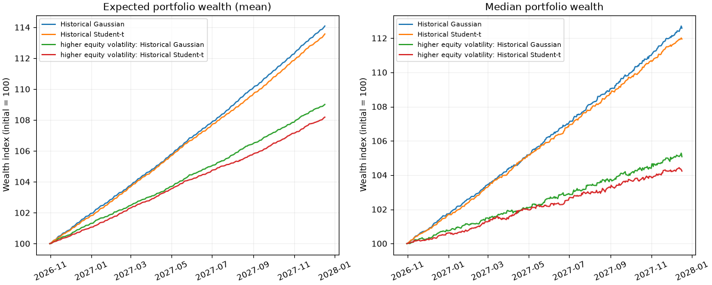

Portfolio growth comparison at each engine's recorded dates

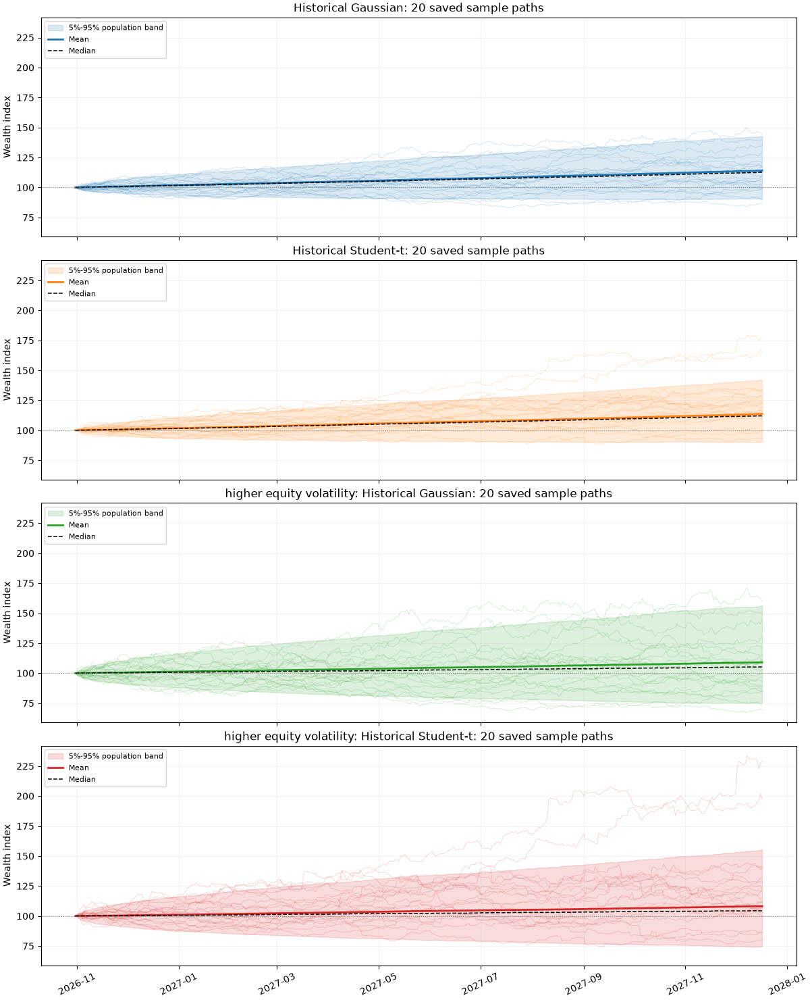

Portfolio Monte Carlo paths and population bands; path IDs do not establish shock pairing across different engines

### How do the distributions and tails differ?

These are empirical terminal portfolio distributions from the simulations, not fitted normal or Student-t PDFs. Gaussian/Student-t describe the shock engines. The same histogram bins cover every observed outcome. In the log-scale tail plots, a higher curve at a fixed loss level means more probability in that downside tail.

Tail panels focus on the lowest/highest 10% of pooled terminal returns for display. Probabilities always use the entire sample for each model; no outcomes are dropped from risk estimates.

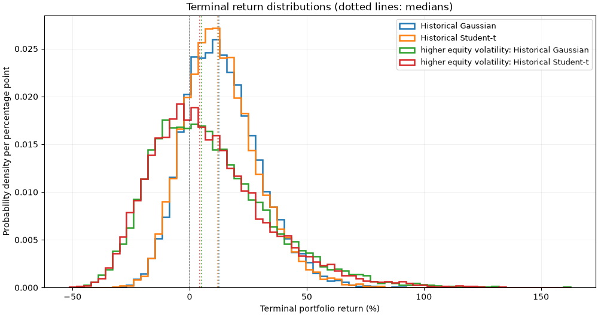

Terminal return distributions (dotted lines: medians)

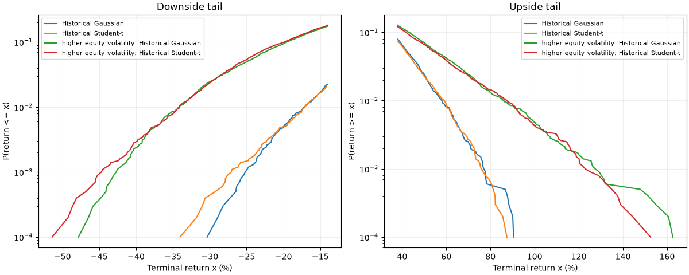

Terminal tails on a logarithmic probability scale; all outcomes retained

### Probability of specified terminal losses

A zero observed count means no such event occurred in this finite sample; it is not proof that the true probability is zero.

| Scenario | Loss greater than 5% | Loss greater than 10% | Loss greater than 20% | Loss greater than 30% | Loss greater than 50% |
| --- | --- | --- | --- | --- | --- |
| Historical Gaussian | 10.02% | 4.56% | 0.49% | 0.01% | 0.00% |
| higher equity volatility: Historical Gaussian | 32.53% | 24.07% | 9.40% | 2.43% | 0.00% |
| higher equity volatility: Historical Student-t | 32.94% | 24.38% | 9.88% | 2.35% | 0.01% |
| Historical Student-t | 10.40% | 4.77% | 0.49% | 0.04% | 0.00% |

Mean MC standard error measures precision of the simulated mean, not the volatility of individual outcomes. All probability intervals are sampling-only; drift estimation, calibration uncertainty and model risk remain outside them.

### User assumptions versus historical baseline

Annual native-currency assumptions for the selected holdings. Compound growth sets the daily mean log return. The scenario retains baseline correlations, FX inputs, weights and forecast dates.

| Scenario | Mean return | Median return | Probability loss | Loss es 0.99 | Loss change pp |
| --- | --- | --- | --- | --- | --- |
| Historical Gaussian | 14.08% | 12.58% | 18.85% | 20.71% | Unavailable |
| higher equity volatility: Historical Gaussian | 9.01% | 5.07% | 41.11% | 38.04% | 22.26 |
| Historical Student-t | 13.57% | 11.94% | 19.70% | 21.08% | Unavailable |
| higher equity volatility: Historical Student-t | 8.18% | 4.23% | 42.04% | 38.42% | 22.34 |

Loss change is measured in percentage points against the corresponding baseline shock model.


Portfolio Monte Carlo paths and population bands; path IDs do not establish shock pairing across different engines


Terminal return distributions (dotted lines: medians)

### Historical stress Monte Carlo comparisons

The baseline lookback and each stress calibration window are independent JSON inputs. A shorter baseline lookback does not disable a crisis scenario if the saved archive still contains sufficient matched observations in that crisis window. Missing or insufficient history makes that stress calibration unavailable; baseline analysis continues. Actual interval coverage is reported below, without inventing missing dates.

| Name | Requested start | Requested end | Drift | Calibration status | First interval start | Last interval end | Matched intervals | Comparison status | Reason |
| --- | --- | --- | --- | --- | --- | --- | --- | --- | --- |
| gfc | 2008-01-01 | 2009-06-30 | stress | complete | 2008-01-02 | 2009-06-30 | 376 | available |  |

These are conditional stress experiments over the same forecast horizon, not forecasts that another crisis will occur. Drift = stress uses the stress-period mean; drift = baseline retains the baseline mean and changes the risk calibration. Tail-cutoff sensitivity variants remain in the separate results above. Optional physical models retain their original eligibility and clock warnings.

#### Baseline versus gfc stress

The user scenario is a baseline-window alternative shown alongside the crisis calibration. Its assumptions are not applied to the crisis window.

| Scenario | Category | Status | Currency | Paths | Mean return | Median return | Probability loss | Mean mc standard error |
| --- | --- | --- | --- | --- | --- | --- | --- | --- |
| Historical Gaussian | baseline | complete | USD | 10000 | 14.08% | 12.58% | 18.85% | 0.16% |
| Historical Student-t | baseline | complete | USD | 10000 | 13.57% | 11.94% | 19.70% | 0.16% |
| higher equity volatility: Historical Gaussian | user_assumption | complete | USD | 10000 | 9.01% | 5.07% | 41.11% | 0.26% |
| higher equity volatility: Historical Student-t | user_assumption | complete | USD | 10000 | 8.18% | 4.23% | 42.04% | 0.25% |
| gfc: Historical Gaussian | stress | complete | USD | 10000 | -12.06% | -16.56% | 75.99% | 0.23% |
| gfc: Historical Student-t | stress | complete | USD | 10000 | -12.78% | -17.36% | 77.54% | 0.23% |

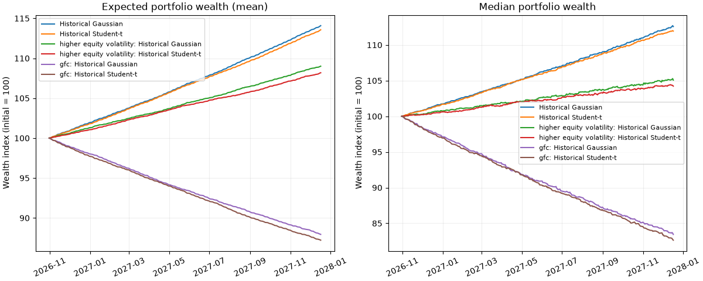

Portfolio growth comparison at each engine's recorded dates

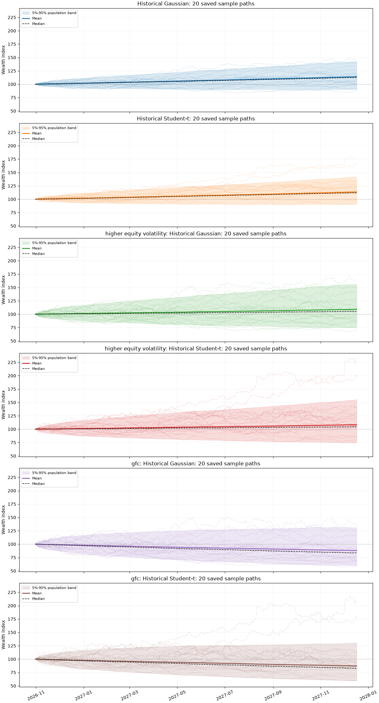

Portfolio Monte Carlo paths and population bands; path IDs do not establish shock pairing across different engines

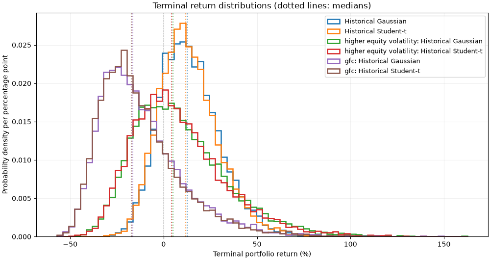

Terminal return distributions (dotted lines: medians)

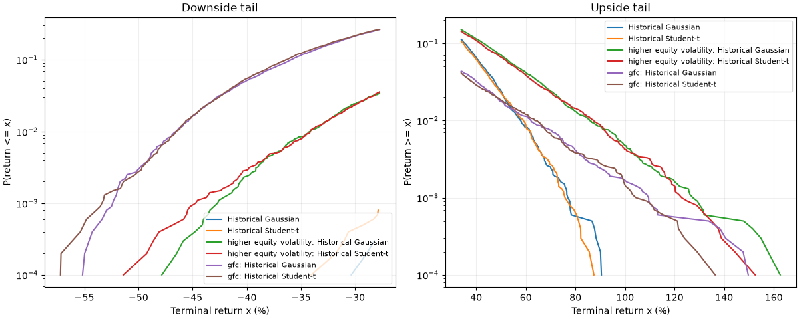

Terminal tails on a logarithmic probability scale; all outcomes retained

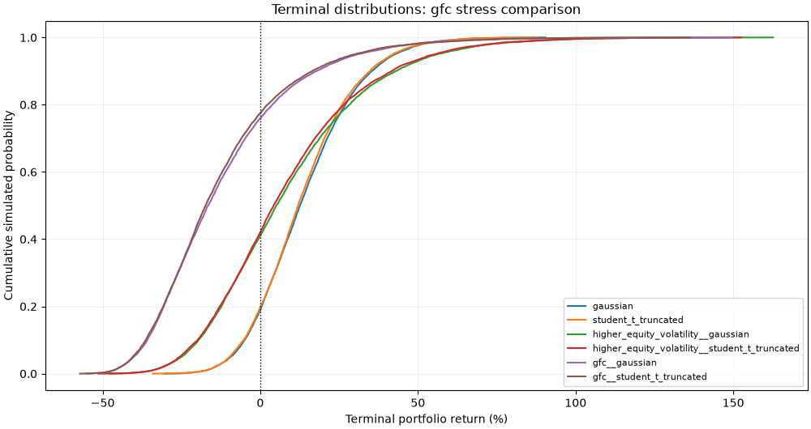

Terminal distributions: gfc stress comparison

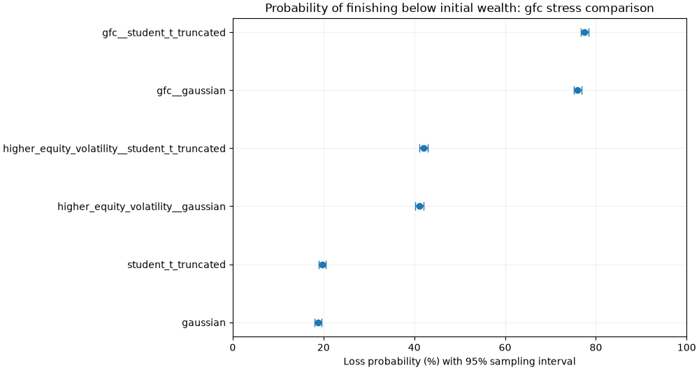

Probability of finishing below initial wealth: gfc stress comparison

| Scenario | Loss greater than 5% | Loss greater than 10% | Loss greater than 20% | Loss greater than 30% | Loss greater than 50% |
| --- | --- | --- | --- | --- | --- |
| Historical Gaussian | 10.02% | 4.56% | 0.49% | 0.01% | 0.00% |
| gfc: Historical Gaussian | 69.63% | 61.57% | 42.85% | 21.36% | 0.29% |
| gfc: Historical Student-t | 71.35% | 63.42% | 44.36% | 21.65% | 0.27% |
| higher equity volatility: Historical Gaussian | 32.53% | 24.07% | 9.40% | 2.43% | 0.00% |
| higher equity volatility: Historical Student-t | 32.94% | 24.38% | 9.88% | 2.35% | 0.01% |
| Historical Student-t | 10.40% | 4.77% | 0.49% | 0.04% | 0.00% |

### Forecast and comparison eligibility

| Scenario | Initial value | Forecast start | Forecast end | Comparability | Comparison reason |
| --- | --- | --- | --- | --- | --- |
| Historical Gaussian | 100 | 2026-10-31 | 2027-12-17 | same_historical_run | Common historical simulation clock |
| Historical Student-t | 100 | 2026-10-31 | 2027-12-17 | same_historical_run | Common historical simulation clock |
| student t tail 0.002 | 100 | 2026-10-31 | 2027-12-17 | same_historical_run | Common historical simulation clock |
| student t tail 5e-05 | 100 | 2026-10-31 | 2027-12-17 | same_historical_run | Common historical simulation clock |
| gfc: Historical Gaussian | 100 | 2026-10-31 | 2027-12-17 | same_historical_run | Common historical simulation clock |
| gfc: Historical Student-t | 100 | 2026-10-31 | 2027-12-17 | same_historical_run | Common historical simulation clock |
| gfc: student t tail 0.002 | 100 | 2026-10-31 | 2027-12-17 | same_historical_run | Common historical simulation clock |
| gfc: student t tail 5e-05 | 100 | 2026-10-31 | 2027-12-17 | same_historical_run | Common historical simulation clock |
| higher equity volatility: Historical Gaussian | 100 | 2026-10-31 | 2027-12-17 | same_historical_run | Common historical simulation clock |
| higher equity volatility: Historical Student-t | 100 | 2026-10-31 | 2027-12-17 | same_historical_run | Common historical simulation clock |

Approximate terminal comparison does not authorize comparisons of daily losses or maximum drawdown across different observation grids. No such ranking is made here.

### Terminal downside at 95% confidence

Positive VaR/ES is a loss fraction of initial wealth. ES averages the worst exact tail probability, including a fractional boundary observation; it is not a maximum possible loss.

| Scenario | Loss var 0.95 | Loss es 0.95 | Expected tail paths 0.95 |
| --- | --- | --- | --- |
| Historical Gaussian | 9.38% | 14.24% | 500 |
| Historical Student-t | 9.73% | 14.37% | 500 |
| student t tail 0.002 | 9.32% | 13.99% | 500 |
| student t tail 5e-05 | 9.42% | 14.05% | 500 |
| gfc: Historical Gaussian | 40.09% | 44.11% | 500 |
| gfc: Historical Student-t | 40.44% | 44.16% | 500 |
| gfc: student t tail 0.002 | 39.90% | 43.75% | 500 |
| gfc: student t tail 5e-05 | 40.11% | 44.02% | 500 |
| higher equity volatility: Historical Gaussian | 24.94% | 30.71% | 500 |
| higher equity volatility: Historical Student-t | 25.52% | 30.90% | 500 |

### Terminal downside at 99% confidence

Positive VaR/ES is a loss fraction of initial wealth. ES averages the worst exact tail probability, including a fractional boundary observation; it is not a maximum possible loss.

| Scenario | Loss var 0.99 | Loss es 0.99 | Expected tail paths 0.99 |
| --- | --- | --- | --- |
| Historical Gaussian | 17.14% | 20.71% | 100 |
| Historical Student-t | 17.10% | 21.08% | 100 |
| student t tail 0.002 | 17.27% | 20.33% | 100 |
| student t tail 5e-05 | 16.76% | 20.12% | 100 |
| gfc: Historical Gaussian | 46.51% | 49.24% | 100 |
| gfc: Historical Student-t | 46.46% | 49.24% | 100 |
| gfc: student t tail 0.002 | 46.47% | 48.78% | 100 |
| gfc: student t tail 5e-05 | 46.35% | 48.65% | 100 |
| higher equity volatility: Historical Gaussian | 34.12% | 38.04% | 100 |
| higher equity volatility: Historical Student-t | 34.15% | 38.42% | 100 |

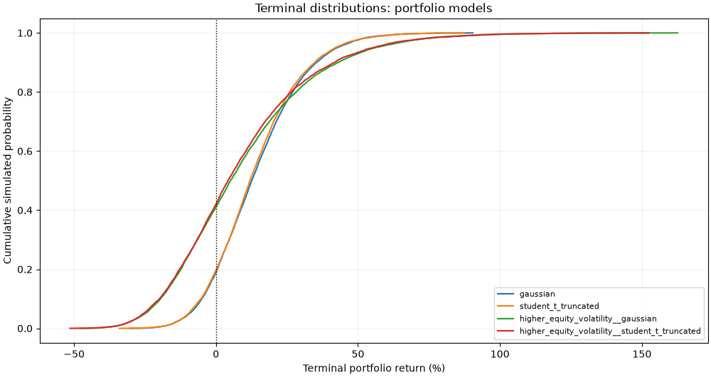

Terminal distributions: portfolio models

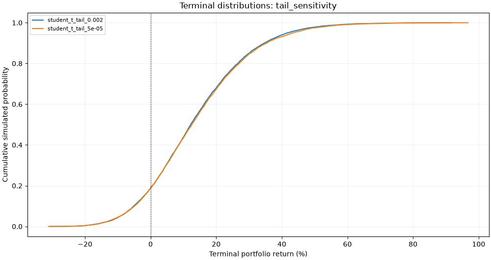

Terminal distributions: tail_sensitivity

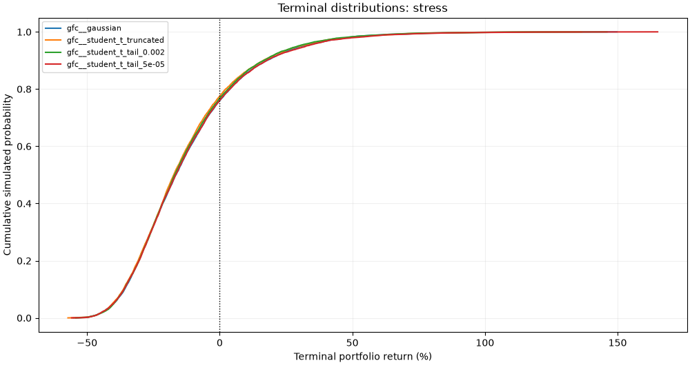

Terminal distributions: stress

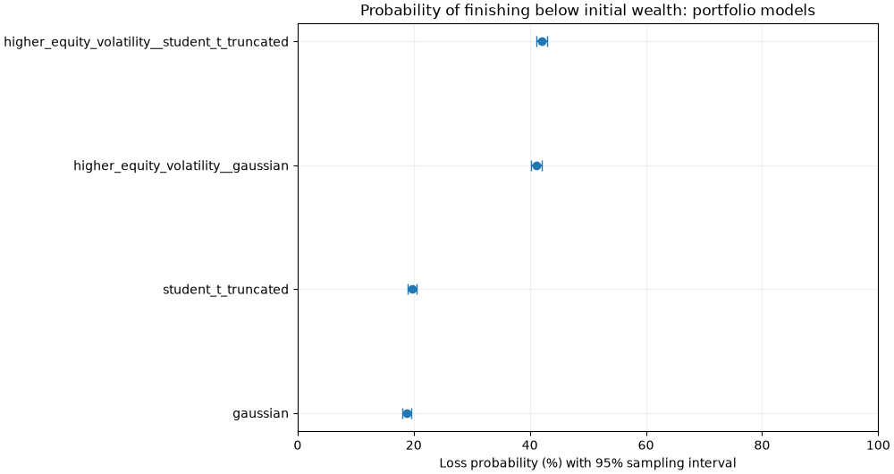

Probability of finishing below initial wealth: portfolio models

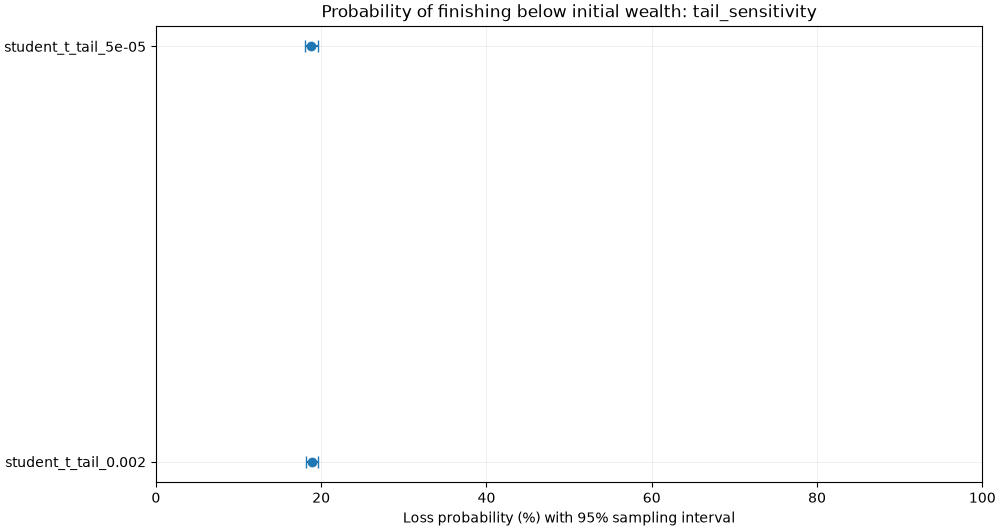

Probability of finishing below initial wealth: tail_sensitivity

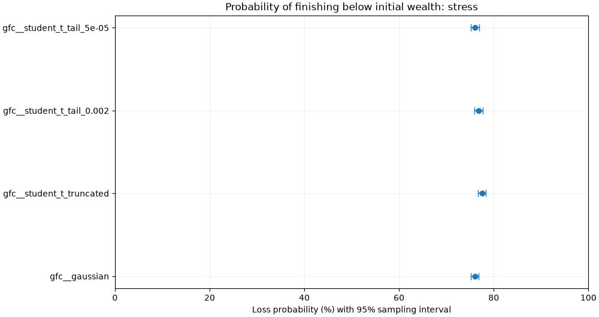

Probability of finishing below initial wealth: stress

**Sampling intervals and calibration windows**

| Scenario | Mean ci low | Mean ci high | Loss probability low | Loss probability high |
| --- | --- | --- | --- | --- |
| Historical Gaussian | 13.77% | 14.40% | 18.10% | 19.63% |
| Historical Student-t | 13.26% | 13.88% | 18.93% | 20.49% |
| student t tail 0.002 | 13.52% | 14.14% | 18.11% | 19.64% |
| student t tail 5e-05 | 13.84% | 14.48% | 18.03% | 19.56% |
| gfc: Historical Gaussian | -12.50% | -11.61% | 75.14% | 76.82% |
| gfc: Historical Student-t | -13.22% | -12.34% | 76.71% | 78.35% |
| gfc: student t tail 0.002 | -12.92% | -12.04% | 75.98% | 77.64% |
| gfc: student t tail 5e-05 | -12.39% | -11.48% | 75.20% | 76.88% |
| higher equity volatility: Historical Gaussian | 8.51% | 9.51% | 40.15% | 42.08% |
| higher equity volatility: Historical Student-t | 7.69% | 8.68% | 41.08% | 43.01% |

#### Historical portfolio Monte Carlo

```text
{
  "requested_start": "2016-10-30",
  "requested_end": "2026-10-30",
  "drift_source": "same_window",
  "first_start": "2016-10-31",
  "last_end": "2026-10-30",
  "observations": 2513,
  "dropped_holding_intervals_for_fx": 0
}
```

```text
[
  {
    "name": "gfc",
    "start": "2008-01-01",
    "end": "2009-06-30",
    "drift": "stress",
    "status": "complete",
    "calibration": {
      "requested_start": "2008-01-01",
      "requested_end": "2009-06-30",
      "drift_source": "same_window",
      "first_start": "2008-01-02",
      "last_end": "2009-06-30",
      "observations": 376,
      "dropped_holding_intervals_for_fx": 0
    },
    "warnings": []
  }
]
```

#### Physical local-volatility portfolio

```text
{}
```

## What does observed history show?

Daily simple returns. Historical analysis currency: **USD**. Skewness describes asymmetry; excess kurtosis above zero indicates heavier fourth-moment tails than a normal distribution. These are sample estimates, not future probabilities.

| Scope | Instrument id | Currency | Observations | Mean daily | Volatility annualized | Skewness | Excess kurtosis | Worst daily | Status |
| --- | --- | --- | --- | --- | --- | --- | --- | --- | --- |
| holding | SPY | USD | 7811 | 0.05% | 19.11% | -0.008266629586452672 | 11.238179989292526 | -10.94% | available |
| holding | IEF | USD | 6103 | 0.01% | 6.79% | 0.08297665787333551 | 2.5449459624553534 | -2.51% | available |
| portfolio | portfolio | USD | 6103 | 0.04% | 13.58% | -0.08349793944834234 | 12.726512447434576 | -8.19% | available |

### Coverage, growth and drawdown

Compare CAGR only over matching dates. A worst daily loss is different from a peak-to-trough drawdown, which can span many sessions.

| Scope | Instrument id | First price date | Last price date | Cagr | Max drawdown | Path status |
| --- | --- | --- | --- | --- | --- | --- |
| holding | SPY | 1995-10-16 | 2026-10-30 | 10.49% | -55.19% | available |
| holding | IEF | 2002-07-30 | 2026-10-30 | 3.48% | -23.92% | available |
| portfolio | portfolio | 2002-07-30 | 2026-10-30 | 9.83% | -38.06% | available |

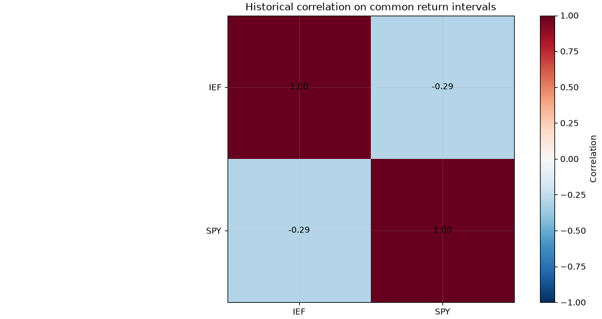

Historical correlation on common return intervals

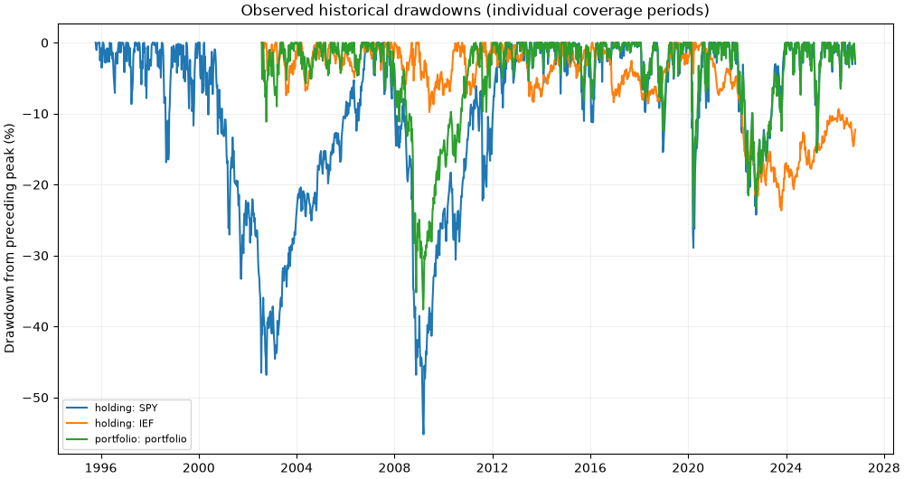

Observed historical drawdowns (individual coverage periods)

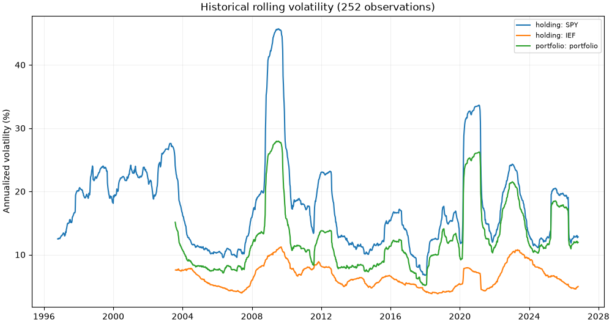

Historical rolling volatility (252 observations)

**Stress-period historical statistics and correlations**

| Name | Start | End | Scope | Instrument id | Observations | Volatility annualized | Skewness | Excess kurtosis | Coverage | Status |
| --- | --- | --- | --- | --- | --- | --- | --- | --- | --- | --- |
| GFC | 2007-01-01 | 2009-12-31 | holding | SPY | 755 | 29.88% | 0.39772510330081645 | 9.50561974471373 | full_window | available |
| COVID | 2020-02-01 | 2020-06-30 | holding | SPY | 103 | 48.87% | -0.3741040573602118 | 2.575386048420164 | full_window | available |
| Equity and bond sell-off | 2022-01-01 | 2022-12-31 | holding | SPY | 250 | 24.28% | 0.04922772540241193 | 0.35327735777045266 | full_window | available |
| GFC | 2007-01-01 | 2009-12-31 | holding | IEF | 755 | 8.60% | 0.34054985700964174 | 2.449679134526836 | full_window | available |
| COVID | 2020-02-01 | 2020-06-30 | holding | IEF | 103 | 10.18% | 0.3132516763685957 | 6.348834638768409 | full_window | available |
| Equity and bond sell-off | 2022-01-01 | 2022-12-31 | holding | IEF | 250 | 10.18% | 0.2783614696733557 | 0.5881472684807703 | full_window | available |
| GFC | 2007-01-01 | 2009-12-31 | portfolio | portfolio | 755 | 18.72% | 0.3248521854072605 | 8.76849949464755 | full_window | available |
| COVID | 2020-02-01 | 2020-06-30 | portfolio | portfolio | 103 | 37.74% | -0.4514461238411321 | 2.456413764671332 | full_window | available |
| Equity and bond sell-off | 2022-01-01 | 2022-12-31 | portfolio | portfolio | 250 | 21.49% | 0.0751721450364279 | 0.46711197325793474 | full_window | available |

| Instrument i | Instrument j | Observations | Correlation |
| --- | --- | --- | --- |
| SPY | SPY | 6103 | 1.0 |
| SPY | IEF | 6103 | -0.2913623292501443 |
| IEF | SPY | 6103 | -0.2913623292501443 |
| IEF | IEF | 6103 | 1.0 |

## What is available from the volatility study?

Option observations can be later than the archive COB. Intraday approximations, boundary assumptions and source eligibility remain in force. Successful repricing is not evidence that physical tail probabilities are accurate.

### Fitted implied volatility

No usable observations supplied for this section.

### Local volatility and boundary validation

No usable observations supplied for this section.

### Risk-neutral underlying validation

No usable observations supplied for this section.

### Option quotes, fitted smiles and surface construction

Each smile compares the IV calculated from saved option quotes with the fitted model at that expiry. The bid/ask IV envelope is shown where inversion was available. The forward is k = log(K/F) = 0. Fitting uses total variance w = IV squared times maturity; the report only displays the existing fit and does not recalibrate it. The saved intraday approximation and original valuation dates still apply.

No usable observations supplied for this section.

IV RMSE is displayed in volatility percentage points (1% means one point of annualized volatility). Strict bid/ask coverage and the configured practical-fit coverage are different checks; the recorded pass/fail flags above are unchanged.

### From the implied surface to state-dependent local volatility

Implied volatility indexes option strike and maturity. Local volatility is the instantaneous annualized diffusion coefficient evaluated at a future underlying state and time; its plotted coordinate is log(S/F). It is not a direct forecast of a one-day loss. These plots show the supported saved grid. Short-end and wing continuation used by Monte Carlo remain separate assumptions, quantified below.

### Physical-model assumptions and boundary usage

Wing visits and short-end usage quantify model assumptions, not observed market frequencies. The maximum local volatility is an annualized instantaneous standard deviation; it is not a one-day loss.

No usable observations supplied for this section.

## Evidence, limitations and next actions

Resolve missing currencies or inputs before interpreting results in the reporting currency. Retain diagnostic models as sensitivity cases. Review stress outcomes and boundary exposure; do not select a model solely because its mean return is higher or its loss probability lower.

**Cleaned data**: Local stage · `processed/2026-10-30/7b0c408ee93389de`

**Historical statistics**: Local stage · `processed/2026-10-30/7b0c408ee93389de/statistics/3961d41f430a8500`

Portfolio results are in USD, not EUR; FX has not been modeled or converted.

**Historical portfolio Monte Carlo**: Local stage · `processed/2026-10-30/7b0c408ee93389de/monte_carlo/71fa73872669a6c4`

EUR unavailable: No usable FX history for EURUSD. Trying USD fallback.

Results are in USD, not the requested reporting currency.

**OIS, forwards and individual IVs**: Local stage · `processed/2026-10-30/7b0c408ee93389de/option_calibration/9113ecddb579b7c1`

**Fitted implied volatility**: Local stage · `processed/2026-10-30/7b0c408ee93389de/volatility_surface/902e4382ef6641a4`

**Local volatility and boundary validation**: Local stage · `processed/2026-10-30/7b0c408ee93389de/local_volatility/0cf5392aca9cdbe6`

**Risk-neutral underlying validation**: Local stage · `processed/2026-10-30/7b0c408ee93389de/local_vol_mc/8c4f6f2082daece0`

**Physical local-volatility portfolio**: Local stage · `processed/2026-10-30/7b0c408ee93389de/local_vol_real_world/ffca1d26bf6a79a2`

**Active report policies and reproducibility**

```text
{
  "schema_version": 1,
  "enabled": true,
  "open_report_after_run": true,
  "plot_windows_after_run": [
    "mc_paths",
    "mc_density"
  ],
  "primary_return_type": "simple",
  "reference_model": "gaussian",
  "confidence_levels": [
    0.95,
    0.99
  ],
  "sampling_confidence": 0.95,
  "allow_approximate_terminal_horizon": true,
  "maximum_relative_horizon_difference": 0.005,
  "material_loss_probability_difference": 0.02,
  "minimum_expected_tail_paths": 50,
  "maximum_chart_points": 1500,
  "surface_display_points": 2500,
  "simulation_plots": {
    "sample_paths": 20,
    "histogram_bins": 70,
    "fan_quantiles": [
      0.05,
      0.95
    ],
    "tail_display_fraction": 0.1,
    "loss_thresholds": [
      0.05,
      0.1,
      0.2,
      0.3,
      0.5
    ],
    "smiles_per_figure": 6
  }
}
```

Source manifest hashes, report code hash and dependency versions are recorded in summary.json. comparison.csv contains unrounded terminal metrics. The HTML embeds all its figures; source-stage paths identify local outputs from the original run.
